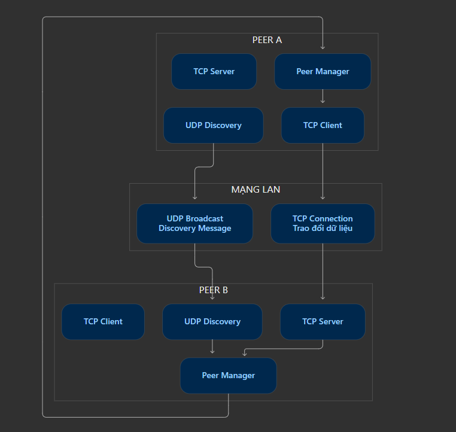
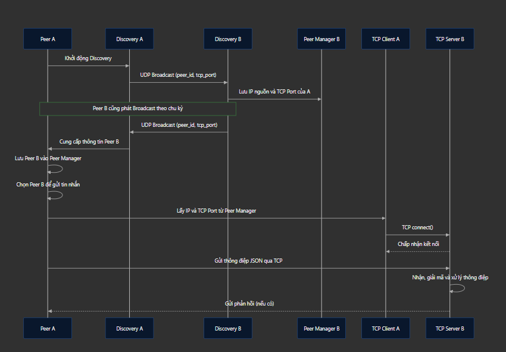
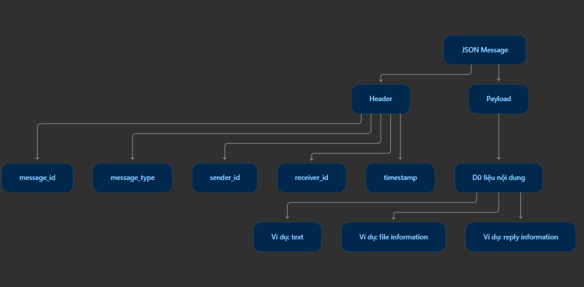

# CHƯƠNG 2: CƠ SỞ LÝ THUYẾT
## 2.1. Tổng quan mô hình Peer-to-Peer
### 2.1.1. Khái niệm:
Peer-to-Peer (P2P) là mô hình kiến trúc mạng phân tán, trong đó các nút tham gia hệ thống có khả năng chia sẻ tài nguyên và giao tiếp với nhau. Khác với mô hình Client-Server truyền thống, P2P không yêu cầu mọi hoạt động trao đổi dữ liệu đều phải thông qua một máy chủ trung tâm. 

Trong mô hình này, mỗi Peer có thể đảm nhận đồng thời hai vai trò:
- Client: Gửi yêu cầu đến Peer khác để sử dụng dịch vụ hoặc nhận dữ liệu.
- Server: Tiếp nhận yêu cầu và cung cấp dữ liệu hoặc dịch vụ cho Peer khác.
### 2.1.2. Đặc điểm mô hình P2P:
Mô hình Peer-to-Peer có những đặc điểm sau:

- Tính phân tán: Các Peer tham gia chia sẻ tài nguyên và thực hiện hoạt động giao tiếp trong hệ thống.

- Khả năng giao tiếp hai chiều: Mỗi Peer có thể gửi và nhận dữ liệu từ các Peer khác.
Chia sẻ tài nguyên: Các Peer có thể cung cấp dữ liệu, dung lượng lưu trữ hoặc năng lực xử lý cho những Peer khác.

- Khả năng mở rộng: Có thể bổ sung Peer mới vào hệ thống mà không nhất thiết phải nâng cấp một máy chủ trung tâm duy nhất.

Bên cạnh những đặc điểm trên, P2P cũng tồn tại một số hạn chế:

- Khó quản lý tập trung trạng thái và thông tin của toàn bộ Peer.

- Khả năng kết nối phụ thuộc vào điều kiện mạng và trạng thái hoạt động của các thiết bị.

- Cần có cơ chế phát hiện, xử lý Peer không còn hoạt động.

- Việc xác thực và bảo vệ dữ liệu giữa các Peer cần được tổ chức phù hợp.

### 2.1.3. Ứng dụng mô hình P2P trong đề tài:
Mô hình Peer-to-Peer có thể được ứng dụng để xây dựng các hệ thống trao đổi thông tin và tệp trực tiếp giữa những thiết bị.

Trong một ứng dụng P2P hoạt động trên mạng LAN, các Peer có thể sử dụng cơ chế phát hiện thiết bị để tìm kiếm những nút đang hoạt động. Sau khi xác định địa chỉ kết nối, Peer có thể khởi tạo kết nối trực tiếp đến thiết bị đích.

Một mô hình giao tiếp thường gặp bao gồm:

1. Các Peer tham gia mạng và khởi tạo thành phần tiếp nhận kết nối.
2. Hệ thống sử dụng cơ chế Discovery để xác định những Peer có thể liên hệ.
3. Peer khởi tạo lựa chọn thiết bị đích và yêu cầu thiết lập kết nối.
4. Sau khi kết nối được thiết lập, hai phía trao đổi dữ liệu thông qua giao thức truyền thông phù hợp.
5. Ứng dụng quản lý trạng thái kết nối và xử lý các trường hợp Peer ngắt kết nối.

Trong mô hình này, các giao thức truyền tải như TCP và UDP có thể được kết hợp để hỗ trợ những nhiệm vụ khác nhau.

### 2.1.4. Sơ đồ 
1. kiến trúc giao tiếp giữa hai Peer:



Sơ đồ thể hiện hai thiết bị có khả năng đồng thời khởi tạo và tiếp nhận kết nối. Khi điều kiện mạng cho phép, dữ liệu có thể được trao đổi trực tiếp giữa các thiết bị mà không cần máy chủ trung gian chuyển tiếp nội dung.

2. Sơ đồ chi tiết luồng Discovery → TCP  → Message:



Sơ đồ minh họa quá trình một Peer phát hiện thiết bị khác, xác định thông tin kết nối và thực hiện trao đổi dữ liệu sau khi kết nối được thiết lập.

Đây là mô hình tổng quát làm cơ sở để nghiên cứu các giao thức truyền thông và cơ chế quản lý kết nối trong ứng dụng P2P.

## 2.2. Giao thức TCP
### 2.2.1. Khái niệm giao thức TCP:
TCP (Transmission Control Protocol) là giao thức truyền tải thuộc tầng Transport trong mô hình TCP/IP, được sử dụng để thiết lập kết nối và trao đổi dữ liệu giữa các ứng dụng trên những thiết bị có khả năng giao tiếp qua mạng IP.

TCP cung cấp cơ chế truyền dữ liệu hướng kết nối (Connection-oriented), bảo đảm dữ liệu được cung cấp cho ứng dụng nhận theo đúng thứ tự và hạn chế mất mát dữ liệu thông qua các cơ chế xác nhận, truyền lại và kiểm soát truyền tải.

TCP truyền dữ liệu dưới dạng luồng byte liên tục (Byte Stream), không tự duy trì ranh giới giữa các thông điệp ở tầng ứng dụng. Vì vậy, ứng dụng cần có cơ chế xác định ranh giới thông điệp khi trao đổi những đơn vị dữ liệu độc lập.

### 2.2.2. Đặc điểm chính của TCP: 
| Đặc điểm | Chi tiết |
|---|---|
| Hướng kết nối | Thiết lập kết nối trước khi truyền dữ liệu |
| Truyền dữ liệu tin cậy | Sử dụng cơ chế xác nhận và truyền lại nhằm bảo đảm dữ liệu được truyền đầy đủ khi kết nối hoạt động bình thường |
| Đúng thứ tự | Dữ liệu được cung cấp cho ứng dụng theo đúng thứ tự byte |
| Kiểm tra lỗi | Sử dụng checksum để phát hiện lỗi trong segment |
| Kiểm soát luồng | Điều chỉnh lượng dữ liệu gửi để tránh làm tràn bộ đệm bên nhận |
| Kiểm soát tắc nghẽn | Điều chỉnh tốc độ truyền khi mạng có dấu hiệu tắc nghẽn |
| Truyền dữ liệu dạng luồng | Cung cấp luồng byte liên tục, không bảo toàn ranh giới từng lần gửi | 

Những đặc điểm trên giúp TCP phù hợp với các ứng dụng yêu cầu dữ liệu được truyền có thứ tự và tin cậy, chẳng hạn như trao đổi thông điệp, truyền tệp và giao tiếp giữa các thiết bị.

Tuy nhiên, TCP không bảo đảm rằng mọi kết nối đều thành công hoặc luôn duy trì liên tục. Khi xảy ra lỗi mạng hoặc kết nối bị ngắt, ứng dụng vẫn cần có cơ chế phát hiện và xử lý phù hợp.

Ngoài ra, TCP không tự cung cấp cơ chế mã hóa nội dung hoặc xác thực danh tính ứng dụng ở hai đầu kết nối. Những yêu cầu bảo mật này cần được triển khai thông qua các giao thức hoặc cơ chế bổ sung.

### 2.2.3. Cơ chế bắt tay ba bước (Three-way Handshake):
Trước khi trao đổi dữ liệu, TCP sử dụng cơ chế bắt tay ba bước (Three-way Handshake) nhằm thiết lập kết nối và đồng bộ các thông tin cần thiết giữa hai đầu giao tiếp.

Quá trình này gồm ba bước:

Bước 1: SYN (Synchronize):
- Peer A gửi một gói tin SYN đến Peer B.

Bước 2: SYN-ACK (Synchronize-Acknowledge):
- Peer B nhận được yêu cầu từ Peer A.
- B gửi lịa gói SYN-ACK để xác nhận yêu cầu và thông báo số thứ tự ban đầu của mình

Bước 3: ACK(Acknowledge):
- Peer A nhận được phản hồi từ B.
- A gửi gói ACK để xác nhận.
- Sau khi hoàn thành ba bước, kết nối TCP được thiết lập và hai bên có thể bắt đầu trao đổi dữ liệu. 

Cơ chế Three-way Handshake giúp hai phía đồng bộ thông tin kết nối trước khi truyền dữ liệu.

Cần phân biệt rằng quá trình bắt tay TCP chỉ phục vụ thiết lập kết nối ở tầng Transport, không thực hiện xác thực danh tính ứng dụng hay trao đổi khóa mã hóa.

Nếu ứng dụng yêu cầu bảo mật dữ liệu, các cơ chế như trao đổi khóa và thiết lập phiên mã hóa được thực hiện riêng ở tầng ứng dụng hoặc thông qua giao thức bảo mật phù hợp.

Sơ đồ trình tự TCP Three-way Handshake


### 2.2.4. Cơ chế truyền dữ liệu của TCP:
Sau khi kết nối được thiết lập, TCP bắt đầu truyền dữ liệu theo cơ chế: 
1. Đánh số thứ tự (Sequence Number):  Xác định vị trí các byte dữ liệu trong luồng truyền, giúp phía nhận sắp xếp dữ liệu theo đúng thứ tự. 
2. Xác nhận dữ liệu (Acknowledgement): Phía nhận thông báo vị trí byte tiếp theo mà nó mong đợi nhận được, qua đó xác nhận dữ liệu đã tiếp nhận.
3. Truyền lại (Retranmission): Nếu dữ liệu bị mất hoặc không được xác nhận trong khoảng thời gian phù hợp, TCP có thể truyền lại.
4. Kiểm soát luồng (Flow Control): Điều chỉnh tốc độ gửi để han chế tình trạng quá tải mạng.
5. Kiểm soát tắc nghẽn (Congestion Control): Điều chỉnh tốc độ gửi để hạn chế tình trạng quá tải mạng.

Một đặc điểm quan trọng là TCP không bảo toàn ranh giới giữa các lần gửi dữ liệu. Một lần gửi có thể được tiếp nhận thông qua nhiều lần đọc hoặc nhiều lần gửi có thể được đọc trong cùng một lần nhận.

Do đó, đối với ứng dụng trao đổi thông điệp, cần bổ sung cơ chế đóng khung dữ liệu (Message Framing) để xác định ranh giới từng thông điệp. Một phương pháp là Length-Prefix Framing, được trình bày tại mục 2.5.3.

### 2.2.5. Ứng dụng TCP trong đề tài:
Quá trình giao tiếp diễn ra như sau: 

1. Peer khởi tạo xác định địa chỉ IP và TCP Port của Peer đích.
2. TCP Client gửi yêu cầu thiết lập kết nối đến TCP Server của Peer đích.
3. Hai bên thực hiện quá trình Three-way Handshake ở tầng TCP.
4. Sau khi kết nối được thiết lập, ứng dụng có thể thực hiện các bước trao đổi thông tin hoặc thiết lập bảo mật cần thiết.
5. Các Peer sử dụng kết nối TCP để truyền và nhận dữ liệu.
6. Khi kết thúc giao tiếp hoặc xảy ra lỗi, ứng dụng xử lý và giải phóng tài nguyên kết nối theo cơ chế phù hợp.

## 2.3. Giao thức UDP
### 2.3.1. Khái niệm giao thức UDP:
UDP (User Datagram Protocol) là giao thức truyền tải thuộc tầng Transport trong mô hình TCP/IP, cho phép các ứng dụng trao đổi dữ liệu thông qua những đơn vị được gọi là Datagram.

Khác với TCP, UDP là giao thức không hướng kết nối (Connectionless). UDP không yêu cầu thiết lập kết nối bằng cơ chế Three-way Handshake trước khi gửi dữ liệu.

UDP cung cấp cơ chế truyền dữ liệu đơn giản với overhead thấp, nhưng không tự bảo đảm việc dữ liệu được chuyển đến đích, không bảo đảm thứ tự tiếp nhận và không cung cấp cơ chế truyền lại khi xảy ra mất gói.

Nhờ những đặc điểm này, UDP phù hợp với các ứng dụng cần trao đổi những thông điệp độc lập, có kích thước nhỏ hoặc ưu tiên sự đơn giản trong quá trình truyền dữ liệu.

### 2.3.2. Đặc điểm của UDP:
| Đặc điểm | Chi tiết |
|---|---|
| Không hướng kết nối | Không cần Three-way Handshake trước khi gửi |
| Không đảm bảo tin cậy | Datagram có thể bị mất trên đường truyền |
| Không đảm bảo thứ tự | Gói tin có thể đến không đúng thứ tự |
| Không tự truyền lại | Ứng dụng phải tự xử lý nếu cần gửi lại |
| Overhead thấp | Header UDP cơ bản chỉ có 8 byte |
| Hỗ trợ Broadcast | Có thể gửi dữ liệu đến các thiết bị trong phạm vi mạng Broadcast |
| Hỗ trợ Multicast | Có thể gửi dữ liệu đến một nhóm thiết bị tham gia nhóm Multicast |

So với TCP, UDP có cơ chế truyền tải đơn giản hơn do không quản lý việc thiết lập kết nối, xác nhận dữ liệu và truyền lại.

Tuy nhiên, ứng dụng sử dụng UDP cần tự xem xét những vấn đề như mất gói, dữ liệu không hợp lệ, giới hạn kích thước Datagram và khả năng tiếp nhận của thiết bị đích.

### 2.3.3. Cơ chế hoạt động của UDP:
Quá trình truyền dữ liệu bằng UDP có thể được mô tả thông qua các bước:

1. Ứng dụng gửi tạo dữ liệu cần truyền.
2. UDP đóng gói dữ liệu thành Datagram.
3. Datagram được gửi đến địa chỉ IP và UDP Port đích.
4. Nếu Datagram đến được thiết bị đích và có Socket phù hợp tiếp nhận, ứng dụng phía nhận có thể đọc dữ liệu.
5. Ứng dụng tiếp tục kiểm tra và xử lý nội dung Datagram.

UDP không yêu cầu phía gửi duy trì một kết nối truyền thông với phía nhận.

Khác với TCP, UDP bảo toàn ranh giới giữa các Datagram. Tuy nhiên, nếu bộ đệm nhận không đủ lớn, dữ liệu trong Datagram có thể bị cắt bớt tùy theo cách sử dụng Socket.

Do không có cơ chế xác nhận và truyền lại tích hợp, việc gửi thành công một Datagram không đồng nghĩa với việc phía nhận đã tiếp nhận hoặc xử lý thành công nội dung dữ liệu.

### 2.3.4. Cơ chế UDP Broadcast:
UDP Broadcast là cơ chế cho phép một thiết bị gửi Datagram đến một địa chỉ Broadcast, nhằm truyền thông tin đến các thiết bị có khả năng tiếp nhận trong cùng phạm vi mạng Broadcast.

Trong mạng IPv4, địa chỉ Broadcast có thể là địa chỉ Broadcast của một mạng con hoặc địa chỉ Limited Broadcast 255.255.255.255.

Thông thường, Broadcast được sử dụng trong phạm vi mạng cục bộ và không được chuyển tiếp qua các router theo cách định tuyến thông thường.

Một ứng dụng phổ biến của UDP Broadcast là Peer Discovery, cho phép các thiết bị trong mạng LAN phát hiện sự hiện diện của nhau mà không cần phụ thuộc vào máy chủ trung tâm.

Về nguyên lý, quá trình Peer Discovery bằng UDP Broadcast gồm các bước:

1. Peer A tạo thông điệp Discovery chứa `peer_id` và `tcp_port`.
2. A gửi thông điệp bằng UDP Broadcast đến cổng Discovery được quy định. 
3. Các Peer đang chạy chương trình và lắng nghe cổng Discovery tương ứng có thể nhận được thông điệp. 
4. Peer nhận kiểm tra tính hợp lệ của thông tin Discovery. 
5. Nếu thông tin hợp lệ, Peer nhận lưu địa chỉ IP và TCP Port của Peer gửi vào Peer Manager để sử dụng cho quá trình thiết lập kết nối tiếp theo. 

Cần lưu ý rằng UDP Broadcast chỉ hỗ trợ phát hiện Peer trong những điều kiện mạng phù hợp. Khả năng tiếp nhận còn phụ thuộc vào cấu hình mạng, tường lửa, chính sách thiết bị và phạm vi Broadcast.

Việc phát hiện được một Peer cũng không đồng nghĩa với việc kết nối TCP đến Peer đó chắc chắn thành công.

### 2.3.5. Vai trò của UDP trong ứng dụng Peer-to-Peer:
Trong hệ thống Peer-to-Peer, UDP có thể được sử dụng để hỗ trợ phát hiện các thiết bị đang hoạt động trong mạng nội bộ.

Cơ chế Discovery giúp các Peer trao đổi thông tin nhận diện và địa chỉ kết nối, từ đó hỗ trợ việc thiết lập kết nối trực tiếp bằng TCP.

Có thể phân biệt vai trò của hai giao thức như sau:
| Giao thức | Vai trò |
|---|---|
| UDP | hỗ trợ phát hiện Peer và trao đổi thông tin Discovery trong mạng LAN |
| TCP | thiết lập kết nối và truyền nhận dữ liệu ứng dụng giữa các Peer | 

Việc kết hợp UDP và TCP cho phép hệ thống tận dụng ưu điểm của từng giao thức: UDP hỗ trợ phát hiện thiết bị mà không cần thiết lập kết nối trước, trong khi TCP cung cấp cơ chế truyền dữ liệu tin cậy và có thứ tự.

Tuy nhiên, hệ thống vẫn cần có cơ chế quản lý danh sách Peer, kiểm tra thông tin Discovery và xử lý các trường hợp thiết bị không còn hoạt động.

## 2.4. Lập trình Socket
### 2.4.1. Khái niệm Socket:
Socket là một giao diện lập trình (Application Programming Interface – API) cho phép các ứng dụng thực hiện hoạt động giao tiếp và trao đổi dữ liệu qua mạng.

Thông qua Socket, ứng dụng có thể tạo điểm cuối giao tiếp, thiết lập kết nối, gửi và nhận dữ liệu bằng những giao thức truyền tải như TCP hoặc UDP.

Đối với các ứng dụng sử dụng TCP/IP, Socket thường được gắn với thông tin địa chỉ IP, số cổng (Port) và giao thức truyền tải.

Lập trình Socket cho phép nhà phát triển xây dựng các chức năng giao tiếp mạng ở tầng ứng dụng mà không cần trực tiếp xử lý toàn bộ cơ chế truyền tải ở những tầng bên dưới. 

### 2.4.2. Các thành phần cơ bản:
| Thành phần | Ý nghĩa |
|---|---|
| IP Address| Xác định địa chỉ thiết bị trong mạng |
| Port | Xác định ứng dụng hoặc dịch vụ đang giao tiếp trên thiết bị |
| Protocol | Xác định giao thức truyền tải: TCP hoặc UDP |
| Socket | Điểm cuối giao tiếp mạng được ứng dụng sử dụng để gửi và nhận dữ liệu |
| Endpoint | Điểm cuối giao tiếp, thường được xác định bởi địa chỉ IP và Port trong TCP/IP |

Trong giao tiếp TCP, một kết nối được phân biệt bởi địa chỉ IP và Port của cả hai đầu giao tiếp cùng giao thức truyền tải.

### 2.4.3. Lập trình TCP Socket:

TCP Socket cung cấp giao diện cho ứng dụng thiết lập kết nối và trao đổi dữ liệu dưới dạng luồng byte.

| Hàm | Chức năng |
|---|---|
| `socket()` | Tạo socket |
| `bind()` | Gắn socket với địa chỉ IP và Port |
| `listen()` | Đưa TCP Server vào trạng thái chờ kết nối |
| `accept()` | Chấp nhận kết nối từ Client |
| `connect()` | Client yêu cầu kết nối đến Server |
| `sendall()` | Gửi toàn bộ dữ liệu byte được cung cấp hoặc báo lỗi |
| `recv()` | Nhận dữ liệu từ kết nối |
| `close()` | Đóng socket |

Trong mô hình TCP Client–Server, phía Server sử dụng bind(), listen() và accept() để tiếp nhận kết nối. Phía Client sử dụng connect() để yêu cầu kết nối đến địa chỉ và cổng của Server.

Sau khi kết nối được thiết lập, hai phía có thể sử dụng sendall() và recv() để trao đổi dữ liệu.

Do TCP hoạt động dưới dạng luồng byte, ứng dụng cần sử dụng cơ chế xác định ranh giới thông điệp nếu dữ liệu được tổ chức thành những thông điệp độc lập.

### 2.4.4. Lập trình UDP Socket 

UDP Socket cho phép ứng dụng gửi và nhận Datagram mà không yêu cầu thiết lập kết nối TCP trước khi truyền dữ liệu.

| Hàm | Chức năng |
|---|---|
| `socket()` | Tạo UDP Socket |
| `bind()` | Gắn socket với IP và Port để nhận dữ liệu |
| `sendto()` | Gửi Datagram đến IP và Port đích |
| `recvfrom()` | Nhận Datagram và địa chỉ người gửi |
| `setsockopt()` | Cấu hình một số tùy chọn của Socket, chẳng hạn cho phép Broadcast |
| `settimeout()` | thiết lập thời gian chờ cho các thao tác Socket | 
| `close()` | Đóng Socket | 

Trong trường hợp sử dụng UDP Broadcast, ứng dụng có thể cấu hình tùy chọn SO_BROADCAST để cho phép gửi Datagram đến địa chỉ Broadcast.

Phía nhận sử dụng recvfrom() để tiếp nhận dữ liệu và xác định địa chỉ IP nguồn của Datagram.

Ứng dụng cần kiểm tra nội dung nhận được và xử lý các trường hợp dữ liệu không hợp lệ hoặc không có phản hồi.

### 2.4.5. Ứng dụng Socket trong đề tài:
Trong các ứng dụng Peer-to-Peer, Socket đóng vai trò là giao diện giao tiếp mạng giữa các thiết bị.

Một Peer có thể đồng thời sử dụng:

- TCP Server Socket: Lắng nghe và chấp nhận các kết nối đến.
- TCP Client Socket: Chủ động thiết lập kết nối đến Peer khác.
- UDP Socket: Hỗ trợ gửi và nhận các thông điệp phát hiện thiết bị trong mạng nội bộ.

Thông qua Socket, ứng dụng có thể thực hiện các thao tác phát hiện Peer, thiết lập kết nối và trao đổi dữ liệu.

Tuy nhiên, Socket API chỉ cung cấp phương tiện giao tiếp mạng. Các cơ chế như định dạng thông điệp, kiểm tra dữ liệu, quản lý trạng thái kết nối, bảo mật và xử lý lỗi cần được xây dựng ở tầng ứng dụng.

Đây là cơ sở để thiết kế các thành phần giao tiếp và trao đổi dữ liệu trong hệ thống Peer-to-Peer.

## 2.5. Dịnh dạng dữ liệu JSON
### 2.5.1. Khái niệm JSON:
JSON (JavaScript Object Notation) là định dạng dữ liệu dùng để lưu trữ và trao đổi thông tin giữa các hệ thống. JSON có cấu trúc đơn giản, dễ đọc, dễ xử lý bằng nhiều ngôn ngữ lập trình. 

JSON thường sử dụng các kiểu dữ liệu:
- `String`: chuỗi ký tự
- `Number`: Số
- `Boolean`: `true` hoặc `false`
- `Array`: Danh sách dữ liệu
- `Object`: Đối tượng gồm các cặp key-value
- `Null`: Giá trị rỗng 

Trong Python, thư viện json cung cấp các phương thức hỗ trợ chuyển đổi dữ liệu giữa đối tượng Python và định dạng JSON:
| Hàm | Chức năng |
|---|---|
| `json.dumps()` | Chuyển Python Object thành chuỗi JSON |
| `json.loads()` | Chuyển chuỗi JSON thành Python Object |
| `json.dump()` | Ghi dữ liệu JSON vào file |
| `json.load()` | Đọc dữ liệu JSON từ file |

### 2.5.2. Cấu trúc Header và Payload:
Header: Chứa các thông tin phục vụ nhận diện, phân loại và xử lý thông điệp, chẳng hạn như mã định danh, loại thông điệp, nguồn gửi, đích nhận và thời điểm tạo.

Payload: chứa dữ liệu thực tế mà người gửi muốn truyền đi. Cấu trúc của Payload có thể thay đổi tùy theo loại thông điệp, ví dụ văn bản, thông tin tệp hoặc dữ liệu điều khiển.. 

Sơ đồ cấu trúc JSON Message 



Ví dụ minh họa cấu trúc thông điệp JSON: 
```json 
{
  "header":{
      "message_id": "UUID",
      "message_type": "TEXT",
      "sender_id": "peer_A",
      "receiver_id": "peer_B",
      "timestamp": "2026-10-26T01:00:00Z"
  },
  "payload":{
    "text": "Xin chào!"
  }
}
```
Trong ví dụ trên, Header cung cấp thông tin nhận diện thông điệp, còn Payload chứa nội dung văn bản được trao đổi giữa hai thiết bị.

Cấu trúc Header/Payload không phải là quy định bắt buộc của JSON mà là cách tổ chức dữ liệu do ứng dụng hoặc giao thức lựa chọn.

### 2.5.3. Đóng gói và truyền dữ liệu JSON qua TCP:
TCP là giao thức truyền dữ liệu dưới dạng luồng byte liên tục. TCP bảo đảm thứ tự các byte được truyền nhưng không duy trì ranh giới giữa những thông điệp do ứng dụng gửi.

Vì vậy, khi truyền nhiều thông điệp JSON qua cùng một kết nối TCP, ứng dụng cần có cơ chế xác định điểm bắt đầu và kết thúc của từng thông điệp.

Một giải pháp thường được sử dụng là Length-Prefix Framing, trong đó độ dài thông điệp được đặt trước nội dung dữ liệu.

Nguyên lý hoạt động:
1. Chuyển JSON thành chuỗi byte UTF-8.
2. Tính độ dài của chuỗi byte.
3. Đóng gói độ dài thành 4 byte bằng `struct.pack("!I",...)`.
4. Gửi 4 byte độ dài trước, sau đó gửi nội dung JSON.
5. Phía nhận đọc 4 byte đầu để biết cần nhận bao nhiêu byte dữ liệu tiếp theo.

Cấu trúc khung dữ liệu minh họa:

[4-byte Length][JSON UTF-8 Data]

Trong Python, thư viện struct có thể được sử dụng để chuyển đổi giá trị độ dài thành biểu diễn nhị phân, trong khi json hỗ trợ mã hóa và giải mã nội dung thông điệp.

Cơ chế Length-Prefix Framing giúp ứng dụng xác định ranh giới từng thông điệp khi trao đổi dữ liệu qua TCP, kể cả trong trường hợp dữ liệu được nhận thành nhiều phần.

## 2.6. Lập trình đa luồng và QThread
### 2.6.1. Khái niệm lập trình đa luồng 
Thread (luồng) là một đơn vị thực thi bên trong tiến trình (Process). Một tiến trình có thể chứa nhiều luồng thực thi, cho phép tổ chức và xử lý các tác vụ khác nhau trong cùng một chương trình.

Lập trình đa luồng (Multithreading) là kỹ thuật sử dụng nhiều luồng nhằm tổ chức các công việc có thể diễn ra đồng thời hoặc xen kẽ trong quá trình thực thi ứng dụng.

Trong các ứng dụng mạng có giao diện đồ họa, những thao tác như chờ kết nối, nhận dữ liệu từ Socket hoặc đọc và ghi tệp có thể mất nhiều thời gian. Nếu các thao tác này được thực hiện trực tiếp trong luồng giao diện, chương trình có thể bị gián đoạn khả năng phản hồi với người dùng.

Vì vậy, các tác vụ xử lý mạng và dữ liệu thường được chuyển sang những luồng xử lý riêng để duy trì khả năng phản hồi của giao diện.

Một số vai trò luồng thường gặp:
| Thread | Vai trò |
|---|---|
| Main Thread | xử lý sự kiện và cập nhật giao diện người dùng |
| Network Thread | thực hiện các thao tác gửi và nhận dữ liệu mạng |
| Discovery Thread | thực hiện các hoạt động phát hiện thiết bị |
| File Transfer Worker | xử lý đọc, ghi và truyền dữ liệu tệp | 

Việc sử dụng nhiều luồng giúp phân tách trách nhiệm xử lý, nhưng cũng đặt ra yêu cầu đồng bộ khi các luồng cùng truy cập tài nguyên hoặc dữ liệu dùng chung

### 2.6.2. Cơ chế QThread trong Qt 
QThread là lớp do Qt cung cấp để quản lý luồng thực thi trong các ứng dụng sử dụng Qt Framework.

QThread cho phép tổ chức các tác vụ chạy ngoài luồng giao diện chính. Nhờ đó, các thao tác có khả năng chặn luồng như đọc dữ liệu từ Socket hoặc xử lý tệp có thể được thực hiện mà không trực tiếp làm gián đoạn vòng lặp sự kiện của GUI.

Trong Qt, một cách tổ chức phổ biến là sử dụng đối tượng Worker kế thừa từ QObject, sau đó chuyển Worker sang luồng được quản lý bởi QThread.

Mô hình này giúp phân tách:

- Main Thread: tiếp nhận sự kiện, quản lý và cập nhật giao diện.
- Worker Object: chứa logic xử lý tác vụ.
- QThread: quản lý luồng thực thi dành cho Worker.

### 2.6.3. Signal và Slot:
Signal và Slot là cơ chế giao tiếp giữa các đối tượng trong Qt.

Signal là tín hiệu được phát ra khi một sự kiện xảy ra, chẳng hạn hoàn thành một tác vụ, nhận được thông điệp hoặc phát sinh lỗi.

Slot là hàm có thể được kết nối để xử lý tín hiệu tương ứng.

Trong các ứng dụng đa luồng, Signal/Slot có thể được sử dụng để truyền kết quả xử lý từ Worker đến đối tượng thuộc Main Thread.

Ví dụ về luồng xử lý:

1. Worker thực hiện thao tác nhận dữ liệu từ Socket.
2. Khi nhận được dữ liệu hợp lệ, Worker phát Signal chứa thông tin cần chuyển.
3. Qt chuyển tín hiệu đến Slot đã đăng ký theo cơ chế kết nối phù hợp.
4. Slot thuộc Main Thread tiếp nhận dữ liệu và cập nhật giao diện.

Khi sử dụng kết nối dạng Queued Connection giữa các đối tượng thuộc những luồng khác nhau, Slot được thực thi trong luồng sở hữu đối tượng nhận, thông qua vòng lặp sự kiện của luồng đó.

Cơ chế này giúp hạn chế việc cập nhật trực tiếp các thành phần GUI từ Worker Thread, qua đó giảm nguy cơ xảy ra lỗi do truy cập giao diện không đúng luồng.

### 2.6.4. Đồng bộ dữ liệu và quản lý vòng đời luồng:

Khi nhiều luồng cùng truy cập hoặc thay đổi dữ liệu dùng chung, có thể xảy ra tình trạng tranh chấp dữ liệu (Race Condition).

Để hạn chế vấn đề này, hệ thống có thể sử dụng các cơ chế đồng bộ như:

- Mutex/Lock: Bảo vệ dữ liệu hoặc tài nguyên dùng chung khỏi các thao tác truy cập đồng thời không an toàn.
- Queue: Tổ chức việc trao đổi dữ liệu hoặc phân phối công việc giữa những luồng xử lý.
- Signal/Slot: Truyền thông tin giữa các đối tượng theo cơ chế sự kiện của Qt.

Ngoài vấn đề đồng bộ, vòng đời của luồng cũng cần được quản lý phù hợp.

Khi tác vụ hoàn thành hoặc ứng dụng kết thúc, hệ thống cần yêu cầu Worker dừng xử lý, giải phóng tài nguyên liên quan và bảo đảm luồng được kết thúc an toàn.

Việc quản lý không phù hợp có thể dẫn đến tình trạng luồng tiếp tục hoạt động ngoài ý muốn, tài nguyên không được giải phóng hoặc ứng dụng không thể kết thúc bình thường.

### 2.6.5. Ứng dụng trong dự án:
Đối với ứng dụng Peer-to-Peer có giao diện đồ họa, lập trình đa luồng đóng vai trò quan trọng trong việc tổ chức các tác vụ mạng và duy trì khả năng phản hồi của giao diện.

Các tác vụ có thể được tổ chức xử lý ngoài Main Thread bao gồm:

Lắng nghe các thông điệp UDP Discovery.

Chờ và tiếp nhận kết nối TCP.

Gửi và nhận thông điệp từ các Peer.

Đọc, ghi và truyền dữ liệu tệp.

Thực hiện những thao tác xử lý mạng có thời gian chờ.

Khi kết hợp với Signal/Slot, Worker có thể chuyển kết quả xử lý về Main Thread để cập nhật danh sách Peer, hiển thị tin nhắn, trạng thái kết nối hoặc tiến độ truyền tệp.

Nhờ đó, giao diện có thể tiếp tục tiếp nhận thao tác của người dùng trong khi các hoạt động mạng được xử lý ở những luồng khác.

Tuy nhiên, việc sử dụng đa luồng cần đi kèm với cơ chế quản lý tài nguyên và đồng bộ dữ liệu để bảo đảm tính ổn định của ứng dụng. 
## 2.7. Mã hóa lai RSA và AES-256
### 2.7.1. Mã hóa đối xứng và thuật toán AES-256: 
Mã hóa đối xứng (Symmetric Encryption) là phương pháp mã hóa trong đó bên gửi và bên nhận sử dụng cùng một khóa bí mật để mã hóa và giải mã dữ liệu.

AES (Advanced Encryption Standard) là thuật toán mã hóa khối đối xứng được sử dụng rộng rãi trong các hệ thống bảo mật thông tin. AES hỗ trợ các độ dài khóa 128 bit, 192 bit và 256 bit.

Trong đó, AES-256 sử dụng khóa có độ dài 256 bit (32 byte), phù hợp để bảo vệ dữ liệu trong quá trình trao đổi giữa các thiết bị.

Một số đặc điểm của AES:

- Có hiệu năng phù hợp để xử lý lượng dữ liệu lớn.

- Có thể ứng dụng để mã hóa thông điệp văn bản và nội dung tệp.

- Yêu cầu bên gửi và bên nhận sử dụng khóa mã hóa tương ứng.

- Cần kết hợp với chế độ hoạt động phù hợp để bảo đảm yêu cầu bảo mật.

Chế độ mã hóa AES-GCM

GCM (Galois/Counter Mode) là chế độ mã hóa có xác thực (Authenticated Encryption), kết hợp khả năng bảo mật nội dung với kiểm tra tính toàn vẹn của dữ liệu.

Khi sử dụng AES-GCM, quá trình mã hóa có thể sử dụng các thành phần:
| Thành phần | Vai trò |
|---|---|
| Key | khóa bí mật dùng để mã hóa và giải mã |
| Nonce | Giá trị sử dụng cho một lần mã hóa, phải bảo đẩm không bị trùng với cùng khóa |
| Plaintext | Dữ liệu ban đầu |
| Ciphertext | Dữ liệu sau khi mã hóa |
| Authentication Tag | Giá trị dùng để kiếm tra tính toàn vẹn và xác thực dữ liệu |
| AAD | Dữ liệu bổ sung được xác thực nhưng không mã hóa | 

Khi giải mã, hệ thống kiểm tra Authentication Tag. Nếu dữ liệu đã bị thay đổi hoặc quá trình xác thực thất bại, thông điệp sẽ không được chấp nhận

### 2.7.2. Mã hóa bất đối xứng và thuật toán RSA:
Mã hóa bất đối xứng (Asymmetric Encryption) sử dụng một cặp khóa có quan hệ toán học với nhau, gồm khóa công khai (Public Key) và khóa riêng (Private Key).

RSA là một thuật toán mật mã bất đối xứng có thể được sử dụng để bảo vệ dữ liệu kích thước nhỏ, chẳng hạn khóa phiên dùng trong mã hóa đối xứng.
| Khóa | Chức năng |
|---|---|
| Public Key | Khóa công khai, có thể chia sẻ cho người khác. |
| Private Key | Khóa riêng tư, được giữ bí mật, dùng để giải mã dữ liệu đã được mã hóa bằng Public Key tương ứng. |

rong quá trình trao đổi khóa, bên gửi có thể sử dụng Public Key của bên nhận để mã hóa một khóa bí mật. Chỉ bên sở hữu Private Key tương ứng mới có thể giải mã khóa đó.

RSA-OAEP

RSA-OAEP (Optimal Asymmetric Encryption Padding) là cơ chế đệm được sử dụng trong mã hóa RSA nhằm tăng cường an toàn so với việc áp dụng RSA trực tiếp mà không có cơ chế đệm phù hợp.

RSA-OAEP có thể kết hợp với SHA-256 trong quá trình mã hóa và giải mã khóa phiên.

Tuy nhiên, việc nhận được Public Key không đồng nghĩa với việc đã xác thực danh tính của chủ sở hữu khóa. Các hệ thống cần có cơ chế kiểm tra hoặc xác thực Public Key để hạn chế nguy cơ tấn công trung gian (Man-in-the-Middle).

### 2.7.3. Mã hóa lai RSA + AES-256:
Mã hóa lai (Hybrid Encryption) là phương pháp kết hợp mã hóa bất đối xứng và mã hóa đối xứng nhằm tận dụng ưu điểm của cả hai cơ chế.

Trong mô hình này:

- RSA được sử dụng để bảo vệ quá trình trao đổi khóa phiên.

- AES-256 được sử dụng để mã hóa dữ liệu trao đổi.

- AES-GCM hỗ trợ kiểm tra tính toàn vẹn và xác thực dữ liệu mã hóa.

Nguyên lý hoạt động:
1. Peer B tạo cặp khóa RSA → B có public key và private key.
2. Peer B gửi Public Key cho Peer A.
3. Peer A tạo khóa AES-256 ngẫu nhiên: dùng để mã hóa nội dung tin nhắn.
4. Peer A mã hóa tin nhắn bằng AES-256.
5. Peer A mã hóa khóa AES bằng Public key của B: sử dụng RSA-OAEP để bảo vệ khóa AES khi truyền đi.
6. Peer A gửi dữ liệu cho Peer B: gồm tin nhắn mã hóa và khóa AES đã được RSA mã hóa.
7. Peer B giải mã khóa AES: dùng private key của B để lấy lại khóa AES ban đầu.
8. Peer B giải mã nội dung: dùng khóa AES vừa khôi phục để giải mã tin nhắn mã hóa và đọc tin nhắn. 

Khóa phiên chỉ được sử dụng trong phạm vi được quy định cho phiên giao tiếp. Việc sử dụng khóa phiên riêng giúp hạn chế phụ thuộc vào một khóa đối xứng cố định cho toàn bộ quá trình hoạt động của ứng dụng.

### 2.7.4. Ứng dụng trong dự án:
Trong ứng dụng Peer-to-Peer, các thiết bị có thể thiết lập kết nối trực tiếp để trao đổi dữ liệu mà không cần máy chủ trung tâm chuyển tiếp nội dung.

Tuy nhiên, việc thiết lập kết nối TCP không tự động bảo đảm tính bí mật hoặc xác thực danh tính của các thiết bị tham gia.

Do đó, cơ chế mã hóa lai có thể được sử dụng ở tầng ứng dụng nhằm bảo vệ dữ liệu trong quá trình truyền nhận.

Các mục đích chính bao gồm:

- Bảo mật nội dung: Hạn chế việc bên không có khóa phù hợp đọc được dữ liệu trao đổi.

- Kiểm tra tính toàn vẹn: Phát hiện dữ liệu mã hóa bị thay đổi khi sử dụng chế độ mã hóa có xác thực.

- Quản lý khóa phiên: Sử dụng khóa riêng cho từng phiên giao tiếp thay vì phụ thuộc vào một khóa đối xứng cố định.

- Hỗ trợ trao đổi dữ liệu: Áp dụng cơ chế mã hóa cho thông điệp và dữ liệu tệp theo thiết kế của hệ thống.

Việc triển khai cần bảo đảm khóa riêng được bảo vệ, khóa phiên được tạo bằng phương pháp an toàn và các giá trị Nonce không bị sử dụng trùng với cùng một khóa.

Ngoài ra, hệ thống cần kiểm tra khóa công khai của Peer, xử lý lỗi giải mã và quản lý vòng đời khóa phiên nhằm giảm thiểu các rủi ro bảo mật trong quá trình giao tiếp.

