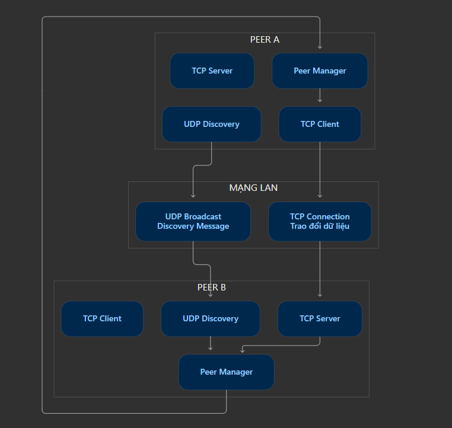
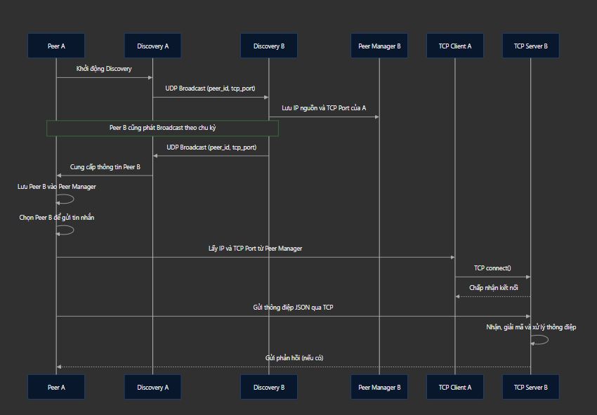
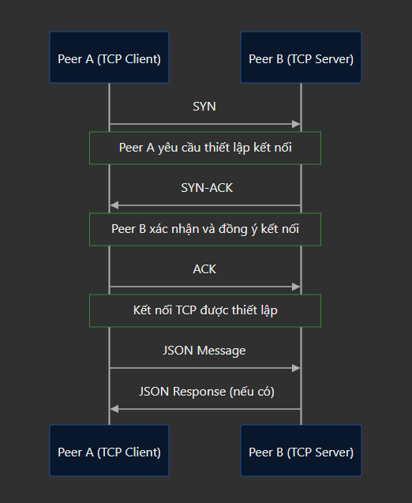
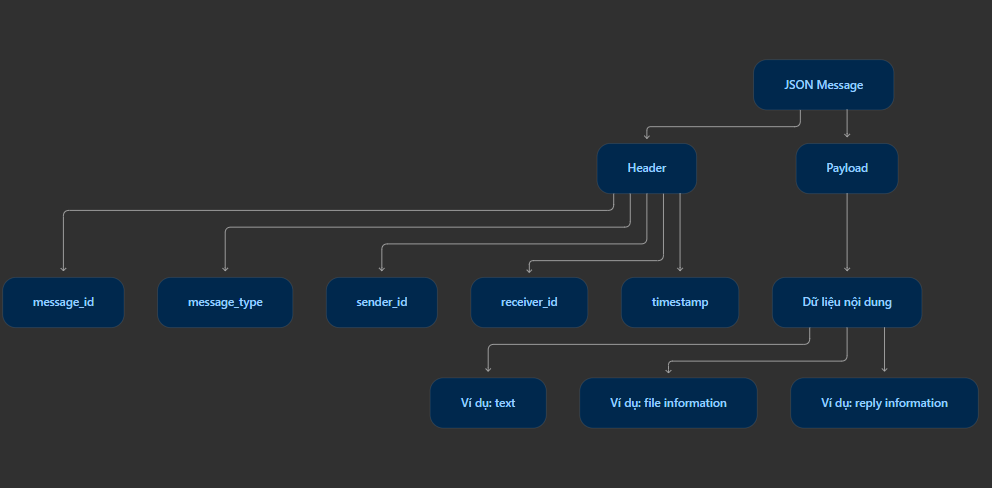

# CHƯƠNG 2: CƠ SỞ LÝ THUYẾT
## 2.1. Tổng quan mô hình Peer-to-Peer
### 2.1.1. Khái niệm:
Peer-to-Peer (P2P) là mô hình kiến trúc mạng phân tán, trong đó các nút tham gia hệ thống có khả năng chia sẻ tài nguyên và giao tiếp với nhau. Khác với mô hình Client-Server truyền thống, P2P không yêu cầu mọi hoạt động trao đổi dữ liệu đều phải thông qua một máy chủ trung tâm. 

Trong mô hình này, mỗi Peer có thể đảm nhận đồng thời hai vai trò:
- Client: Gửi yêu cầu đến Peer khác để sử dụng dịch vụ hoặc nhận dữ liệu.
- Server: Tiếp nhận yêu cầu và cung cấp dữ liệu hoặc dịch vụ cho Peer khác.
### 2.1.2. Đặc điểm mô hình P2P:
Tính phân tán: Các Peer tham gia chia sẻ tài nguyên và thực hiện hoạt động giao tiếp trong hệ thống.

Khả năng giao tiếp hai chiều: Mỗi Peer có thể gửi và nhận dữ liệu từ các Peer khác.
Chia sẻ tài nguyên: Các Peer có thể cung cấp dữ liệu, dung lượng lưu trữ hoặc năng lực xử lý cho những Peer khác.

Khả năng mở rộng: Có thể bổ sung Peer mới vào hệ thống mà không nhất thiết phải nâng cấp một máy chủ trung tâm duy nhất.
### 2.1.3. Ứng dụng mô hình P2P trong đề tài:
Trong đề tài P2P Chat & File Transfer Application, mô hình P2P được sử dụng để cho phép các thiết bị trong cùng mạng nội bộ trao đổi trực tiếp với nhau mà không cần thông qua máy chủ.

Mỗi Peer trong ứng dụng có hai chức năng:
- Chức năng tiếp nhận kết nối: khởi tạo TCP Server để lắng nghe và tiếp nhận kết nối từ các Peer khác.
-  Chức năng khởi tạo kết nối: sử dụng TCP Client để chủ động kết nối đến Peer đích và gửi dữ liệu. 

Trước khi trao đổi dữ liệu, các Peer sử dụng UDP Broadcast để thông báo sự hiện diện của mình và phát hiện ra các Peer khác đang hoạt động trong cùng mạng LAN. Sau khi thu thập được thông tin địa chỉ IP và Port của Peer đích, ứng dụng có thể thiết lập kết nối TCP để thực hiện trao đổi thông điệp. Vì thế mỗi thiết bị có thể vừa gửi tin nhắn, vừa tiếp nhận tin nhắn từ các thiết bị khác.  
### 2.1.4. Sơ đồ 
1. kiến trúc giao tiếp giữa hai Peer:



2. Sơ đồ chi tiết luồng Discovery → TCP  → Message:




- Peer A và Peer B đều khởi chạy UDP Discovery để thông báo sự hiện diện.
- Peer A nhận thông tin Discovery từ B, gồm: IP nguồn và TCP Port.
- Peer A lưu thông tin của B vào Peer Manager.
- Khi A muốn gửi tin nhắn, A lấy thông tin từ Peer Manager.
- TCP Client của A kết nối đến TCP Server của B.
- Sau khi kết nối thành công, hai Peer trao đổi dữ liệu. 

## 2.2. Giao thức TCP
### 2.2.1. Khái niệm giao thức TCP:
TCP(Transmission Control Protocol) là giao thức truyền tải thuộc tầng Transport trong mô hìn TCP/IP, được sử dụng để thiết lập kết nối và truyền dữ liệu giữa hai thiết bị thồng qua mạng máy tính.
### 2.2.2. Đặc điểm chính của TCP: 
| Đặc điểm | Chi tiết |
|---|---|
| Hướng kết nối | Thiết lập kết nối trước khi truyền dữ liệu |
| Độ tin cậy | Có cơ chết xác nhận và truyền lại dữ liệu khi cần |
| Đúng thứ tự | Dữ liệu được cung cấp cho ứng dụng theo đúng thứ tự byte |
| Kiểm tra lỗi | Sử dụng checksum để phát hiện lỗi trong segment |
| Kiểm soát luồng | Điều chỉnh lượng dữ liệu gửi để tránh làm tràn bộ đệm bên nhận |
| Kiểm soát tắc nghẽn | Điều chỉnh tốc độ truyền khi mạng có dấu hiệu tắc nghẽn |
| Truyền dữ liệu dạng luồng | Cung cấp luồng byte liên tục, không bảo toàn ranh giới từng lần gửi | 

### 2.2.3. Cơ chế bắt tay ba bước (Three-way Handshake):
TCP sử dụng cơ chế bắt tay ba bước (Three-way Handshake) để thiết lập kết nối giữa hai thiết bị trước khi truyền dữ liệu.

Bước 1: SYN (Synchronize):
- Peer A gửi một gói tin SYN đến Peer B.

Bước 2: SYN-ACK (Synchronize-Acknowledge):
- Peer B nhận được yêu cầu từ Peer A.
- B gửi lịa gói SYN-ACK để xác nhận yêu cầu và thông báo số thứ tự ban đầu của mình

Bước 3: ACK(Acknowledge):
- Peer A nhận được phản hồi từ B.
- A gửi gói ACK để xác nhận.
- Sau khi hoàn thành ba bước, kết nối TCP được thiết lập và hai bên có thể bắt đầu trao đổi dữ liệu. 

Sơ đồ trình tự TCP Three-way Handshake




### 2.2.4. Cơ chế truyền dữ liệu của TCP:
Sau khi kết nối được thiết lập, TCP bắt đầu truyền dữ liệu theo cơ chế: 
1. Đánh số thứ tự (Sequence Number): Theo dõi vị trí của dữ liệu trong luồng byte. 
2. Xác nhận dữ liệu (Acknowledgement): Bên nhận gửi thông tin xác nhận dữ liệu đã nhận.
3. Truyền lại (Retranmission): Nếu dữ liệu bị mất hoặc không được xác nhận trong khoảng thời gian phù hợp, TCP có thể truyền lại.
4. Kiểm soát luồng (Flow Control): Điều chỉnh tốc độ gửi để han chế tình trạng quá tải mạng.
5. Kiểm soát tắc nghẽn (Congestion Control): Điều chỉnh tốc độ gửi để hạn chế tình trạng quá tải mạng. 

### 2.2.5. Ứng dụng TCP trong đề tài:
1. Mỗi Peer khởi tạo một TCP Server để lắng nghe kết nối đến.
2. Khi muốn gửi tin nhắn, Peer gửi sử dụng thông tin IP và TCP Port của Peer đích để khởi tạo két nối bừng TCP Client.
3. Hai bên thực hiện quá trình Three-way Handshake ở tầng TCP.
4. Sau khi kết nối thành công, ứng dụng đóng gói thông điệp theo định dạng JSON.
5. Dữ liệu được mã hóa thành byte và truyền qua kết nối TCP. 
6. Peer nhận tiếp nhận dữ liệu, giải mã và xử lý thông điệp. 

Ứng dụng trong bài làm của nhóm:
| Thành phần | Vai trò |
|---|---|
|`server.py` | Tạo TCP Server, bind địa chỉ IP và Port, lắng nghe kết nối bằng `listen()` và tiếp nhận bằng `accept()`. |
| `client.py` | Tạo TCP Client và kết nối đến Peer đích bằng `connect()`. |
| `protocol.py` | Đóng gói JSON, mã hòa thành byte và xử lý cơ chế đóng khung bản tin. |
|`config_loader.py`| Đọc cấu hình địa chỉ và cổng mạng. |


## 2.3. Giao thức UDP
### 2.3.1. Khái niệm giao thức UDP:
UDP (User Datagram Protocol) là giao thức truyền tải thuộc tầng Transport trong mô hình TCP/IP. UDP cho phép các ứng dụng gửi và nhận dữ liệu thông qua các gói tin được gọi là Datagram. 
### 2.3.2. Đặc điểm của UDP:
| Đặc điểm | Chi tiết |
|---|---|
| Không hướng kết nối | Không cần Three-way Handshake trước khi gửi |
| Không đảm bảo tin cậy | Datagram có thể bị mất trên đường truyền |
| Không đảm bảo thứ tự | Gói tin có thể đến không đúng thứ tự |
| Không tự truyền lại | Ứng dụng phải tự xử lý nếu cần gửi lại |
| Overhead thấp | Header UDP cơ bản chỉ có 8 byte |
| Hỗ trợ Broadcast | Có thể gửi dữ liệu đến các thiết bị trong phạm vi mạng Broadcast |
| Hỗ trợ Multicast | Có thể gửi dữ liệu đến một nhóm thiết bị tham gia nhóm Multicast |

### 2.3.3. Cơ chế hoạt động của UDP:
1. Ứng dụng gửi tạo dữ liệu cần truyền.
2. UDP đóng gói dữ liệu thành Datagram.
3. Datagram được gửi đến địa chỉ IP và UDP Port đích.
4. Thiết bị nhận sử dụng UDP Port tương ứng để tiếp nhận Datagram.
5. Ứng dụng nhận xử lý nội dụng dữ liệu. 

### 2.3.4. Cơ chế UDP Broadcast:
UDP Broadcast là cơ chế cho phép một thiết bị gửi Datagram đến địa chỉ Broadcast của mạng để các thiết bị phù hợp trong cùng phạm vi mạng có thể nhận được thông tin. 

Quá trình Discovery bằng UDP Broadcast:
1. Peer A tạo thông điệp Discovery chứa `peer_id` và `tcp_port`.
2. A gửi thông điệp bằng UDP Broadcast đến cổng Discovery. 
3. Các Peer đang chạy chương trình và lắng nghe cổng Discovery có thể nhận được thông điệp. 
4. Peer nhận kiểm tra `peer_id` để tránh nhận diện chính nó. 
5. Nếu thông tin hợp lệ, Peer nhận lưu địa chỉ IP và TCP Port của Peer gửi vào Peer Manager. 

Các thành phần Socket liên quan:
- `socket.SOCK_DGRAM` để tạo UDP socket.
- `SO_BROADCAST` để cho phép gửi Broadcast.
- `sendto()` để gửi thông điệp Discovery.
- `recvfrom()` để nhận Datagram và lấy địa chỉ IP của Peer gửi.
- `SO_REUSEADDR` để hỗ trợ sử dụng lại địa chỉ Socket trong môi trường kiểm thử. 

## 2.4. Lập trình Socket
### 2.4.1. Khái niệm Socket:
Socket là một giao diện lập trình (API) cho phép các ứng dụng giao tiếp và trao đổi dữ liệu thông qua mạng máy tính. 

Một Socket thường được xác định bằng sự kết hợp giữa địa chỉ IP, số Port và giao thức truyền tải. Trong ứng dụng P2P, Socket giúp các Peer gửi và nhận dữ liệu thông qua TCP hoặc UDP. 

### 2.4.2. Các thành phần cơ bản:
| Thành phần | Ý nghĩa |
|---|---|
| IP Address| Xác định địa chỉ thiết bị trong mạng |
| Port | Xác định ứng dụng hoặc dịch vụ đang giao tiếp trên thiết bị |
| Protocol | Xác định giao thức truyền tải: TCP hoặc UDP |
| Socket | Điểm cuối giao tiếp mạng được ứng dụng sử dụng để gửi và nhận dữ liệu |
### 2.4.3. Các hàm Socket TCP:

| Hàm | Chức năng |
|---|---|
| `socket()` | Tạo socket |
| `bind()` | Gắn socket với địa chỉ IP và Port |
| `listen()` | Đưa TCP Server vào trạng thái chờ kết nối |
| `accept()` | Chấp nhận kết nối từ Client |
| `connect()` | Client yêu cầu kết nối đến Server |
| `sendall()` | Gửi toàn bộ dữ liệu byte được cung cấp hoặc báo lỗi |
| `recv()` | Nhận dữ liệu từ kết nối |
| `close()` | Đóng socket |

### 2.4.4. Các hàm Socket UDP:
| Hàm | Chức năng |
|---|---|
| `socket()` | Tạo UDP Socket |
| `bind()` | Gắn socket với IP và Port để nhận dữ liệu |
| `sendto()` | Gửi Datagram đến IP và Port đích |
| `recvfrom()` | Nhận Datagram và địa chỉ người gửi |
| `close()` | Đóng Socket | 

### 2.4.5. Ứng dụng Socket trong đề tài:
- TCP Socket: Được sử dụng trong `server.py` và `client.py` để thiết lập kết nối và trao đổi thông điệp giữa các Peer. 
- UDP Socket: Được sử dụng trong `udp_discovery.py` để gửi và nhận thông điệp qua UDP Broadcast. 

## 2.5. Dịnh dạng dữ liệu JSON
### 2.5.1. Khái niệm JSON:
JSON (JavaScript Object Notation) là định dạng dữ liệu dùng để lưu trữ và trao đổi thông tin giữa các hệ thống. JSON có cấu trúc đơn giản, dễ đọc, dễ xử lý bằng nhiều ngôn ngữ lập trình. 

JSON thường sử dụng các kiểu dữ liệu:
- `String`: chuỗi ký tự
- `Number`: Số
- `Boolean`: `true` hoặc `false`
- `Array`: Danh sách dữ liệu
- `Object`: Đối tượng gồm các cặp key-value
- `Null`: Giá trị rỗng 

Một số thư viện `json` để chuyển đổi dữ liệu:
| Hàm | Chức năng |
|---|---|
| `json.dumps()` | Chuyển Python Object thành chuỗi JSON |
| `json.loads()` | Chuyển chuỗi JSON thành Python Object |
| `json.dump()` | Ghi dữ liệu JSON vào file |
| `json.load()` | Đọc dữ liệu JSON từ file |

### 2.5.2. Cấu trúc Header và Payload:
Header: chứa thông tin giúp hệ thống xác định tin nhắn
| Trường | Kiểu dữ liệu | Ý nghĩa | 
|---|---|---|
| `message_id` | String | mã định danh duy nhất của tin nhắn UUID |
| `message_type` | String | loại tin nhắn |
| `sender_id` | String |ID Peer gửi |
| `receiver_id` | String | ID Peer nhận |
| `timestamp` | String | thời điểm tạo tin nhắn |

Payload: chứa dữ liệu thực tế mà người gửi muốn truyền đi. Nội dung phụ thuộc vào loại tin nhắn. 

Danh sách message type
| Message type | Mục đích |
|---|---|
| `TEXT` | Gửi tin nhắn văn bản |
| `EMOJI` | Gửi emoji |
| `REPLY` | Trả lời một thông điệp cụ thể |
| `FORWARD` | Chuyển tiếp thông điệp |
| `FILE` | Trao đổi metadata và trạng thái truyền file |
| `KEY_EXCHANGE` | Trao đổi thông tin mã hóa | 

Sơ đồ cấu trúc JSON Message 



### TEXT 
| Field | Type | Required | Description |
|---|----|---|---|
| `text` | String | YES | Nội dung tin nhắn | 

Ví dụ payload: 
```json 
{
  "header":{
      "message_id": "UUID",
      "message_type": "TEXT",
      "sender_id": "peer_A",
      "receiver_id": "peer_B",
      "timestamp": "2026-10-26T01:00:00Z"
  },
  "payload":{
    "text": "Xin chào!"
  }
}
```
### EMOJI
| Field | Type | Required | Description |
|---|---|---|---|
| `emoji` | String | Yes | Nội dung tin nhắn |

Ví dụ payload: 
```json 
  "payload":{
    "emoji": "😂"
  }
```
### REPLY 
| Field | Type | Required | Description |
|---|---|---|---|
| `reply_to_message_id` | String | Yes | ID của tin nhắn gốc |
| `text` | String | Yes | Nội dung trả lời |

Ví dụ payload: 
```json 
  "payload":{
    "reply_to_message_id": "550e8400-e29b-41d4-a716-446655440001",
    "text": "Xin chào! Bạn khỏe không ?"
  }
```
Quy tắc: 
- Tin nhắn trả lời phải có `message_id` mới. 
- `reply_to_message_id` tham chiếu đến `message_id` của thông điệp gốc.
- Giao diên tra cứu thông điệp gốc bằng ID để hiển thị nội dung được trả lời. 
- Không dùng `sender_id` để thay thế `reply_to_message_id`.

### FORWARD 
| Field | Type | Required | Description |
|---|---|---|---|
| `original_message_id` | String | Yes | ID của tin nhắn gốc |
| `original_sender_id` | String | Yes | Peer gửi tin nhắn gốc |
| `original_message_type` | String | Yes | Loại thông điệp gốc |
| `original_payload` | Object | Yes | Payload gốc được chuyển tiếp |

Ví dụ payload: 
```json
{
  "original_message_id": "550e8400-e29b-41d4-a716-446655440001",
  "original_message_type": "TEXT",
  "original_sender_id": "peer_A",
  "original_payload": {
      "text": "Mai nhớ nộp bài nha !"
  } 
}
```
Quy tắc:
- Thông điệp FORWARD có `message_id`  mới
- `sender_id` là peer đang chuyển tiếp
- `receiver_id` là peer nhận nội dung được chuyển tiếp
- `original_message_id` giữ nguyên ID của tin nhắn gốc
- Chỉ chuyển tiếp các loại thông điệp được Protocol cho phép.
- Không tự động chuyển tiếp dữ liệu khóa riêng hoặc thông tin bí mật.

### FILE
| Field | Type | Required | Description |
|---|---|---|---|
| `action` | String | Yes | Loại thao tác truyền tệp, ví dụ: FILE_OFFER, FILE_ACCEPT, FILE_REJECT, FILE_COMPLETE, FILE_ERROR |
| `transfer_id` | String | Yes | ID duy nhất của phiên truyền file |
| `file_name` | String | Yes ( dùng cho OFFER ) | Tên file |
| `file_size` | Integer | Yes (dùng cho OFFER) | Kích thước file tính bằng bytes |
| `chunk_size` | Integer | Yes | Kích thước mỗi khối dữ liệu |
| `total_chunks` | Integer | Yes | Tổng số khối dữ liệu |

Ví dụ payload: 
```json
{
  "action": "FILE_OFFER",
  "transfer_id": "UUID_PHIEU_TRUYEN_FILE",
  "file_name": "baocao.pdf",
  "file_size": 102400,
  "chunk_size": 16384,
  "total_chunks": 7 
}
```
Quy tắc:
- Kích thước mỗi khối dữ liệu dự kiến nằm trong khoảng 4 KB đến 64 KB.
- Kích thước thực tế của khối cuối có thể nhỏ hơn các khối trước.
- Phía nhận cần kiểm tra kích thước tệp và dữ liệu nhận được.
- Tệp nên được ghi vào tệp tạm trong lúc nhận; chỉ đổi sang tên chính thức khi hoàn tất và kiểm tra thành công
- Nếu tên tệp đã tồn tại, cần tạo tên mới hoặc yêu cầu người dùng xác nhận
- `file_name` chỉ là tên tệp, không được dùng trực tiếp làm đường dẫn lưu 

### KEY_EXCHANGE 
| Field | Type | Description |
|---|---|---|
| `action` | String | Hành động trao đổi khóa |
| `algorithm` | String | Thuật toán sử dụng |
| `key_id` | String | ID của khóa |
| `public_key` | String | Khóa công khai |
| `encrypted_session_key` | String | Khóa đã mã khóa | 

Ví dụ payload - gửi khóa công khai:
```json
{
  "action": "PUBLIC_KEY",
  "algorithm": "RSA",
  "key_id": "key-peer-A-001",
  "public_key": "NOI_DUNG_KHOA_CONG_KHAI"
}
```
Ví dụ payload - gửi khóa đã được mã hóa:
```json
{
  "action": "SESSION_KEY",
  "algorithm": "RSA-OAEP-SHA256",
  "key_id": "key-peer-B-001",
  "encrypted_session_key": "BASE64_ENCODED_CIPHERTEXT"
}
```
Quy tắc:
-  Chỉ chia sẻ khóa công khai, không gửi khóa riêng RSA qua mạng 
-  Khi dùng RSA-OAEP, phải sử dụng thư viện mật mã đáng tin cậy và tham số tương thích ở hai phía
-  Khóa AES-256 phải được tạo bằng bộ sinh số ngẫu nhiên an toàn
-  Không gửi khóa AES ở dạng văn bản thuần
-  Cần xác thực khóa công khai của peer để giảm nguy cơ tấn công trung gian

### 2.5.3. Đóng gói và truyền dữ liệu JSON qua TCP:
TCP chỉ truyền theo luồng byte, không tự phân biệt ranh giới giữa các tin nhắn nên trong đề tài này nhóm sử dụng kỹ thuật Length-Prefix Framing:
1. Chuyển JSON thành chuỗi byte UTF-8.
2. Tính độ dài của chuỗi byte.
3. Đóng gói độ dài thành 4 byte bằng `struct.pack("!I",...)`.
4. Gửi 4 byte độ dài trước, sau đó gửi nội dung JSON.
5. Phía nhận đọc 4 byte đầu để biết cần nhận bao nhiêu byte dữ liệu tiếp theo.

## 2.6. Lập trình đa luồng và QThread
### 2.6.1. Thread là gì ?
Thread (luồng) là đơn vị thực thi nhỏ bên trong một tiến trình (process). Một chương trình có thẻ thực hiện những công việc khác nhau. 

Trong ứng dụng Chat P2P:
| Thread | Vai trò |
|---|---|
| Main Thread | Hiển thị và xử lý giao diện GUI |
| Network Thread | Chờ nhận tin nhắn từ Peer |
| Discovery Thread | Gửi và nhận gói UDP Discovery |

### 2.6.2. QThread là gì?
QThread là lớp của Qt dùng để tạo và quản lý luồng thực thi riêng trong ứng dụng sử dụng PySide6 hoặc PyQt6.

### 2.6.3. Signal và Slot:
Signal: Tín hiệu được phát ra khi có sự kiện xảy ra.
Slot: Hàm nhận và xử lý tín hiệu đó.
Luồng xử lý tin nhắn: Peer B gửi tin nhắn → Network Thread (nhận dữ liệu qua TCP Socket) → (Signal) → Main Thread - GUI (Slot) → Tin nhắn xuất hiện trên giao diện.

### 2.6.4. Ứng dụng trong dự án:
- Nhận tin nhắn TCP mà không làm treo GUI.
- Gửi dữ liệu trong quá trình trao đổi giữa các Peer.
- Chạy UDP Discovery định kỳ.
- Xử lý tác vụ truyền File trong nền. 
## 2.7. Mã hóa lai RSA và AES-256
### 2.7.1. Thuật toán AES-256: 
AES (Advanced Encryption Standard) là thuật toán mã hóa đối xứng - bên gửi và bên nhận sử dụng cùng một khóa bí mật để mã hóa và giải mã dữ liệu. AES-256 có nghĩa là sử dụng khóa mã hóa có độ dài 256 bit (32 byte).

Điểm mạnh:
- Mã hóa và giải mã nhanh.
- Phù hợp với dữ liệu lớn như tin nhắn và File.
- Có thể sử dụng để mã hóa toàn bộ nội dung trao đổi. 

### 2.7.2. Thuật toán RSA:
RSA là thuật toán mã hóa bất đối xứng. RSA sử dụng một cặp khóa:
| Khóa | Chức năng |
|---|---|
| Public Key | Khóa công khai, có thể chia sẻ cho người khác. |
| Private Key | Khóa riêng tư, phải được giữ bí mật . |

### 2.7.3. Mã hóa lai RSA + AES-256:
Mã hóa lại (Hybrid Encryption) kết hợp hai thuật toán:
- RSA: bảo vệ khóa AES khi trao đổi giữa hai peer.
- AES-256: mã hóa nội dung tin nhắn hoặc file. 

Quy trình khi Peer A muốn gửi tin nhắn bí mật cho Peer B:
1. Peer B tạo cặp khóa RSA → B có public key và private key.
2. Peer B gửi Public Key cho Peer A.
3. Peer A tạo khóa AES-256 ngẫu nhiên: dùng để mã hóa nội dung tin nhắn.
4. Peer A mã hóa tin nhắn bằng AES-256.
5. Peer A mã hóa khóa AES bằng Public key của B: sử dụng RSA-OAEP để bảo vệ khóa AES khi truyền đi.
6. Peer A gửi dữ liệu cho Peer B: gồm tin nhắn mã hóa và khóa AES đã được RSA mã hóa.
7. Peer B giải mã khóa AES: dùng private key của B để lấy lại khóa AES ban đầu.
8. Peer B giải mã nội dung: dùng khóa AES vừa khôi phục để giải mã tin nhắn mã hóa và đọc tin nhắn. 

### 2.7.4. Ứng dụng trong dự án:
| Thuật toán | Vai trò |
|---|---|
| RSA | Mã hóa và bảo vệ khóa AES |
| AES-256 | Mã hóa nội dung tin nhắn và file |
| RSA-OAEP | Cơ chế mã hóa khóa AES an toàn |
| AES-GCM | Mã hóa và xác thực tính toàn vẹn dữ liệu | 

