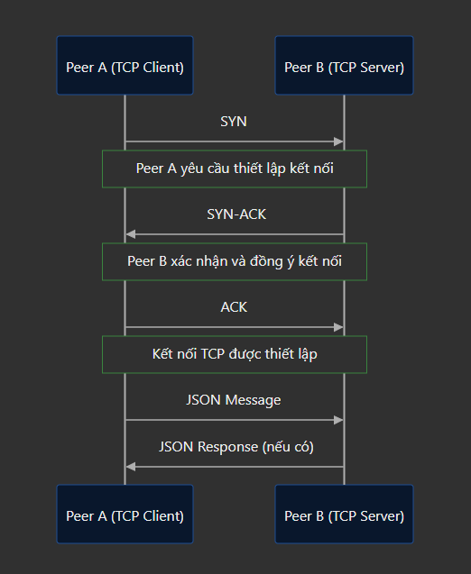
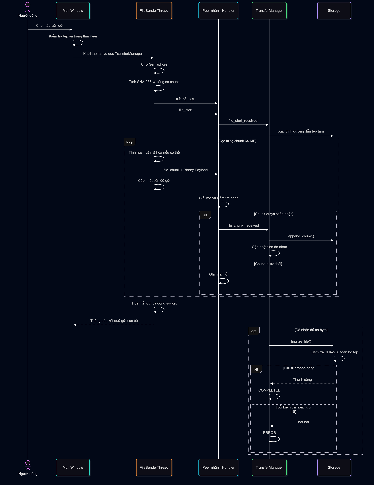

# CHƯƠNG 2: CƠ SỞ LÝ THUYẾT
## 2.1. Tổng quan mô hình Peer-to-Peer
### 2.1.1. Khái niệm:
Peer-to-Peer (P2P) là mô hình kiến trúc mạng phân tán, trong đó các nút tham gia hệ thống có khả năng chia sẻ tài nguyên và giao tiếp với nhau. Khác với mô hình Client-Server truyền thống, P2P không yêu cầu mọi hoạt động trao đổi dữ liệu đều phải thông qua một máy chủ trung tâm. 

Trong mô hình này, mỗi Peer có thể đảm nhận đồng thời hai vai trò:
- Client: Gửi yêu cầu đến Peer khác để sử dụng dịch vụ hoặc nhận dữ liệu.
- Server: Tiếp nhận yêu cầu và cung cấp dữ liệu hoặc dịch vụ cho Peer khác.
### 2.1.2. Đặc điểm mô hình P2P:
Tính phân tán: Các Peer tham gia chia sẻ tài nguyên và thực hiện hoạt động giao tiếp trong hệ thống.

Khả năng giao tiếp hai chiều: Mỗi Peer có thể gửi và nhận dữ liệu từ các Peer khác.
Chia sẻ tài nguyên: Các Peer có thể cung cấp dữ liệu, dung lượng lưu trữ hoặc năng lực xử lý cho những Peer khác.

Khả năng mở rộng: Có thể bổ sung Peer mới vào hệ thống mà không nhất thiết phải nâng cấp một máy chủ trung tâm duy nhất.
### 2.1.3. Ứng dụng mô hình P2P trong đề tài:

Trong đề tài *P2P Chat & File Transfer Application*, mô hình Peer-to-Peer (P2P) được áp dụng để các thiết bị trong cùng mạng nội bộ (LAN) có thể phát hiện và trao đổi dữ liệu trực tiếp với nhau mà không cần máy chủ trung tâm.

Mỗi Peer có thể đồng thời thực hiện hai vai trò:

- **TCP Server:** Lắng nghe và tiếp nhận kết nối từ các Peer khác.
- **TCP Client:** Chủ động thiết lập kết nối đến Peer đích để gửi dữ liệu.

Ứng dụng sử dụng cơ chế **UDP Broadcast** để phát hiện các Peer trong mạng LAN. Đối với giao diện GUI, lớp `PeerDiscovery` trong `CODE/p2p_node/discovery.py` định kỳ phát thông điệp beacon có `type` là `p2p_beacon`, bao gồm các trường `instance_id`, `username`, `port` và `timestamp`.

Khi nhận được beacon, ứng dụng kiểm tra thông tin Peer, bỏ qua thông điệp phát ra từ chính phiên chạy của mình, xác định địa chỉ IP từ gói UDP nhận được và kết hợp với TCP port để tạo định danh Peer dạng `IP:port`.

Nếu phát hiện một Peer mới, `PeerDiscovery` phát tín hiệu `peer_discovered` để giao diện cập nhật danh sách Peer khả dụng. Người dùng có thể lựa chọn Peer và thiết lập kết nối TCP để trao đổi tin nhắn hoặc truyền tệp.

Ngoài luồng Discovery tích hợp với GUI, module `discovery.py` còn cung cấp các hàm `send_discovery()` và `listen_discovery()` phục vụ hoạt động CLI. Hai luồng sử dụng cấu trúc thông điệp và nguồn cấu hình khác nhau, vì vậy cần được phân biệt trong phần mô tả triển khai.

### 2.1.4. Sơ đồ 
1. kiến trúc giao tiếp giữa hai Peer:


2. Sơ đồ chi tiết luồng Discovery → TCP  → Message:


- Peer A và Peer B đều khởi chạy cơ chế UDP Discovery để thông báo sự hiện diện trong mạng LAN.
- Peer A nhận beacon từ Peer B và xác định địa chỉ IP nguồn cùng cổng TCP được cung cấp trong thông điệp.
- Thành phần PeerDiscovery xử lý thông tin và phát tín hiệu để giao diện cập nhật danh sách Peer.
- Khi người dùng lựa chọn Peer B để giao tiếp, ứng dụng sử dụng thông tin địa chỉ IP và cổng TCP tương ứng.
- Ứng dụng có thể thiết lập kết nối TCP giữa hai Peer.
- Sau khi kết nối được thiết lập, hai Peer thực hiện trao đổi dữ liệu theo giao thức tầng ứng dụng.

## 2.2. Giao thức TCP
### 2.2.1. Khái niệm giao thức TCP:

TCP (Transmission Control Protocol) là giao thức truyền tải thuộc tầng Transport trong mô hình TCP/IP, cung cấp cơ chế truyền dữ liệu có kết nối, đáng tin cậy và đúng thứ tự dưới dạng luồng byte giữa các thiết bị thông qua mạng máy tính.

### 2.2.2. Đặc điểm chính của TCP: 
| Đặc điểm | Chi tiết |
|---|---|
| Hướng kết nối | Thiết lập kết nối trước khi truyền dữ liệu |
| Độ tin cậy | Có cơ chế xác nhận (ACK) và truyền lại (Retransmission) khi cần. |
| Đúng thứ tự | Dữ liệu được cung cấp cho ứng dụng theo đúng thứ tự byte |
| Kiểm tra lỗi | Sử dụng checksum để phát hiện lỗi trong segment |
| Kiểm soát luồng | Điều chỉnh lượng dữ liệu gửi để tránh làm tràn bộ đệm bên nhận |
| Kiểm soát tắc nghẽn | Điều chỉnh tốc độ truyền khi mạng có dấu hiệu tắc nghẽn |
| Truyền dữ liệu dạng luồng | Cung cấp luồng byte liên tục, không bảo toàn ranh giới từng lần gửi | 

### 2.2.3. Cơ chế bắt tay ba bước (Three-way Handshake):
TCP sử dụng cơ chế bắt tay ba bước (Three-way Handshake) để thiết lập kết nối giữa hai thiết bị trước khi truyền dữ liệu.

Bước 1: SYN (Synchronize):
- Peer A gửi một gói tin SYN đến Peer B.

Bước 2: SYN-ACK (Synchronize-Acknowledge):
- Peer B nhận được yêu cầu từ Peer A.
- Peer B gửi lại gói SYN-ACK để xác nhận yêu cầu kết nối của Peer A và thông báo số thứ tự ban đầu của mình.

Bước 3: ACK(Acknowledge):
- Peer A nhận được phản hồi từ B.
- A gửi gói ACK để xác nhận.
- Sau khi hoàn thành ba bước, kết nối TCP được thiết lập và hai bên có thể bắt đầu trao đổi dữ liệu. 

**Hình 2.3. Cơ chế bắt tay ba bước của TCP**




### 2.2.4. Cơ chế truyền dữ liệu của TCP:

Sau khi kết nối được thiết lập, TCP cung cấp các cơ chế hỗ trợ quá trình truyền dữ liệu đáng tin cậy:

1. **Đánh số thứ tự (Sequence Number):** Theo dõi vị trí của dữ liệu trong luồng byte, hỗ trợ việc sắp xếp dữ liệu theo đúng thứ tự.
2. **Xác nhận dữ liệu (Acknowledgement):** Bên nhận gửi thông tin xác nhận dữ liệu đã tiếp nhận.
3. **Truyền lại (Retransmission):** TCP có thể truyền lại dữ liệu khi phát hiện mất dữ liệu hoặc không nhận được xác nhận trong khoảng thời gian phù hợp.
4. **Kiểm soát luồng (Flow Control):** Điều tiết lượng dữ liệu gửi dựa trên khả năng tiếp nhận và dung lượng bộ đệm của bên nhận.
5. **Kiểm soát tắc nghẽn (Congestion Control):** Điều chỉnh lượng dữ liệu truyền nhằm hạn chế tình trạng tắc nghẽn trên mạng.

Trong đề tài P2P Chat & File Transfer Application, giao thức TCP được sử dụng để thiết lập kết nối và trao đổi dữ liệu trực tiếp giữa các Peer. Mỗi Peer có khả năng lắng nghe kết nối đến và chủ động kết nối tới Peer khác khi cần trao đổi thông tin.

Quy trình giao tiếp TCP trong ứng dụng được mô tả như sau:

Khi ứng dụng khởi chạy, thành phần TCP Listener mở socket và lắng nghe kết nối tại cổng đã được cấu hình.

Sau khi phát hiện Peer thông qua cơ chế UDP Discovery hoặc nhận được thông tin kết nối hợp lệ, ứng dụng có thể chủ động thiết lập kết nối TCP đến Peer đích.

Hai thiết bị thực hiện cơ chế bắt tay ba bước (Three-way Handshake) ở tầng TCP để thiết lập kết nối.

Sau khi kết nối được thiết lập, ứng dụng sử dụng giao thức thông điệp ở tầng ứng dụng để đóng gói, gửi và nhận dữ liệu.

Peer nhận đọc dữ liệu từ socket, tái tạo thông điệp theo định dạng đóng khung tương ứng và chuyển đến thành phần xử lý.

Các thành phần triển khai TCP trong ứng dụng

| Module | Vai trò |
|---|---|
| CODE/main.py | Điểm khởi chạy ứng dụng, tiếp nhận tham số và khởi tạo GUI. |
| CODE/ui/app.py | Tích hợp giao diện và các thành phần giao tiếp mạng. |
| CODE/p2p_node/listener.py | Triển khai TCP Listener để lắng nghe và xử lý kết nối đến. |
| CODE/p2p_node/sender.py | Triển khai cơ chế chủ động kết nối và gửi dữ liệu đến Peer đích. |
| CODE/shared/protocol.py | Cung cấp các hàm tạo, đóng gói, đọc và kiểm tra thông điệp. |
| CODE/config/ | Quản lý các tham số cấu hình phục vụ ứng dụng và các luồng chạy tương ứng. |

Cơ chế đóng khung dữ liệu TCP

TCP cung cấp luồng byte liên tục và không tự bảo toàn ranh giới thông điệp của ứng dụng. Vì vậy, hệ thống sử dụng cơ chế Message Framing để xác định điểm bắt đầu, độ dài và nội dung của từng thông điệp.

Trong CODE/shared/protocol.py hiện có hai nhóm API đóng khung dữ liệu:

1. JSON Message Framing

Các hàm encode_message() và recv_message() sử dụng cấu trúc:

[4-byte Message Length] + [JSON Message UTF-8]

Bốn byte đầu biểu diễn độ dài toàn bộ thông điệp JSON sau khi mã hóa UTF-8. Phía nhận đọc độ dài này để xác định số byte cần tiếp nhận.

2. JSON Header kết hợp Binary Payload

Các hàm pack_message() và read_message() sử dụng cấu trúc:

[4-byte Header Length] + [JSON Header UTF-8] + [Binary Payload]

Bốn byte đầu biểu diễn độ dài của JSON Header. Trường payload_size trong Header xác định số byte dữ liệu nhị phân đi kèm.

Hai định dạng này phục vụ các API truyền thông khác nhau và không thể sử dụng thay thế trực tiếp cho nhau.


## 2.3. Giao thức UDP
### 2.3.1. Khái niệm giao thức UDP:
UDP (User Datagram Protocol) là giao thức truyền tải thuộc tầng Transport trong mô hình TCP/IP. UDP cho phép các ứng dụng gửi và nhận dữ liệu thông qua các gói tin được gọi là Datagram. 
### 2.3.2. Đặc điểm của UDP:
| Đặc điểm | Chi tiết |
|---|---|
| Không hướng kết nối | Không cần Three-way Handshake trước khi gửi |
| Không đảm bảo tin cậy | Datagram có thể bị mất trên đường truyền |
| Không đảm bảo thứ tự | Gói tin có thể đến không đúng thứ tự |
| Không tự truyền lại | Ứng dụng phải tự xử lý nếu cần gửi lại |
| Overhead thấp | Header UDP cơ bản chỉ có 8 byte |
| Hỗ trợ Broadcast | Có thể gửi dữ liệu đến các thiết bị trong phạm vi mạng Broadcast |
| Hỗ trợ Multicast | Có thể gửi dữ liệu đến một nhóm thiết bị tham gia nhóm Multicast |

### 2.3.3. Cơ chế hoạt động của UDP:
1. Ứng dụng gửi tạo dữ liệu cần truyền.
2. UDP đóng gói dữ liệu thành Datagram.
3. Datagram được gửi đến địa chỉ IP và UDP Port đích.
4. Thiết bị nhận sử dụng UDP Port tương ứng để tiếp nhận Datagram.
5. Ứng dụng nhận xử lý nội dung dữ liệu.

UDP có thể được sử dụng trong các cơ chế giao tiếp như Unicast, Broadcast và Multicast. Tuy nhiên, trong phạm vi triển khai của đề tài, chức năng Peer Discovery sử dụng UDP Broadcast để phát hiện các Peer trong mạng LAN. Multicast được trình bày nhằm bổ sung kiến thức cơ sở lý thuyết, không phải là chức năng Discovery đã được tích hợp trong ứng dụng.

### 2.3.4. Cơ chế UDP Broadcast:
UDP Broadcast là cơ chế cho phép một thiết bị gửi datagram đến địa chỉ broadcast để các thiết bị trong cùng phạm vi mạng có thể tiếp nhận thông tin mà không cần thiết lập kết nối trước.

Trong ứng dụng P2P Chat & File Transfer Application, UDP Broadcast được sử dụng để phát hiện các Peer đang hoạt động trong mạng LAN trước khi thiết lập kết nối TCP.

a. Cơ chế Peer Discovery trong ứng dụng GUI

Ứng dụng GUI triển khai chức năng phát hiện Peer thông qua lớp PeerDiscovery, được định nghĩa trong module CODE/p2p_node/discovery.py.

Lớp này kế thừa QThread của PyQt6, thực hiện gửi và nhận UDP beacon trên luồng nền nhằm hạn chế ảnh hưởng đến khả năng phản hồi của giao diện.

Thông điệp beacon có cấu trúc như sau:

```json
{
  "type": "p2p_beacon",
  "instance_id": "550e8400-e29b-41d4-a716-446655440000",
  "username": "Alice",
  "port": 9001,
  "timestamp": 1795222800.0
}
```

Trong đó:

| Trường | Ý nghĩa |
|---|---|
| type | Xác định thông điệp phát hiện Peer, có giá trị p2p_beacon. |
| instance_id | UUID định danh phiên chạy của ứng dụng. |
| username | Tên hiển thị của Peer gửi. |
| port | Cổng TCP mà Peer đang lắng nghe. |
| timestamp | Thời điểm tạo beacon, biểu diễn dưới dạng Unix timestamp. |

Quy trình phát hiện Peer trong GUI gồm các bước:

1. Khi ứng dụng khởi chạy, PeerDiscovery được khởi tạo với tên người dùng và cổng TCP đang sử dụng.

2. Peer định kỳ phát UDP beacon đến địa chỉ broadcast 255.255.255.255, sử dụng cổng Discovery mặc định 37020.

3. Các Peer đang lắng nghe trên cổng tương ứng tiếp nhận beacon thông qua recvfrom().

4. Peer nhận kiểm tra loại thông điệp và bỏ qua beacon có instance_id trùng với phiên chạy của chính mình. Mã nguồn còn có điều kiện lọc bổ sung dựa trên IP nguồn và cổng TCP.

5. Ứng dụng xác định địa chỉ IP của Peer gửi từ gói UDP nhận được và kết hợp với trường port để tạo định danh Peer dạng IP:port.

6. Nếu Peer chưa nằm trong danh sách đã phát hiện, lớp PeerDiscovery phát tín hiệu peer_discovered.

7. Giao diện nhận tín hiệu và cập nhật danh sách Peer khả dụng.

Lớp PeerDiscovery cũng theo dõi thời điểm nhận beacon gần nhất của từng Peer. Khi một Peer không còn gửi beacon trong khoảng thời gian vượt quá HEARTBEAT_TIMEOUT (mặc định 15 giây), hệ thống loại Peer khỏi danh sách theo dõi và phát tín hiệu peer_lost.

Theo cấu hình mặc định, khoảng thời gian phát beacon là 3 giây.

b. Cơ chế Discovery trong công cụ CLI

Bên cạnh lớp PeerDiscovery phục vụ GUI, module CODE/p2p_node/discovery.py còn cung cấp hai hàm:

send_discovery(): Gửi thông điệp Discovery bằng UDP Broadcast.

listen_discovery(): Tiếp nhận và kiểm tra thông điệp Discovery, sau đó cập nhật thông tin Peer thông qua PeerManager.

Luồng CLI sử dụng cấu trúc thông điệp riêng:

```json
{
  "type": "DISCOVERY",
  "peer_id": "peer-A",
  "tcp_port": 7000
}
```

Các tham số của luồng CLI được đọc từ CODE/config/network.json thông qua config_loader.py. Trong cấu hình đang được lưu tại repository, cổng Discovery của CLI là 9999.

Hai luồng GUI và CLI có cấu trúc thông điệp, nguồn cấu hình và cách cập nhật danh sách Peer khác nhau. Vì vậy, tài liệu phân biệt rõ hai cơ chế này thay vì xem chúng là một luồng xử lý duy nhất.

c. Các thành phần Socket được sử dụng

| Thành phần | Chức năng |
|---|---|
| socket.AF_INET | Sử dụng địa chỉ IPv4. |
| socket.SOCK_DGRAM | Tạo socket UDP. |
| socket.SO_BROADCAST | Cho phép gửi datagram đến địa chỉ broadcast. |
| socket.SO_REUSEADDR | Hỗ trợ cấu hình tái sử dụng địa chỉ socket trong những điều kiện phù hợp. |
|sendto() | Gửi thông điệp UDP đến địa chỉ IP và cổng đích. |
| recvfrom() | Nhận datagram và thông tin địa chỉ của bên gửi. |
| QThread | Cho phép xử lý Peer Discovery trên luồng nền của ứng dụng GUI.

Việc sử dụng UDP Broadcast giúp các Peer trong cùng phạm vi mạng có thể tự động phát hiện sự hiện diện của nhau. Tuy nhiên, cơ chế này phụ thuộc vào khả năng truyền broadcast của mạng LAN và không bảo đảm phát hiện được các Peer nằm ngoài phạm vi broadcast hoặc trong môi trường mạng hạn chế lưu lượng UDP.

## 2.4. Lập trình Socket
### 2.4.1. Khái niệm Socket:

Socket là điểm cuối giao tiếp mạng được hệ điều hành cung cấp thông qua giao diện lập trình ứng dụng (API), cho phép các tiến trình gửi và nhận dữ liệu qua mạng máy tính.

Trong lập trình mạng, socket có thể được gắn với địa chỉ IP, cổng và giao thức truyền tải tương ứng.

Một kết nối TCP được nhận diện thông qua bốn thành phần: địa chỉ IP nguồn, cổng nguồn, địa chỉ IP đích và cổng đích.

Trong ứng dụng P2P, TCP Socket được sử dụng để thiết lập kết nối và trao đổi dữ liệu giữa các Peer, trong khi UDP Socket được sử dụng để phát hiện các Peer thông qua cơ chế Broadcast.

### 2.4.2. Các thành phần cơ bản:
| Thành phần | Ý nghĩa |
|---|---|
| IP Address| Xác định địa chỉ thiết bị trong mạng |
| Port | Xác định ứng dụng hoặc dịch vụ đang giao tiếp trên thiết bị |
| Protocol | Xác định giao thức truyền tải: TCP hoặc UDP |
| Socket | Điểm cuối giao tiếp mạng được ứng dụng sử dụng để gửi và nhận dữ liệu |
### 2.4.3. Các hàm Socket TCP:

| Hàm | Chức năng |
|---|---|
| `socket()` | Tạo socket |
| `bind()` | Gắn socket với địa chỉ IP và Port |
| `listen()` | Đưa TCP Server vào trạng thái chờ kết nối |
| `accept()` | Chấp nhận kết nối từ Client |
| `connect()` | Client yêu cầu kết nối đến Server |
| `sendall()` | Gửi toàn bộ dữ liệu byte được cung cấp hoặc báo lỗi |
| `recv()` | Nhận dữ liệu từ kết nối |
| `close()` | Đóng socket |

### 2.4.4. Các hàm Socket UDP:
| Hàm | Chức năng |
|---|---|
| `socket()` | Tạo UDP Socket |
| `bind()` | Gắn socket với IP và Port để nhận dữ liệu |
| `sendto()` | Gửi Datagram đến IP và Port đích |
| `recvfrom()` | Nhận Datagram và địa chỉ người gửi |
| `close()` | Đóng Socket | 

### 2.4.5. Ứng dụng Socket trong đề tài:
Trong ứng dụng *P2P Chat & File Transfer Application*, Socket được sử dụng để triển khai hai cơ chế giao tiếp mạng chính:

- **TCP Socket:** Được triển khai trong các module `CODE/p2p_node/listener.py` và `CODE/p2p_node/sender.py`, phục vụ thiết lập kết nối và trao đổi dữ liệu giữa các Peer.
- **UDP Socket:** Được triển khai trong `CODE/p2p_node/discovery.py`, phục vụ phát hiện các Peer đang hoạt động trong mạng LAN thông qua UDP Broadcast.

Các thành phần giao tiếp mạng được tích hợp vào giao diện ứng dụng thông qua `CODE/ui/app.py`.

## 2.5. Định dạng dữ liệu và giao thức thông điệp
### 2.5.1. Khái niệm JSON:
JSON (JavaScript Object Notation) là định dạng dữ liệu dùng để lưu trữ và trao đổi thông tin giữa các hệ thống. JSON có cấu trúc đơn giản, dễ đọc, dễ xử lý bằng nhiều ngôn ngữ lập trình. 

JSON thường sử dụng các kiểu dữ liệu:
- `String`: chuỗi ký tự
- `Number`: Số
- `Boolean`: `true` hoặc `false`
- `Array`: Danh sách dữ liệu
- `Object`: Đối tượng gồm các cặp key-value
- `Null`: Giá trị rỗng 

Một số thư viện `json` để chuyển đổi dữ liệu:
| Hàm | Chức năng |
|---|---|
| `json.dumps()` | Chuyển Python Object thành chuỗi JSON |
| `json.loads()` | Chuyển chuỗi JSON thành Python Object |
| `json.dump()` | Ghi dữ liệu JSON vào file |
| `json.load()` | Đọc dữ liệu JSON từ file |

### 2.5.2. Cấu trúc Header và Payload:
Trong ứng dụng P2P Chat & File Transfer, dữ liệu trao đổi giữa các Peer được tổ chức dưới dạng thông điệp có cấu trúc. Thông điệp thường bao gồm thông tin điều khiển (Header) và nội dung dữ liệu (Payload).

Header: Chứa thông tin định danh, loại thông điệp, bên gửi và các thông số cần thiết để xử lý thông điệp.

Payload: Chứa dữ liệu thực tế cần trao đổi. Payload có thể là một đối tượng JSON hoặc một chuỗi byte nhị phân tùy theo cơ chế đóng khung được sử dụng.

Theo mã nguồn hiện tại tại CODE/shared/protocol.py, ứng dụng có hai nhóm API với cấu trúc thông điệp khác nhau.

a. Cấu trúc JSON Message

Nhóm API create_message(), validate_message(), encode_message() và recv_message() sử dụng đối tượng JSON gồm hai thành phần header và payload.

Các trường Header:

| Trường | Kiểu dữ liệu | Ý nghĩa |
|---|---|---|
| message_id | String (UUID) | Định danh duy nhất của thông điệp |
| message_type | String | Xác định loại thông điệp |
| sender_id | String | Định danh Peer gửi |
| receiver_id | String | Định danh Peer nhận |
| timestamp | String | Thời điểm tạo thông điệp theo ISO 8601 UTC |

Trường timestamp được biểu diễn theo múi giờ UTC. Ví dụ, 2026-11-21T10:00:00+00:00 là một giá trị hợp lệ về định dạng.

Ví dụ thông điệp TEXT:

```json 
{
  "header": {
    "message_id": "550e8400-e29b-41d4-a716-446655440001",
    "message_type": "TEXT",
    "sender_id": "peer_A",
    "receiver_id": "peer_B",
    "timestamp": "2026-11-21T10:00:00+00:00"
  },
  "payload": {
    "text": "Xin chào!"
  }
}
```

Trong ví dụ này, TEXT được xác định thông qua header.message_type. Nội dung tin nhắn được lưu tại payload.text.

Ví dụ thông điệp EMOJI:

```json
{
  "header": {
    "message_id": "550e8400-e29b-41d4-a716-446655440002",
    "message_type": "EMOJI",
    "sender_id": "peer_A",
    "receiver_id": "peer_B",
    "timestamp": "2026-11-21T10:01:00+00:00"
  },
  "payload": {
    "emoji": "😂"
  }
}
```

Hàm validate_message() kiểm tra các trường Header bắt buộc. Đối với TEXT và EMOJI, hàm kiểm tra trường nội dung tương ứng phải có kiểu chuỗi.

Các loại thông điệp truyền tệp:

Đối với nhóm API này, thông điệp truyền tệp sử dụng quy ước FILE_<ACTION>.

Ví dụ:

| Message type | Payload action | Mục đích |
|---|---|---|
| FILE_START | START | Bắt đầu phiên truyền tệp |
| FILE_CHUNK | CHUNK | Truyền một phần dữ liệu |
| FILE_END | END | Thông báo đã gửi hết dữ liệu |
| FILE_CANCEL | CANCEL | Yêu cầu hủy truyền tệp |
| FILE_ERROR | ERROR | Thông báo lỗi truyền tệp |

Các loại trên phản ánh cấu trúc được triển khai trong nhánh TCPSender và các thông điệp liên quan. Việc một loại thông điệp có trong mã nguồn không đồng nghĩa tất cả các luồng giao diện đều sử dụng loại đó.

Ví dụ FILE_START:

```json
{
  "header": {
    "message_id": "550e8400-e29b-41d4-a716-446655440003",
    "message_type": "FILE_START",
    "sender_id": "peer_A",
    "receiver_id": "peer_B",
    "timestamp": "2026-11-21T10:02:00+00:00"
  },
  "payload": {
    "action": "START",
    "transfer_id": "550e8400-e29b-41d4-a716-446655440004",
    "file_name": "baocao.pdf",
    "file_size": 102400,
    "sha256": "GIA_TRI_SHA256_CUA_TEP"
  }
}
```

Trong thông điệp này:

- transfer_id xác định phiên truyền tệp.

- file_name là tên tệp cần truyền.

- file_size là kích thước tệp tính bằng byte.

- sha256 là giá trị băm dùng để hỗ trợ kiểm tra tính toàn vẹn.

validate_message() yêu cầu payload.action phải khớp với hậu tố của message_type. Ví dụ, FILE_START phải đi kèm action là START.

b. Cấu trúc JSON Header kết hợp Binary Payload

Nhóm API pack_message() và read_message() sử dụng một đối tượng Header dạng JSON kết hợp với Payload nhị phân tùy chọn.

Cấu trúc dữ liệu được truyền:

[4-byte Header Length] + [JSON Header UTF-8] + [Binary Payload]

Các trường Header thường xuất hiện:

| Trường | Kiểu dữ liệu | Ý nghĩa |
|---|---|---|
| msg_id | String (UUID) |Định danh thông điệp |
| type | String | Loại thông điệp |
| sender | String | Tên hoặc định danh bên gửi |
| timestamp | Number | Thời điểm tạo thông điệp dạng Unix timestamp |
| payload_size | Integer | Số byte của Payload nhị phân đi kèm |

Khác với nhóm JSON Message, nhóm này sử dụng các trường msg_id, type, sender thay cho message_id, message_type, sender_id.

Ví dụ JSON Header của tin nhắn Chat:

```json
{
  "msg_id": "550e8400-e29b-41d4-a716-446655440005",
  "type": "chat",
  "sender": "Alice",
  "text": "Xin chào Bob!",
  "is_encrypted": false,
  "nonce": null,
  "timestamp": 1795255200.0,
  "payload_size": 0
}
```

Đây là ví dụ minh họa cấu trúc Header được tạo từ make_chat_header() và bổ sung trường payload_size khi đóng gói bằng pack_message().

Trong nhóm API này, thông điệp Chat có thể chứa các trường metadata bổ sung.

**Reply**:

Trường reply_to được sử dụng để lưu thông tin tham chiếu đến tin nhắn được trả lời. Tin nhắn phản hồi vẫn có type là chat.

Ví dụ phần metadata:

```json
{
  "reply_to": {
    "msg_id": "550e8400-e29b-41d4-a716-446655440001",
    "sender": "Bob",
    "content": "Bạn khỏe không?"
  }
}
```

**Forward**:

Trường forward_from được dùng để lưu thông tin nguồn của nội dung được chuyển tiếp. Thông điệp gửi đi vẫn sử dụng loại chat.

Ví dụ phần metadata:

```json
{
  "forward_from": {
    "original_sender": "Alice"
  }
}
```

Các ví dụ Reply và Forward trên chỉ minh họa nguyên lý sử dụng metadata, không được xem là schema bắt buộc đã được validate_message() kiểm tra.

c. Thông điệp bắt tay và trao đổi khóa

Nhóm API tạo Header còn cung cấp các loại thông điệp:

| Type | Mục đích |
|---|---|
| handshake | Khởi tạo quá trình bắt tay ở tầng ứng dụng |
| handshake_ack | Phản hồi thông tin bắt tay |
| key_exchange | Trao đổi dữ liệu phục vụ thiết lập khóa phiên |

Các trường được sử dụng trong các Header này bao gồm sender, listen_port, rsa_public_key và encrypted_key, tùy loại thông điệp.

Cần phân biệt cơ chế bắt tay ở tầng ứng dụng với Three-way Handshake của TCP. TCP Handshake thiết lập kết nối truyền tải, còn cơ chế bắt tay ở tầng ứng dụng phục vụ trao đổi thông tin và thiết lập phiên giao tiếp.

Phạm vi xác thực khóa công khai và bảo vệ dữ liệu được trình bày riêng ở mục 2.7 dựa trên các thành phần bảo mật đang được tích hợp.

Ngoài các Header `handshake`, `handshake_ack` và `key_exchange` của luồng GUI, module `CODE/security/handshake.py` còn triển khai thông điệp JSON có `message_type` là `KEY_EXCHANGE`, với các hành động `PUBLIC_KEY`, `SESSION_KEY` và `KEY_CONFIRM`. Đây là cơ chế trao đổi khóa thuộc nhóm API bảo mật sử dụng SessionCrypto, cần được phân biệt với cơ chế trao đổi khóa của CryptoManager.

d. Phân biệt hai nhóm cấu trúc thông điệp

| Tiêu chí | JSON Message  | JSON Header + Binary Payload |
| API | encode_message(), recv_message() | pack_message(), read_message() |
| ID thông điệp | message_id | msg_id |
| Loại thông điệp | message_type | type |
| Thời gian | ISO 8601 UTC | Unix timestamp |
| Payload | Đối tượng JSON | Chuỗi byte tùy chọn |
| Độ dài 4 byte đầu | Độ dài toàn bộ JSON Message | Độ dài JSON Header |

Hai nhóm định dạng có cấu trúc và cách giải mã khác nhau, vì vậy bên gửi và bên nhận phải sử dụng cặp API tương thích.

Việc xác định nhóm API nào được sử dụng phụ thuộc vào luồng xử lý cụ thể trong sender.py, listener.py và các thành phần tích hợp GUI.

### 2.5.3. Đóng gói và truyền dữ liệu JSON qua TCP:
TCP là giao thức truyền dữ liệu dưới dạng luồng byte liên tục (byte stream), không tự bảo toàn ranh giới giữa các thông điệp ở tầng ứng dụng. Do đó, khi một Peer gửi nhiều thông điệp liên tiếp, phía nhận không thể mặc định rằng mỗi lần gọi recv() sẽ trả về đúng một thông điệp hoàn chỉnh.

Để giải quyết vấn đề này, ứng dụng sử dụng cơ chế đóng khung thông điệp (Message Framing), trong đó thông tin về độ dài được đặt trước phần dữ liệu cần truyền.

Theo mã nguồn tại CODE/shared/protocol.py, hệ thống cung cấp hai nhóm API đóng khung dữ liệu.

a. JSON Message Framing

Nhóm API encode_message() và recv_message() sử dụng cấu trúc:

[4-byte Message Length] + [JSON Message UTF-8]

Quy trình đóng gói:

1. Kiểm tra cấu trúc thông điệp bằng hàm validate_message().

2. Chuyển đối tượng Python sang chuỗi JSON bằng json.dumps().

3. Mã hóa chuỗi JSON thành dữ liệu byte theo UTF-8.

4. Xác định kích thước thông điệp bằng số byte sau khi mã hóa.

5. Chuyển kích thước thành một số nguyên không dấu 4 byte theo thứ tự byte mạng (big-endian).

6. Ghép phần độ dài và phần JSON đã mã hóa thành một khung dữ liệu hoàn chỉnh.

7. Hàm encode_message() áp dụng giới hạn MAX_MESSAGE_SIZE = 1024 * 1024 byte (1 MiB) đối với phần JSON Message.

Quy trình tiếp nhận:

1. Phía nhận đọc đủ 4 byte đầu tiên để xác định độ dài thông điệp.

2. Giải mã giá trị độ dài theo định dạng big-endian.

3. Kiểm tra độ dài hợp lệ và không vượt quá MAX_MESSAGE_SIZE.

4. Đọc đủ số byte JSON theo độ dài đã xác định.

5. Giải mã UTF-8 thành chuỗi JSON.

6. Chuyển JSON về đối tượng Python và kiểm tra cấu trúc thông điệp.

Trong nhóm API này, độ dài được tính theo số byte UTF-8, không phải số ký tự. Điều này đặc biệt quan trọng khi nội dung chứa tiếng Việt hoặc emoji vì một ký tự có thể chiếm nhiều byte.

b. JSON Header kết hợp Binary Payload Framing

Nhóm API pack_message() và read_message() sử dụng cấu trúc:

[4-byte Header Length] + [JSON Header UTF-8] + [Binary Payload]

Quy trình đóng gói:

1. Tạo hoặc nhận đối tượng Header dưới dạng Python dictionary.

2. Bổ sung trường payload_size để xác định kích thước Payload nhị phân.

3. Bổ sung msg_id và timestamp nếu Header chưa có các trường này.

4. Chuyển Header thành JSON và mã hóa theo UTF-8.

5. Tính số byte của JSON Header.

6. Đóng gói độ dài Header thành 4 byte theo thứ tự big-endian.

7. Ghép phần độ dài Header, JSON Header và Payload nhị phân thành dữ liệu truyền.

Quy trình tiếp nhận:

1. Đọc đủ 4 byte chứa độ dài JSON Header.

2. Giải mã độ dài Header và kiểm tra giới hạn.

3. Đọc đủ số byte JSON Header.

4. Giải mã JSON Header và lấy giá trị payload_size.

5. Nếu payload_size lớn hơn 0, tiếp tục đọc số byte Payload tương ứng.

6. Trả về hai thành phần (header, payload) để module tiếp nhận xử lý.

Trong read_message(), giới hạn MAX_HEADER_SIZE = 1024 * 1024 byte (1 MiB) được áp dụng cho JSON Header. Giới hạn này không đồng nghĩa toàn bộ khung dữ liệu, bao gồm Binary Payload, có kích thước tối đa 1 MiB.

c. Cơ chế đọc đủ dữ liệu bằng recv_exact()

Do TCP không bảo đảm số byte nhận được trong một lần gọi recv() bằng số byte đã yêu cầu, ứng dụng sử dụng hàm recv_exact() để tiếp nhận dữ liệu theo đúng độ dài.

Hàm này thực hiện vòng lặp:

1. Khởi tạo vùng đệm dữ liệu.

2. Gọi recv() để nhận phần dữ liệu còn thiếu.

3. Bổ sung dữ liệu nhận được vào vùng đệm.

4. Tiếp tục đọc cho đến khi đạt đủ số byte yêu cầu.

5. Nếu kết nối bị đóng trước khi nhận đủ dữ liệu, phát sinh ngoại lệ.

Cơ chế này được sử dụng trong cả recv_message() và read_message() nhằm bảo đảm phía nhận lấy đủ số byte cần thiết để tái tạo thông điệp.

d. So sánh hai cơ chế đóng khung

| Tiêu chí | JSON Message Framing | Header + Binary Payload Framing |
|---|---|---|
| Hàm đóng gói | encode_message() | pack_message() |
| Hàm tiếp nhận | recv_message() | read_message() |
| Ý nghĩa 4 byte đầu | Độ dài toàn bộ JSON Message | Độ dài JSON Header |
| Nội dung | Đối tượng JSON | JSON Header và Payload nhị phân |
| Giới hạn được định nghĩa | MAX_MESSAGE_SIZE = 1 MiB | MAX_HEADER_SIZE = 1 MiB |
| Cơ chế đọc đủ byte | recv_exact() | recv_exact() |

Hai cơ chế đóng khung có cách xác định độ dài khác nhau. Vì vậy, bên gửi và bên nhận phải sử dụng các hàm tương thích để tránh lỗi giải mã hoặc đọc sai dữ liệu.

Việc sử dụng Message Framing giúp hệ thống xác định ranh giới thông điệp trên luồng TCP, tạo cơ sở cho quá trình xử lý tin nhắn, trao đổi thông tin điều khiển và truyền dữ liệu giữa các Peer.

## 2.6. Lập trình đa luồng và QThread

### 2.6.1. Khái niệm lập trình đa luồng

Lập trình đa luồng (Multithreading) là kỹ thuật cho phép một tiến trình thực hiện nhiều luồng xử lý đồng thời. Các luồng trong cùng một tiến trình có thể chia sẻ bộ nhớ và tài nguyên của chương trình.

Trong ứng dụng mạng có giao diện đồ họa, lập trình đa luồng giúp tách các tác vụ giao tiếp mạng khỏi luồng xử lý giao diện. Những thao tác có thể mất nhiều thời gian như chờ kết nối TCP, tiếp nhận dữ liệu, phát hiện Peer và truyền tệp có thể được thực hiện trên các luồng nền.

Việc tổ chức đa luồng phù hợp giúp:

- Duy trì khả năng phản hồi của giao diện.
- Hỗ trợ xử lý nhiều kết nối mạng.
- Hỗ trợ gửi và nhận dữ liệu đồng thời.
- Hạn chế việc các tác vụ mạng làm gián đoạn thao tác của người dùng.

### 2.6.2. QThread trong PyQt6

QThread là lớp được cung cấp bởi Qt để quản lý luồng thực thi trong ứng dụng.

Trong đề tài P2P Chat & File Transfer Application, QThread được sử dụng thông qua module `PyQt6.QtCore`.

Các thành phần liên quan bao gồm:

| Thành phần | Chức năng |
|---|---|
| `QThread` | Quản lý và thực thi tác vụ trên luồng riêng |
| `start()` | Khởi động luồng |
| `run()` | Chứa nội dung xử lý của luồng |
| `wait()` | Chờ luồng kết thúc |
| `isRunning()` | Kiểm tra trạng thái hoạt động của luồng |
| `pyqtSignal` | Khai báo tín hiệu phục vụ trao đổi thông tin giữa các thành phần |

Ngoài QThread, ứng dụng còn sử dụng `threading.Thread` của Python để thực hiện một số tác vụ xử lý kết nối TCP.

### 2.6.3. Cơ chế Signal và Slot

Signal và Slot là cơ chế giao tiếp giữa các đối tượng trong Qt, cho phép một thành phần phát tín hiệu khi xảy ra sự kiện và các thành phần khác tiếp nhận, xử lý sự kiện đó.

Trong ứng dụng đa luồng, cơ chế Signal/Slot được sử dụng để chuyển thông tin từ luồng xử lý nền đến các thành phần giao diện.

Ví dụ, khi lớp `PeerDiscovery` phát hiện một Peer mới trong mạng LAN, lớp này phát tín hiệu `peer_discovered` chứa thông tin định danh, tên hiển thị, địa chỉ IP và cổng TCP của Peer.

Giao diện tiếp nhận tín hiệu và cập nhật danh sách Peer tương ứng.

Khi không còn nhận được beacon từ một Peer trong khoảng thời gian vượt quá ngưỡng quy định, `PeerDiscovery` phát tín hiệu `peer_lost` để thông báo sự thay đổi trạng thái.

Cơ chế Signal/Slot hỗ trợ tách biệt việc xử lý mạng và việc cập nhật giao diện, hạn chế thao tác trực tiếp lên các thành phần GUI từ luồng nền.

### 2.6.4. Ứng dụng lập trình đa luồng trong đề tài

Ứng dụng P2P Chat & File Transfer Application tổ chức các thành phần xử lý giao diện và giao tiếp mạng theo những vai trò sau:

| Thành phần | Cơ chế xử lý | Trách nhiệm |
|---|---|---|
| Main Thread | Luồng chính của PyQt6 | Quản lý giao diện và tiếp nhận thao tác người dùng |
| `PeerDiscovery` | `QThread` | Phát và tiếp nhận UDP beacon, phát hiện Peer mới và Peer mất tín hiệu |
| `P2PListener` | `QThread` | Lắng nghe và tiếp nhận kết nối TCP từ các Peer khác |
| TCP Connection Worker | `threading.Thread` | Đọc và chuyển thông điệp nhận được từ từng kết nối TCP đến thành phần xử lý |
| `TransferManager` | Thành phần quản lý tác vụ truyền tệp | Điều phối các tác vụ truyền tệp và phối hợp với các luồng xử lý liên quan |

Trong mã nguồn `CODE/p2p_node/listener.py`, lớp `P2PListener` sử dụng QThread để lắng nghe kết nối TCP. Khi tiếp nhận một kết nối, thành phần này có thể tạo một `threading.Thread` riêng để xử lý dữ liệu của kết nối đó.

Trong mã nguồn `CODE/p2p_node/discovery.py`, lớp `PeerDiscovery` sử dụng QThread để thực hiện việc gửi và tiếp nhận UDP beacon mà không cần thực hiện vòng lặp Discovery trực tiếp trên luồng giao diện.

Đối với chức năng truyền tệp, `TransferManager` và các thành phần xử lý liên quan đảm nhận việc quản lý tác vụ truyền, theo dõi tiến độ và trạng thái.

Việc phân chia trách nhiệm giữa các luồng giúp giảm sự phụ thuộc giữa xử lý giao diện và xử lý mạng, đồng thời hỗ trợ ứng dụng thực hiện nhiều tác vụ giao tiếp giữa các Peer.

Tuy nhiên, khi nhiều luồng cùng truy cập tài nguyên hoặc dữ liệu dùng chung, chương trình cần có cơ chế đồng bộ phù hợp để hạn chế xung đột và bảo đảm tính nhất quán của dữ liệu.



## 2.7. Mã hóa lai RSA và AES-256

### 2.7.1. Thuật toán AES-256

AES (Advanced Encryption Standard) là thuật toán mã hóa đối xứng, trong đó bên gửi và bên nhận sử dụng cùng một khóa bí mật để thực hiện mã hóa và giải mã dữ liệu.

AES-256 sử dụng khóa có độ dài 256 bit, tương đương 32 byte.

Các đặc điểm của AES-256:

- Có hiệu suất mã hóa và giải mã phù hợp với nhiều loại dữ liệu.
- Phù hợp với việc mã hóa nội dung tin nhắn và dữ liệu tệp.
- Có thể kết hợp với các thuật toán mã hóa bất đối xứng để xây dựng cơ chế mã hóa lai.

Trong đề tài, AES được sử dụng kết hợp với chế độ GCM (Galois/Counter Mode).

AES-GCM là cơ chế mã hóa có xác thực (Authenticated Encryption), giúp bảo vệ tính bí mật của dữ liệu và kiểm tra tính toàn vẹn của nội dung được mã hóa.

Các thành phần chính gồm:

| Thành phần | Ý nghĩa |
|---|---|
| Key | Khóa bí mật được sử dụng để mã hóa và giải mã |
| Plaintext | Dữ liệu ban đầu chưa được mã hóa |
| Ciphertext | Dữ liệu sau khi mã hóa |
| Nonce | Giá trị được sử dụng trong một lần mã hóa, không được tái sử dụng với cùng khóa |
| Authentication Tag | Giá trị xác thực dùng để kiểm tra tính toàn vẹn của dữ liệu mã hóa |

Khả năng bảo mật của AES-GCM phụ thuộc vào việc quản lý khóa, nonce và cách tích hợp thuật toán vào hệ thống.

### 2.7.2. Thuật toán RSA

RSA là thuật toán mật mã bất đối xứng sử dụng một cặp khóa có quan hệ toán học với nhau.

| Thành phần | Chức năng |
|---|---|
| Public Key | Khóa công khai, có thể được chia sẻ cho các bên khác |
| Private Key | Khóa riêng, phải được giữ bí mật bởi chủ sở hữu |

Trong cơ chế trao đổi khóa của ứng dụng, khóa công khai RSA được sử dụng để mã hóa khóa phiên AES, trong khi khóa riêng tương ứng được sử dụng để giải mã khóa phiên.

Mã nguồn của đề tài sử dụng RSA với độ dài khóa 2048 bit, kết hợp cơ chế OAEP và hàm băm SHA-256.

RSA-OAEP là cơ chế mã hóa RSA sử dụng kỹ thuật đệm xác suất nhằm tăng cường tính an toàn của quá trình mã hóa.

Do RSA có chi phí tính toán lớn hơn mã hóa đối xứng và giới hạn kích thước dữ liệu đầu vào, hệ thống sử dụng RSA chủ yếu để bảo vệ khóa phiên thay vì mã hóa trực tiếp toàn bộ nội dung tệp.

### 2.7.3. Nguyên lý mã hóa lai RSA và AES-256

Mã hóa lai (Hybrid Encryption) là cơ chế kết hợp mật mã bất đối xứng và mật mã đối xứng nhằm tận dụng ưu điểm của từng nhóm thuật toán.

Trong mô hình này:

- RSA được sử dụng để bảo vệ khóa phiên trong quá trình trao đổi khóa.
- AES-256 được sử dụng để mã hóa dữ liệu trong phiên giao tiếp.

Quy trình nguyên lý giữa hai Peer được mô tả như sau:

1. Các Peer khởi tạo cặp khóa RSA và giữ bí mật khóa riêng.
2. Hai Peer trao đổi thông tin khóa công khai.
3. Một Peer tạo khóa phiên AES-256 ngẫu nhiên.
4. Khóa phiên được mã hóa bằng khóa công khai RSA của Peer đối tác.
5. Khóa phiên đã được mã hóa được truyền đến Peer đối tác.
6. Peer nhận sử dụng khóa riêng RSA của mình để khôi phục khóa phiên.
7. Sau khi thiết lập khóa phiên, các Peer sử dụng AES để mã hóa và giải mã dữ liệu thuộc phạm vi bảo vệ của phiên giao tiếp.

Quy trình trên mô tả nguyên lý chung của mã hóa lai. Trình tự thông điệp và cách quản lý khóa thực tế phụ thuộc vào cơ chế handshake được triển khai trong ứng dụng.

Việc trao đổi khóa công khai cần đi kèm cơ chế xác thực phù hợp để hạn chế nguy cơ tấn công trung gian (Man-in-the-Middle).


### 2.7.4. Ứng dụng cơ chế bảo mật trong đề tài

Theo mã nguồn tích hợp, hệ thống có hai nhóm thành phần triển khai bảo mật tương ứng với các cơ chế truyền thông được trình bày tại mục 2.5.

**a. Cơ chế bảo mật sử dụng CryptoManager**

Lớp `CryptoManager` trong `CODE/security/crypto_manager.py` được tích hợp vào giao diện chính thông qua `CODE/ui/app.py`.

Các chức năng được triển khai bao gồm:

- Khởi tạo cặp khóa RSA-2048 khi tạo đối tượng quản lý bảo mật.
- Xuất khóa công khai dưới định dạng PEM.
- Tiếp nhận và quản lý khóa công khai của các Peer khác.
- Sinh khóa phiên AES-256 ngẫu nhiên.
- Mã hóa và giải mã khóa phiên bằng RSA-OAEP-SHA256.
- Mã hóa và giải mã dữ liệu bằng AES-256-GCM.
- Tính toán và kiểm tra mã băm SHA-256.

Quá trình trao đổi thông tin bảo mật của luồng GUI sử dụng các loại thông điệp `handshake`, `handshake_ack` và `key_exchange`.

Các thông điệp này được tạo thông qua những hàm tương ứng trong `CODE/shared/protocol.py` và được xử lý bởi các thành phần trong `CODE/ui/app.py` và `CODE/p2p_node/handler.py`.

Đối với tin nhắn và dữ liệu tệp, các trường như `is_encrypted` và `nonce` được sử dụng để hỗ trợ xác định và xử lý dữ liệu đã mã hóa.

Việc mã hóa nội dung phụ thuộc vào trạng thái thiết lập khóa phiên và luồng xử lý tương ứng.

**b. Cơ chế bảo mật sử dụng SessionCrypto**

Bên cạnh `CryptoManager`, hệ thống còn có các thành phần trong `CODE/security/crypto.py` và `CODE/security/handshake.py`.

Các module này cung cấp những chức năng:

- Khởi tạo và quản lý cặp khóa RSA.
- Trao đổi khóa phiên AES-256.
- Sử dụng HKDF để dẫn xuất khóa theo từng chiều giao tiếp.
- Mã hóa và giải mã thông điệp bằng AES-256-GCM.
- Kiểm tra số thứ tự thông điệp để hỗ trợ phát hiện dữ liệu bị phát lại.
- Cung cấp cơ chế mã hóa từng chunk của tệp.
- Tạo fingerprint từ khóa công khai để hỗ trợ việc xác minh khóa.

Module `handshake.py` triển khai quá trình bắt tay thông qua nhóm thông điệp `KEY_EXCHANGE`, bao gồm các hành động `PUBLIC_KEY`, `SESSION_KEY` và `KEY_CONFIRM`.

Sau khi quá trình bắt tay thành công, các hàm `send_secure()` và `recv_secure()` cung cấp cơ chế gửi và nhận thông điệp đã mã hóa.

Cần phân biệt nhóm API này với luồng `CryptoManager` được tích hợp trong GUI. Các cơ chế có trong một module bảo mật không mặc nhiên được áp dụng cho toàn bộ chức năng của ứng dụng.

**c. Vai trò của các thuật toán và cơ chế bảo mật**

| Thuật toán hoặc cơ chế | Vai trò |
|---|---|
| RSA-2048 | Bảo vệ khóa phiên trong quá trình trao đổi khóa |
| RSA-OAEP-SHA256 | Cơ chế mã hóa khóa phiên bằng RSA |
| AES-256-GCM | Mã hóa và xác thực tính toàn vẹn của dữ liệu được bảo vệ |
| SHA-256 | Tạo mã băm phục vụ đối chiếu tính toàn vẹn dữ liệu |
| HKDF | Dẫn xuất khóa mật mã trong cơ chế SessionCrypto |
| Public Key Fingerprint | Hỗ trợ nhận diện và xác minh khóa công khai |

### 2.7.5. Phạm vi và giới hạn bảo mật

Việc sử dụng RSA và AES-GCM giúp xây dựng cơ chế bảo vệ dữ liệu trao đổi giữa các Peer. Tuy nhiên, mức độ bảo mật thực tế còn phụ thuộc vào quá trình thiết lập phiên, xác thực khóa công khai và cách sử dụng các API mã hóa.

Các thông điệp UDP Discovery và thông tin điều khiển phục vụ thiết lập kết nối không mặc nhiên được mã hóa bằng AES-256-GCM.

SHA-256 hỗ trợ kiểm tra tính toàn vẹn khi có giá trị băm đối chiếu phù hợp, nhưng bản thân hàm băm không phải là thuật toán mã hóa và không tự xác thực danh tính của Peer gửi.

Ngoài ra, việc tạo fingerprint của khóa công khai không đồng nghĩa khóa đó đã được xác thực bởi người dùng hoặc một nguồn đáng tin cậy.

Vì vậy, khả năng chống tấn công trung gian, bảo vệ toàn bộ lưu lượng và phạm vi mã hóa thực tế cần được đánh giá dựa trên luồng tích hợp và kết quả kiểm thử cụ thể của ứng dụng.
