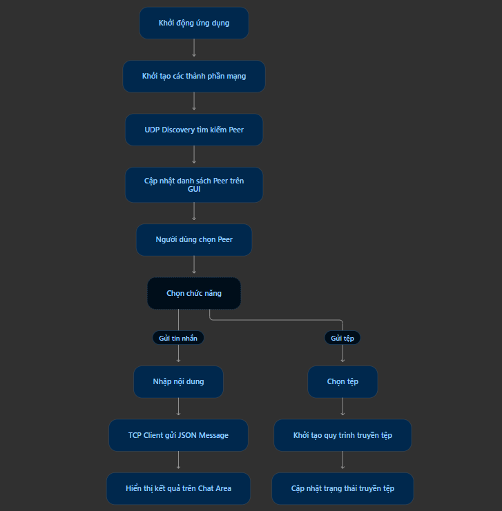
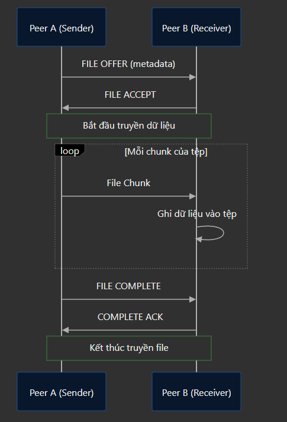

# CHƯƠNG 3: PHÂN TÍCH VÀ THIẾT KẾ HỆ THỐNG
## 3.1. Thiết kế giao diện GUI
### 3.1.1. Các thành phần chính của giao diện
Giao diện người dùng của ứng dụng Chat P2P được thiết kế nhằm hỗ trợ người dùng tìm kiếm Peer, lựa chọn đối tượng giao tiếp, gửi và nhận tin nhắn, đồng thời thực hiện các thao tác truyền tệp. 

Giao diện dự kiến gồm các thành phần chính:
- Peer List: hiển thị danh sách các Peer được phát hiện trong mạng LAN, giúp người dùng lựa chọn đối tượng cần giao tiếp.
- Chat Area: Hiển thị nội dung các tin nhắn được gửi và nhận giữa hai Peer.
- Message Input: khu vực nhập nội dung.
- Send Button: Thực hiện gửi tin nhắn đến Peer đang được lựa chọn.
- File Button: Cho phép người dùng lựa chọn tệp cần gửi.
- Connection Status: Hiển thị trạng thái kết nối của Peer.

Để tránh làm giao diện bị treo trong quá trình trao đổi dữ liệu, các tác vụ mạng cần được thực hiện trên luồng xử lý riêng. Ứng dụng có thể sử dụng QThread kết hợp với cơ chế Signal/Slot của Qt để tác biệt xử lý mạng và xử lý giao diện.

Trong thiết kế này, Main Thread chịu trách nhiệm quản lý giao diện và tiếp nhận thao tác người dùng. Worker Thread thực hiện các tác vụ như lắng nghe kết nối, gửi và nhận dữ liệu. Kêt quả xử lý được chuyển về Main Thread thông qua Signal/Slot để cập nhật giao diện. 

### 3.1.2. Sơ đồ 
Luồng hoạt động của giao diện:




## 3.2. Thiết kế cơ chế truyền file
### 3.2.1. Quy trình truyền file
Chức năng truyền tệp cho phép các Peer trao đổi dữ liệu dạng tệp trực tiếp thông qua kết nối TCP. Khác với tin nhắn văn bản, dữ liệu file có thể có dung lượng lớn nên cần được quản lý và truyền theo từng phần.

Các thành phần trong quy trình truyền file
| Trường | Ý nghĩa |
|---|---|
| `transfer_id` | mã định danh riêng cho một lần truyền file |
| `file_name` | tên tệp cần truyền |
| `file_size` | tổng dung lượng tệp tính bằng byte |
| `chunk_size` | kích thước mỗi phần dữ liệu |
| `total_chunks` | kích thước mỗi phần dữ liệu |
| `action` | hành động trong quy trình: FILE_OFFER, FILE_ACCEPT, FILE_REJECT, FILE_COMPLETE hoặc FILE_ERROR| 

Ví dụ:
```json
{
    "header": {
    "message_id": "550e8400-e29b-41d4-a716-446655440001",
    "message_type": "FILE",
    "sender_id": "peer_A",
    "receiver_id": "peer_B",
    "timestamp": "2026-11-09T10:30:00+00:00" 
    },
    "payload":{
        "message_id": "550e8400-e29b-41d4-a716-446655440001",
        "message_type": "FILE",
        "sender_id": "peer_A",
        "receiver_id": "peer_B",
        "timestamp": "2026-11-09T10:30:00+00:00"   
    }
}
```


Quy trình truyền tệp được thiết kế như sau: 
1. Peer gửi lựa chọn tệp cần truyền và thu thập các thông tin như tên tệp, dung lượng và kích thước mỗi phần dữ liệu. 
2. Peer gửi tạo thông điệp FILE với hành động OFFER để thông báo cho Peer nhận về tệp cần truyền. 
3. Peer nhận kiểm tra thông tin và phản hồi bằng ACCEPT nếu đồng ý nhận tệp hoặc REJECT nếu từ chối.
4. Khi nhận được ACCEPT, Peer gửi chia dữ liệu tệp thành các phần nhỏ (chunks) và truyền lần lượt qua kết nối TCP.
5. Peer nhận tiếp nhận các phần dữ liệu, ghi vào tệp đích và theo dõi tiến độ truyền. 
6. Khi toàn bộ dữ liệu được truyền thành công, hệ thống gửi thông báo COMPLETE để kết thúc quá trình.

Trong quá trình truyền, hệ thống sử dụng transfer_id để phân biệt các phiên truyền tệp. Các trường file_size, chunk_size và total_chunks được sử dụng để quản lý kích thước và số lượng phần dữ liệu cần truyền. 

Việc chia tệp thành các phần nhỏ giúp hệ thống dễ dàng theo dõi tiến độ, kiểm tra dữ liệu nhận được và xử lý các tình huống gián đoạn trong quá trình truyền. Ngoài ra, hệ thống cần kiểm tra tính hợp lệ của tên tệp, dung lượng và dữ liệu được trước khi hoàn tất quá trình ghi tệp. 

### 3.2.2. Sơ đồ 
Sơ đồ trình tự truyền file




## 3.3. Thiết kế chức năng gửi và nhận tin nhắn
### 3.3.1. Mục tiêu chức năng 
Chức năng gửi và nhận tin nhắn cho phép các Peer trao đổi nội dung văn bản trực tiếp với nhau thông qua kết nối TCP

## 3.4. Thiết kế chức năng Reply và Forward
## 3.5. Thiết kế quy trình truyền file
## 3.6. Thiết kế cơ chế bảo mật và xử lý 