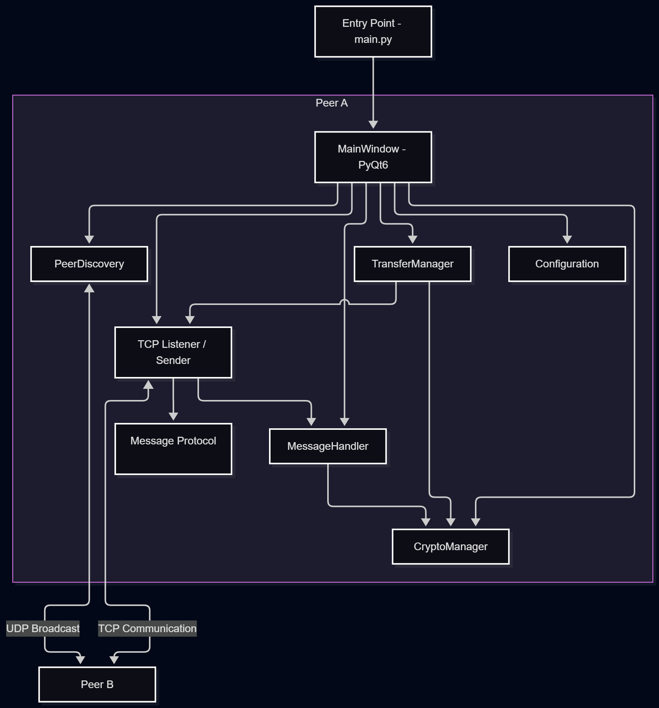
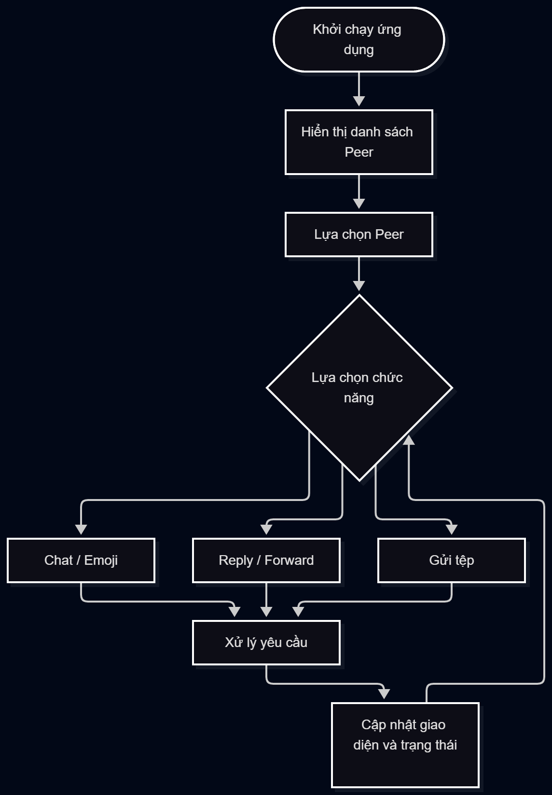
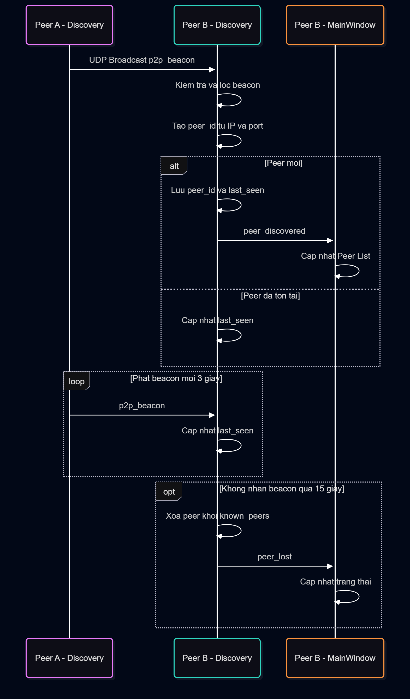
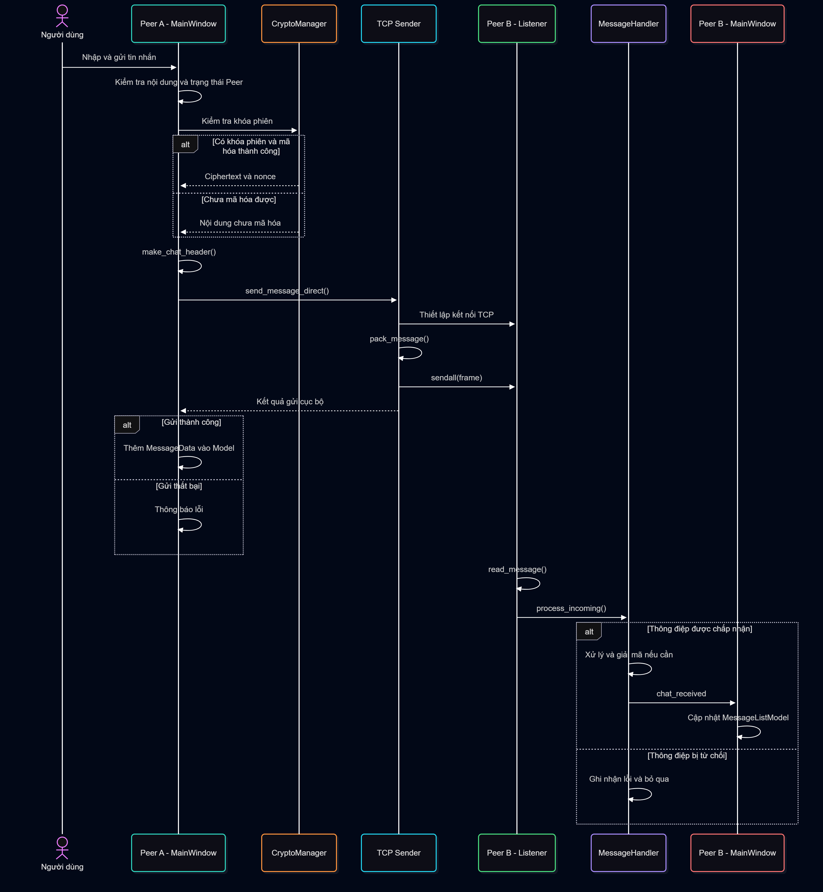
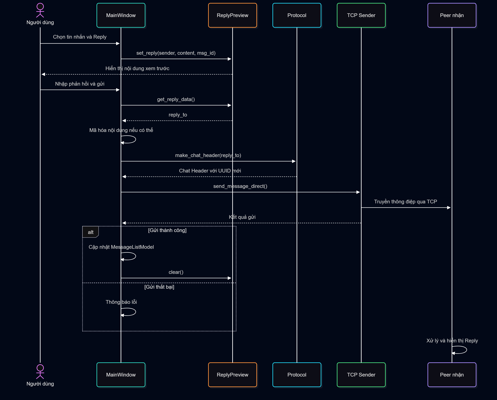
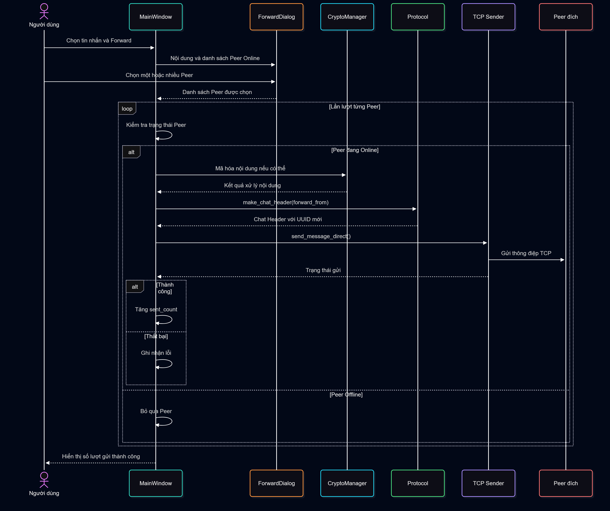
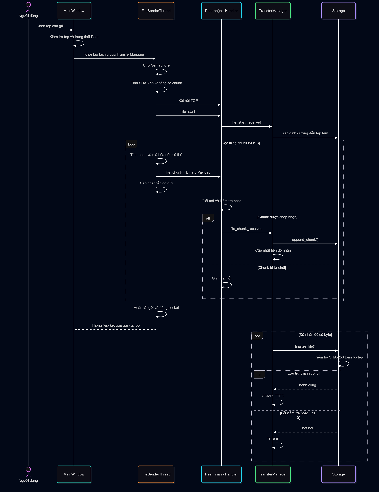
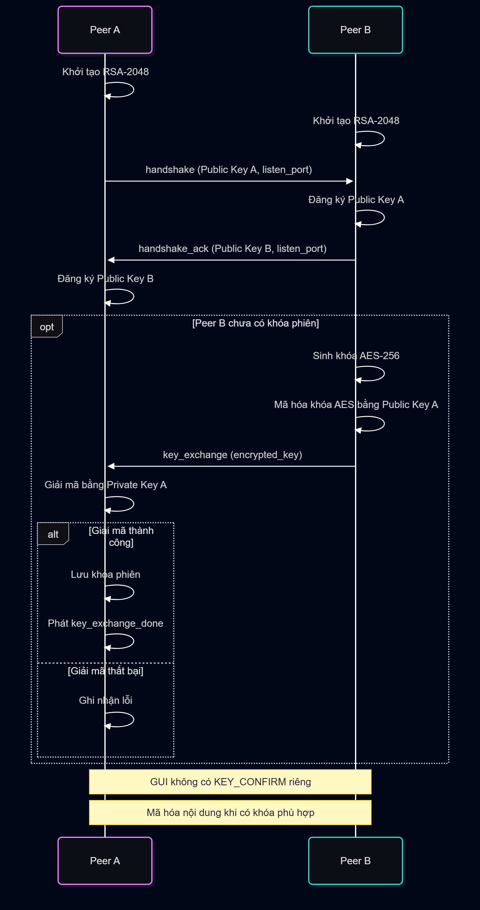
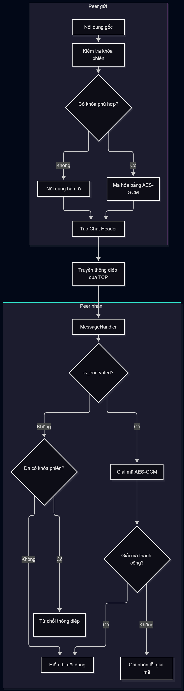
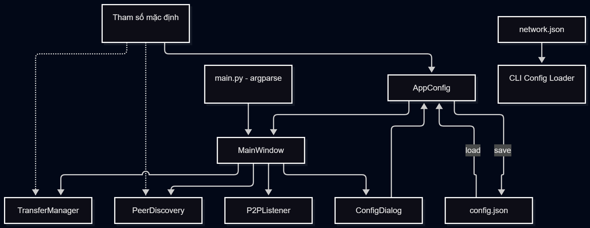

# CHƯƠNG 3: PHÂN TÍCH VÀ THIẾT KẾ HỆ THỐNG

## 3.1. Thiết kế kiến trúc tổng thể

### 3.1.1. Mô hình kiến trúc hệ thống

Ứng dụng P2P Chat & File Transfer Application được thiết kế theo mô hình ngang hàng (Peer-to-Peer), trong đó các thiết bị có thể trực tiếp phát hiện, thiết lập kết nối và trao đổi dữ liệu với nhau mà không cần thông qua máy chủ trung tâm.

Mỗi Peer chạy một phiên bản của ứng dụng và có khả năng thực hiện các chức năng:

- Phát hiện các Peer khác trong mạng LAN thông qua UDP Broadcast.
- Lắng nghe và chủ động thiết lập kết nối TCP.
- Gửi và nhận tin nhắn.
- Trả lời và chuyển tiếp tin nhắn.
- Gửi và nhận tệp.
- Quản lý khóa và thực hiện mã hóa dữ liệu theo cơ chế bảo mật tương ứng.
- Quản lý thông tin cấu hình và trạng thái giao tiếp.

Hệ thống được tổ chức thành các nhóm thành phần có trách nhiệm riêng biệt nhằm hỗ trợ việc phát triển, tích hợp, kiểm thử và bảo trì mã nguồn.

### 3.1.2. Phân chia các thành phần hệ thống

| Thành phần | Module | Trách nhiệm |
|---|---|---|
| Entry Point | `CODE/main.py` | Tiếp nhận tham số khởi chạy và khởi tạo ứng dụng |
| User Interface | `CODE/ui/` | Hiển thị giao diện và tiếp nhận thao tác người dùng |
| Peer Discovery | `CODE/p2p_node/discovery.py` | Phát hiện Peer thông qua UDP Broadcast |
| TCP Listener | `CODE/p2p_node/listener.py` | Lắng nghe và tiếp nhận kết nối TCP |
| TCP Sender | `CODE/p2p_node/sender.py` | Chủ động kết nối và gửi dữ liệu đến Peer đích |
| Message Handler | `CODE/p2p_node/handler.py` | Phân loại và xử lý thông điệp nhận được |
| Message Protocol | `CODE/shared/protocol.py` | Tạo, đóng gói, đọc và kiểm tra cấu trúc thông điệp theo từng nhóm API |
| File Transfer | `CODE/p2p_node/transfer_manager.py` | Quản lý các tác vụ truyền tệp |
| Security | `CODE/security/` | Quản lý khóa, mã hóa, giải mã và ghi nhận các sự kiện liên quan |
| Configuration | `CODE/config/` | Quản lý các tham số cấu hình ứng dụng |



**Hình 3.1. Kiến trúc tổng thể hệ thống P2P**

### 3.1.3. Cơ chế tích hợp các thành phần

Lớp `MainWindow` trong module `CODE/ui/app.py` đóng vai trò tích hợp giao diện đồ họa với các thành phần xử lý mạng, bảo mật và truyền tệp.

Khi ứng dụng khởi chạy, các thành phần được khởi tạo theo trình tự tổng quát:

1. Tiếp nhận tham số khởi chạy và nạp thông tin cấu hình.
2. Khởi tạo thành phần quản lý bảo mật `CryptoManager`.
3. Khởi tạo thành phần quản lý truyền tệp `TransferManager`.
4. Khởi tạo `MessageHandler` và `P2PListener`.
5. Khởi tạo thành phần `PeerDiscovery`.
6. Xây dựng giao diện và liên kết các Signal/Slot.
7. Khởi động TCP Listener và khởi động Peer Discovery nếu chức năng này được bật.

Các thành phần xử lý mạng thực hiện nhiệm vụ theo trách nhiệm được phân công. Những sự kiện liên quan đến Peer, tin nhắn và truyền tệp được chuyển đến các thành phần tương ứng để xử lý và cập nhật giao diện.

### 3.1.4. Luồng giao tiếp tổng thể

Quá trình giao tiếp giữa hai Peer được mô tả ở mức tổng quan như sau:

1. Các Peer khởi chạy ứng dụng và mở cổng lắng nghe TCP.
2. Peer Discovery phát và tiếp nhận UDP beacon để phát hiện các Peer trong mạng LAN.
3. Thông tin Peer được chuyển đến giao diện để hiển thị danh sách thiết bị khả dụng.
4. Người dùng lựa chọn Peer cần giao tiếp.
5. Ứng dụng thực hiện thiết lập kết nối và các bước trao đổi thông tin bảo mật tương ứng.
6. Người dùng thực hiện các thao tác gửi tin nhắn, trả lời, chuyển tiếp hoặc truyền tệp.
7. Thành phần gửi sử dụng các API protocol tương ứng để đóng gói dữ liệu và truyền qua TCP.
8. Thành phần nhận đọc thông điệp, chuyển đến bộ phận xử lý và cập nhật kết quả lên giao diện.

Quy trình chi tiết của từng chức năng được trình bày trong các mục tiếp theo.

### 3.1.5. Đặc điểm của kiến trúc

Kiến trúc hệ thống được xây dựng theo hướng phân chia trách nhiệm giữa các module giao diện, giao tiếp mạng, xử lý thông điệp, truyền tệp, bảo mật và quản lý cấu hình.

Cách tổ chức này hỗ trợ việc phát triển từng thành phần tương đối độc lập, đồng thời tạo điều kiện cho quá trình tích hợp và kiểm thử.

Việc sử dụng UDP cho Peer Discovery và TCP cho hoạt động trao đổi dữ liệu giúp phân biệt hai nhiệm vụ: phát hiện các thiết bị khả dụng trong mạng và thực hiện giao tiếp có kết nối giữa các thiết bị.

Trong phạm vi đề tài, ứng dụng tập trung vào môi trường mạng LAN. Khả năng hoạt động qua các mạng khác nhau và các giới hạn liên quan được trình bày trong phần đánh giá sản phẩm.

## 3.2. Thiết kế giao diện GUI

### 3.2.1. Mục tiêu thiết kế giao diện

Giao diện người dùng của ứng dụng P2P Chat & File Transfer Application được xây dựng bằng thư viện PyQt6, hướng đến việc cung cấp môi trường giao tiếp trực quan, hỗ trợ người dùng thực hiện các chức năng trao đổi dữ liệu giữa các Peer trong mạng LAN.

Các mục tiêu thiết kế giao diện bao gồm:

- Hiển thị danh sách các Peer khả dụng trong mạng.
- Hỗ trợ lựa chọn Peer để thực hiện giao tiếp.
- Hiển thị nội dung tin nhắn gửi và nhận.
- Hỗ trợ gửi văn bản, emoji, trả lời và chuyển tiếp tin nhắn.
- Hỗ trợ lựa chọn tệp và theo dõi trạng thái truyền tệp.
- Cung cấp thông tin về trạng thái kết nối và cấu hình ứng dụng.
- Hạn chế tình trạng giao diện mất khả năng phản hồi trong quá trình xử lý mạng.

### 3.2.2. Các thành phần chính của giao diện

Giao diện chính được tổ chức thông qua lớp `MainWindow` trong module `CODE/ui/app.py`. Các thành phần giao diện được xây dựng theo từng nhóm chức năng.

| Thành phần | Vai trò |
|---|---|
| Peer List | Hiển thị danh sách Peer và hỗ trợ lựa chọn đối tượng giao tiếp. |
| Chat Header | Hiển thị thông tin Peer đang được lựa chọn và trạng thái kết nối. |
| Message List | Hiển thị nội dung các tin nhắn trong cuộc trò chuyện. |
| Message Input | Cho phép người dùng nhập nội dung tin nhắn. |
| Send Button | Thực hiện thao tác gửi tin nhắn. |
| Emoji Picker | Cung cấp giao diện lựa chọn biểu tượng cảm xúc. |
| Reply Preview | Hiển thị thông tin tin nhắn đang được trả lời. |
| Forward Dialog | Hỗ trợ lựa chọn Peer nhận nội dung được chuyển tiếp. |
| Avatar Widget | Hiển thị ảnh đại diện người dùng. |
| File Transfer Panel | Hiển thị thông tin, tiến độ và trạng thái của tác vụ truyền tệp. |
| Configuration Dialog | Cung cấp giao diện phục vụ quản lý thông tin cấu hình ứng dụng. |

Các thành phần được phân chia thành những module giao diện riêng nhằm hỗ trợ quá trình phát triển và bảo trì.

| Module | Trách nhiệm |
|---|---|
| `CODE/ui/app.py` | Quản lý cửa sổ chính và tích hợp các chức năng. |
| `CODE/ui/peer_list_widget.py` | Xây dựng thành phần danh sách Peer. |
| `CODE/ui/chat_widgets.py` | Cung cấp các thành phần hiển thị tin nhắn, emoji, avatar và Reply Preview. |
| `CODE/ui/file_row.py` | Cung cấp thành phần hiển thị tác vụ truyền tệp. |
| `CODE/ui/dialogs.py` | Cung cấp các hộp thoại hỗ trợ thao tác người dùng. |
| `CODE/ui/dnd.py` | Hỗ trợ xử lý thao tác kéo và thả tệp. |
| `CODE/ui/styles.qss` | Quy định kiểu trình bày của các thành phần giao diện. |

Đối với việc hiển thị tin nhắn, ứng dụng sử dụng `QListView` kết hợp với các thành phần `MessageListModel` và `MessageDelegate` để quản lý dữ liệu và trình bày nội dung cuộc trò chuyện.

### 3.2.3. Luồng tương tác của người dùng

Quá trình tương tác với giao diện được thiết kế theo các bước tổng quát:

1. Người dùng khởi chạy ứng dụng.
2. Hệ thống khởi tạo giao diện, các thành phần xử lý mạng và cấu hình tương ứng.
3. Khi phát hiện Peer trong mạng LAN, hệ thống cập nhật thông tin Peer vào danh sách trên giao diện.
4. Người dùng lựa chọn Peer cần giao tiếp.
5. Giao diện hiển thị thông tin và nội dung cuộc trò chuyện tương ứng.
6. Người dùng lựa chọn thao tác gửi tin nhắn, trả lời, chuyển tiếp hoặc truyền tệp.
7. Thành phần giao diện chuyển yêu cầu đến các module xử lý tương ứng.
8. Kết quả xử lý và các sự kiện phát sinh được sử dụng để cập nhật giao diện.

Đối với chức năng gửi tin nhắn, người dùng có thể nhập nội dung và thực hiện thao tác gửi thông qua nút Send hoặc phím Enter.

Đối với chức năng truyền tệp, người dùng có thể lựa chọn tệp thông qua giao diện chọn tệp hoặc thực hiện thao tác kéo và thả vào khu vực được hỗ trợ.

Các luồng xử lý chi tiết của từng chức năng được trình bày ở những mục tiếp theo.



**Hình 3.2. Luồng tương tác của người dùng với giao diện ứng dụng P2P**

### 3.2.4. Tổ chức xử lý sự kiện giao diện

Ứng dụng sử dụng cơ chế Signal/Slot của PyQt6 để liên kết các sự kiện giao diện với những thành phần xử lý tương ứng.

Các thao tác như lựa chọn Peer, nhập nội dung tin nhắn, gửi tin nhắn hoặc lựa chọn tệp được tiếp nhận thông qua giao diện và chuyển đến các phương thức xử lý trong lớp `MainWindow`.

Bên cạnh đó, các thành phần mạng cũng phát tín hiệu khi xảy ra những sự kiện cần cập nhật giao diện.

| Sự kiện | Thành phần liên quan | Mục đích |
|---|---|---|
| Phát hiện Peer mới | `PeerDiscovery` | Cập nhật danh sách Peer khả dụng. |
| Peer mất tín hiệu | `PeerDiscovery` | Cập nhật thông tin trạng thái Peer. |
| Tiếp nhận kết nối TCP | `P2PListener` | Thông báo sự kiện kết nối đến. |
| Tiếp nhận thông điệp | `MessageHandler` | Chuyển thông tin đến bộ phận xử lý tương ứng. |
| Tiến độ truyền tệp | `TransferManager` và các thành phần liên quan | Cập nhật thông tin tiến độ và trạng thái truyền. |

Việc kết hợp Signal/Slot với các thành phần xử lý trên luồng nền giúp phân chia trách nhiệm giữa giao diện và hoạt động giao tiếp mạng.

Cách tổ chức này hướng đến việc duy trì khả năng tương tác của người dùng trong khi ứng dụng thực hiện các tác vụ mạng. Mức độ đáp ứng thực tế của giao diện được đánh giá thông qua các kịch bản kiểm thử hệ thống.

## 3.3. Thiết kế cơ chế Peer Discovery

### 3.3.1. Mục tiêu thiết kế

Cơ chế Peer Discovery được xây dựng nhằm hỗ trợ các Peer tự động phát hiện sự hiện diện của nhau trong mạng LAN mà không cần sử dụng máy chủ trung tâm.

Các mục tiêu của cơ chế Peer Discovery bao gồm:

- Tự động thông báo sự hiện diện của Peer.
- Thu thập thông tin địa chỉ IP, cổng TCP và tên hiển thị của các Peer khác.
- Hạn chế việc nhận diện chính phiên chạy của ứng dụng.
- Theo dõi trạng thái khả dụng của các Peer dựa trên thời điểm nhận beacon gần nhất.
- Cung cấp thông tin cho giao diện và các thành phần thiết lập kết nối TCP.

### 3.3.2. Thiết kế thành phần Peer Discovery

Trong ứng dụng GUI, cơ chế Peer Discovery được triển khai thông qua lớp `PeerDiscovery` trong module `CODE/p2p_node/discovery.py`.

Lớp này kế thừa `QThread` của PyQt6 để thực hiện các tác vụ gửi và nhận UDP beacon trên luồng nền.

Các thành phần và thuộc tính chính của lớp bao gồm:

| Thành phần | Trách nhiệm |
|---|---|
| `username` | Lưu tên hiển thị của Peer hiện tại. |
| `listen_port` | Lưu cổng TCP mà Peer sử dụng để tiếp nhận kết nối. |
| `discovery_port` | Xác định cổng UDP phục vụ Peer Discovery. |
| `_instance_id` | Định danh duy nhất của phiên chạy ứng dụng. |
| `_known_peers` | Lưu định danh và thời điểm phát hiện gần nhất của các Peer. |
| `_is_running` | Kiểm soát trạng thái thực thi của luồng Discovery. |
| `peer_discovered` | Tín hiệu thông báo phát hiện Peer mới. |
| `peer_lost` | Tín hiệu thông báo Peer không còn được phát hiện. |

Các phương thức chính:

| Phương thức | Chức năng |
|---|---|
| `__init__()` | Khởi tạo thông tin và trạng thái của thành phần Discovery. |
| `run()` | Thực hiện vòng lặp gửi, nhận beacon và kiểm tra timeout. |
| `update_info()` | Cập nhật thông tin tên hiển thị và cổng TCP. |
| `stop()` | Yêu cầu dừng luồng xử lý Discovery. |

### 3.3.3. Thiết kế cấu hình Discovery

Các tham số mặc định của cơ chế Discovery trong GUI được khai báo tại `CODE/config/__init__.py`.

| Tham số | Giá trị mặc định | Ý nghĩa |
|---|---|---|
| `DISCOVERY_BROADCAST_IP` | `255.255.255.255` | Địa chỉ IPv4 Broadcast. |
| `DEFAULT_DISCOVERY_PORT` | `37020` | Cổng UDP phục vụ Discovery. |
| `DISCOVERY_INTERVAL` | `3 giây` | Khoảng thời gian giữa các lần phát beacon. |
| `HEARTBEAT_TIMEOUT` | `15 giây` | Ngưỡng thời gian không nhận được beacon trước khi xác định Peer mất tín hiệu. |
| `DEFAULT_LISTEN_PORT` | `9001` | Cổng TCP mặc định của ứng dụng. |

Việc phân biệt cổng UDP Discovery và cổng TCP Listener giúp các Peer thực hiện hai nhiệm vụ riêng biệt: phát hiện thiết bị trong mạng và trao đổi dữ liệu có kết nối.

Cấu trúc thông điệp beacon được trình bày tại mục 2.3.4 của Chương 2.

### 3.3.4. Quy trình phát hiện Peer

Quy trình phát hiện Peer trong ứng dụng GUI được thiết kế như sau:

1. Khi ứng dụng khởi chạy, lớp `MainWindow` khởi tạo đối tượng `PeerDiscovery` với tên hiển thị và cổng TCP tương ứng.

2. Nếu chức năng Discovery được bật, ứng dụng khởi động luồng `PeerDiscovery`.

3. Thành phần Discovery khởi tạo UDP socket phục vụ việc gửi và nhận beacon.

4. Theo chu kỳ được cấu hình, Peer tạo thông điệp `p2p_beacon` và gửi đến địa chỉ Broadcast thông qua cổng UDP Discovery.

5. Khi tiếp nhận beacon, Peer nhận giải mã dữ liệu JSON và kiểm tra loại thông điệp.

6. Hệ thống áp dụng các điều kiện lọc để hạn chế việc nhận diện chính phiên chạy của mình.

7. Địa chỉ IP nguồn của datagram được kết hợp với trường `port` trong beacon để tạo định danh Peer dưới dạng `IP:port`.

8. Hệ thống kiểm tra định danh Peer trong `_known_peers` và cập nhật thời điểm phát hiện gần nhất.

9. Nếu đây là Peer mới, thành phần Discovery phát tín hiệu `peer_discovered`.

10. Giao diện tiếp nhận tín hiệu và cập nhật thông tin Peer, phục vụ quá trình lựa chọn đối tượng giao tiếp.

Cơ chế Discovery chỉ cung cấp thông tin để xác định Peer khả dụng trong mạng. Việc phát hiện Peer không đồng nghĩa kết nối TCP hoặc phiên bảo mật giữa hai Peer đã được thiết lập thành công.



**Hình 3.3. Sơ đồ trình tự phát hiện và theo dõi trạng thái Peer**

### 3.3.5. Thiết kế quản lý trạng thái Peer

Thành phần `PeerDiscovery` sử dụng dictionary `_known_peers` để lưu thông tin theo cấu trúc:

`{peer_id: last_seen_time}`

Trong đó:

- `peer_id`: Định danh Peer được tạo từ địa chỉ IP và cổng TCP.
- `last_seen_time`: Thời điểm gần nhất mà thành phần Discovery ghi nhận beacon của Peer.

Khi nhận được beacon từ một Peer đã tồn tại, hệ thống cập nhật `last_seen_time` mà không cần phát lại tín hiệu phát hiện Peer mới.

Trong mỗi vòng lặp xử lý, hệ thống kiểm tra khoảng thời gian kể từ lần ghi nhận beacon gần nhất.

Nếu khoảng thời gian này vượt quá giá trị `HEARTBEAT_TIMEOUT`, hệ thống thực hiện:

1. Loại bỏ định danh Peer khỏi `_known_peers`.
2. Phát tín hiệu `peer_lost`.
3. Thông báo cho giao diện để cập nhật trạng thái tương ứng.

Nếu Peer tiếp tục phát beacon sau khi đã bị loại khỏi danh sách theo dõi, thành phần Discovery có thể phát hiện lại Peer và phát tín hiệu `peer_discovered`.

Cơ chế timeout phản ánh trạng thái phát hiện Peer thông qua UDP beacon, không phải là kết quả xác minh trực tiếp trạng thái của mọi kết nối TCP.

### 3.3.6. Tích hợp Peer Discovery với giao diện

Thành phần Peer Discovery hoạt động trên luồng nền và giao tiếp với giao diện thông qua cơ chế Signal/Slot.

| Tín hiệu | Dữ liệu | Mục đích |
|---|---|---|
| `peer_discovered` | `peer_id`, `username`, `ip`, `port` | Thông báo phát hiện Peer mới. |
| `peer_lost` | `peer_id` | Thông báo Peer đã vượt quá ngưỡng timeout. |

Lớp `MainWindow` tiếp nhận những tín hiệu này để quản lý thông tin Peer và cập nhật giao diện tương ứng.

Việc phân chia giữa thành phần Discovery và giao diện giúp tách biệt hoạt động giao tiếp UDP với quá trình hiển thị thông tin, đồng thời hạn chế sự phụ thuộc trực tiếp giữa hai thành phần.

### 3.3.7. Phạm vi và giới hạn thiết kế

Cơ chế Peer Discovery hiện tại được thiết kế chủ yếu cho môi trường mạng LAN sử dụng IPv4 Broadcast.

Khả năng phát hiện Peer phụ thuộc vào cấu hình mạng, cổng UDP, chính sách tường lửa và khả năng truyền broadcast giữa các thiết bị.

Do UDP không bảo đảm mọi datagram đều được tiếp nhận, hệ thống sử dụng cơ chế phát beacon định kỳ kết hợp timeout để duy trì danh sách Peer được phát hiện.

Cơ chế này không mặc nhiên hỗ trợ phát hiện Peer qua Internet hoặc giữa các mạng không có khả năng chuyển tiếp broadcast.

## 3.4. Thiết kế chức năng gửi và nhận tin nhắn

### 3.4.1. Mục tiêu chức năng

Chức năng gửi và nhận tin nhắn cho phép các Peer trao đổi nội dung trực tiếp với nhau thông qua kết nối TCP trong mạng LAN mà không cần sử dụng máy chủ trung tâm.

Chức năng được thiết kế với các mục tiêu:

- Hỗ trợ gửi và nhận tin nhắn văn bản.
- Hỗ trợ nội dung Unicode, bao gồm tiếng Việt và emoji.
- Quản lý nội dung cuộc trò chuyện theo từng Peer.
- Định danh thông điệp để hỗ trợ chức năng Reply và Forward.
- Mã hóa và giải mã nội dung theo trạng thái khóa phiên.
- Thông báo các lỗi phát sinh trong quá trình gửi dữ liệu.
- Cập nhật giao diện dựa trên kết quả xử lý.

### 3.4.2. Các thành phần tham gia xử lý

Quá trình gửi và nhận tin nhắn có sự phối hợp giữa các thành phần giao diện, giao tiếp mạng, protocol và bảo mật.

| Thành phần | Module | Trách nhiệm |
|---|---|---|
| `MainWindow` | `CODE/ui/app.py` | Tiếp nhận thao tác gửi và cập nhật nội dung cuộc trò chuyện. |
| `CryptoManager` | `CODE/security/crypto_manager.py` | Quản lý khóa phiên, mã hóa và giải mã nội dung. |
| `make_chat_header()` | `CODE/shared/protocol.py` | Tạo Header của thông điệp Chat. |
| `pack_message()` | `CODE/shared/protocol.py` | Đóng gói thông điệp thành dữ liệu byte. |
| `send_message_direct()` | `CODE/p2p_node/sender.py` | Thiết lập kết nối TCP, gửi dữ liệu và đóng socket. |
| `P2PListener` | `CODE/p2p_node/listener.py` | Lắng nghe và tiếp nhận kết nối TCP. |
| `read_message()` | `CODE/shared/protocol.py` | Đọc và tái tạo Header cùng Payload từ socket. |
| `MessageHandler` | `CODE/p2p_node/handler.py` | Phân loại và xử lý thông điệp nhận được. |
| `MessageListModel` | `CODE/ui/chat_widgets.py` | Quản lý dữ liệu tin nhắn phục vụ hiển thị. |

### 3.4.3. Thiết kế cấu trúc thông điệp Chat

Trong luồng GUI, tin nhắn được biểu diễn bằng Header có trường `type` mang giá trị `chat`.

Các trường chính của thông điệp bao gồm:

| Trường | Kiểu dữ liệu | Ý nghĩa |
|---|---|---|
| `msg_id` | String (UUID) | Định danh duy nhất của thông điệp. |
| `type` | String | Loại thông điệp, có giá trị `chat`. |
| `sender` | String | Tên hiển thị của Peer gửi. |
| `sender_port` | Integer | Cổng TCP Listener của Peer gửi. |
| `text` | String | Nội dung văn bản hoặc nội dung đã mã hóa dưới dạng Base64. |
| `is_encrypted` | Boolean | Xác định nội dung có được mã hóa hay không. |
| `nonce` | String hoặc Null | Giá trị nonce phục vụ giải mã nếu nội dung được mã hóa. |
| `timestamp` | Number | Thời điểm tạo thông điệp dưới dạng Unix timestamp. |
| `payload_size` | Integer | Kích thước Payload nhị phân đi kèm. |
| `reply_to` | Object (tùy chọn) | Thông tin tham chiếu đến tin nhắn được trả lời. |
| `forward_from` | Object (tùy chọn) | Thông tin nguồn của nội dung được chuyển tiếp. |

Các thông điệp Chat được tạo bởi hàm `make_chat_header()` và đóng gói bằng `pack_message()` theo cơ chế Message Framing đã trình bày tại mục 2.5.3.

Đối với thao tác gửi tin nhắn văn bản thông thường trong GUI, nội dung được đặt trong trường `text` của Header và không cần Payload nhị phân đi kèm.

### 3.4.4. Quy trình gửi tin nhắn

Quy trình gửi tin nhắn được triển khai thông qua phương thức `_send_chat_message()` của lớp `MainWindow`.

1. Người dùng lựa chọn Peer cần giao tiếp và nhập nội dung tin nhắn.
2. Người dùng nhấn nút Send hoặc phím Enter.
3. Hệ thống kiểm tra nội dung tin nhắn và thông tin Peer đang được lựa chọn.
4. Nếu Peer không tồn tại hoặc đang ở trạng thái Offline, hệ thống không tiếp tục gửi và thông báo lỗi phù hợp.
5. Hệ thống lấy địa chỉ IP và cổng TCP của Peer đích.
6. Thành phần bảo mật kiểm tra sự tồn tại của khóa phiên và thực hiện mã hóa nội dung nếu có thể.
7. Hàm `make_chat_header()` tạo Header của thông điệp.
8. Hệ thống bổ sung `sender_port` để cung cấp thông tin cổng lắng nghe của Peer gửi.
9. Hàm `send_message_direct()` thiết lập kết nối TCP đến Peer đích.
10. Hàm `pack_message()` đóng gói dữ liệu và dữ liệu được gửi qua `sendall()`.
11. Socket gửi được đóng sau khi thao tác kết thúc.
12. Nếu thao tác gửi thành công, hệ thống tạo đối tượng `MessageData` và cập nhật nội dung cuộc trò chuyện trên giao diện.
13. Nếu phát sinh lỗi gửi, hệ thống xử lý trạng thái kết nối và hiển thị thông báo phù hợp.

Trong luồng này, trạng thái gửi thành công phản ánh việc thao tác gửi dữ liệu qua socket đã hoàn thành mà không phát sinh ngoại lệ. Trạng thái đó không đồng nghĩa Peer nhận đã đọc hoặc hiển thị thành công tin nhắn.

### 3.4.5. Quy trình nhận tin nhắn

Quá trình tiếp nhận tin nhắn được thực hiện thông qua `P2PListener`, `MessageHandler` và các phương thức xử lý sự kiện của giao diện.

1. Thành phần `P2PListener` lắng nghe kết nối tại cổng TCP của ứng dụng.
2. Khi tiếp nhận kết nối, hệ thống tạo luồng xử lý dữ liệu tương ứng.
3. Hàm `read_message()` đọc dữ liệu từ socket và tái tạo Header cùng Payload.
4. Dữ liệu được chuyển đến phương thức `process_incoming()` của `MessageHandler`.
5. Thành phần xử lý kiểm tra trường `type` để xác định loại thông điệp.
6. Đối với thông điệp `chat`, hệ thống lấy nội dung, thông tin bên gửi, thời gian và các metadata liên quan.
7. Nếu thông điệp được đánh dấu đã mã hóa, thành phần bảo mật thực hiện giải mã bằng khóa phiên tương ứng.
8. Thành phần xử lý tạo dữ liệu tin nhắn và phát tín hiệu `chat_received`.
9. Lớp `MainWindow` tiếp nhận tín hiệu thông qua phương thức `_on_chat_received()`.
10. Hệ thống xác định Peer tương ứng, tạo đối tượng `MessageData` và bổ sung tin nhắn vào `MessageListModel`.
11. Giao diện cập nhật nội dung cuộc trò chuyện và thông tin tin nhắn gần nhất trong danh sách Peer.

Việc sử dụng `sender_port` hỗ trợ nhận diện Peer gửi một cách nhất quán, do cổng nguồn của kết nối TCP có thể là cổng tạm thời khác với cổng lắng nghe chính thức của Peer.



**Hình 3.4. Sơ đồ trình tự gửi và nhận tin nhắn giữa hai Peer**

### 3.4.6. Quản lý dữ liệu cuộc trò chuyện

Trong lớp `MainWindow`, dữ liệu tin nhắn được quản lý thông qua dictionary `_message_models`.

Cấu trúc quản lý tổng quát:

- Key: Định danh của Peer.
- Value: Đối tượng `MessageListModel` tương ứng với cuộc trò chuyện.

Mỗi tin nhắn được biểu diễn thông qua đối tượng `MessageData`, chứa các thông tin như:

| Thuộc tính | Ý nghĩa |
|---|---|
| `msg_id` | Định danh thông điệp. |
| `sender` | Tên hiển thị của người gửi. |
| `content` | Nội dung hiển thị của tin nhắn. |
| `timestamp` | Thời điểm tạo thông điệp. |
| `is_sent` | Phân biệt tin nhắn gửi đi và nhận được. |
| `reply_to` | Thông tin tin nhắn được trả lời. |
| `forward_from` | Thông tin nguồn của tin nhắn chuyển tiếp. |
| `avatar_path` | Thông tin ảnh đại diện phục vụ hiển thị. |

Cách tổ chức này cho phép ứng dụng quản lý nội dung theo từng Peer và hiển thị cuộc trò chuyện tương ứng khi người dùng thay đổi đối tượng giao tiếp.

### 3.4.7. Xử lý lỗi và giới hạn

Các tình huống xử lý lỗi liên quan đến chức năng gửi và nhận tin nhắn bao gồm:

| Tình huống | Hành vi xử lý |
|---|---|
| Nội dung tin nhắn rỗng | Không thực hiện thao tác gửi. |
| Chưa lựa chọn Peer | Không thực hiện thao tác gửi. |
| Peer đang Offline | Thông báo không thể gửi tin nhắn. |
| Kết nối TCP bị từ chối hoặc hết thời gian chờ | Ghi nhận lỗi và trả về trạng thái gửi thất bại. |
| Kết nối bị gián đoạn | Xử lý trạng thái kết nối và hiển thị thông báo phù hợp. |
| Giải mã tin nhắn thất bại | Ghi nhận lỗi và hiển thị thông báo lỗi giải mã. |
| Nhận tin nhắn không mã hóa khi đã có khóa phiên tương ứng | Từ chối thông điệp theo điều kiện kiểm tra của MessageHandler. |

Trong phiên bản mã nguồn hiện tại, phương thức `_encrypt_text_if_ready()` thực hiện mã hóa nội dung khi có khóa phiên và thao tác mã hóa thành công. Nếu điều kiện này không được đáp ứng, phương thức có thể trả về nội dung chưa mã hóa.

Do đó, không thể khẳng định mọi tin nhắn đều luôn được mã hóa trong tất cả trạng thái hoạt động.

Ngoài ra, luồng gửi tin nhắn thông thường chưa thể hiện cơ chế xác nhận riêng ở tầng ứng dụng rằng Peer nhận đã hiển thị hoặc đọc tin nhắn. Những giới hạn này cần được xem xét khi đánh giá mức độ hoàn thiện của sản phẩm.

## 3.5. Thiết kế chức năng Reply và Forward

### 3.5.1. Mục tiêu chức năng

Bên cạnh chức năng gửi và nhận tin nhắn thông thường, ứng dụng P2P Chat & File Transfer Application cung cấp hai chức năng mở rộng nhằm hỗ trợ quá trình trao đổi thông tin giữa các Peer:

- **Reply:** Cho phép người dùng trả lời một tin nhắn cụ thể, đồng thời hiển thị thông tin tham chiếu đến tin nhắn được trả lời.
- **Forward:** Cho phép người dùng chuyển tiếp nội dung của một tin nhắn đến một hoặc nhiều Peer được lựa chọn.

Hai chức năng được xây dựng dựa trên cơ chế gửi và nhận thông điệp Chat hiện có, thông qua việc bổ sung metadata vào Header thay vì xây dựng cơ chế truyền thông riêng biệt.

### 3.5.2. Các thành phần tham gia xử lý

| Thành phần | Trách nhiệm |
|---|---|
| `MainWindow` | Tiếp nhận thao tác Reply và Forward, điều phối quá trình gửi dữ liệu. |
| `MessageData` | Biểu diễn nội dung và thông tin của tin nhắn. |
| `MessageListModel` | Quản lý danh sách tin nhắn của từng Peer. |
| `ReplyPreview` | Quản lý và hiển thị thông tin tin nhắn đang được trả lời. |
| `ForwardDialog` | Hiển thị nội dung cần chuyển tiếp và hỗ trợ lựa chọn Peer nhận. |
| `CryptoManager` | Hỗ trợ mã hóa và giải mã nội dung tin nhắn. |
| `make_chat_header()` | Tạo Header với metadata Reply hoặc Forward tương ứng. |
| `send_message_direct()` | Thiết lập kết nối TCP và gửi thông điệp. |
| `MessageHandler` | Xử lý thông điệp nhận được và chuyển dữ liệu đến giao diện. |
| `MessageDelegate` | Tham gia trình bày nội dung tin nhắn trên giao diện. |

### 3.5.3. Thiết kế chức năng Reply

#### a. Cấu trúc dữ liệu

Chức năng Reply sử dụng trường `reply_to` trong Header của thông điệp `chat`.

Trường này được tạo và quản lý bởi lớp `ReplyPreview` trong `CODE/ui/chat_widgets.py`.

| Trường | Kiểu dữ liệu | Ý nghĩa |
|---|---|---|
| `msg_id` | String | Định danh của tin nhắn được trả lời. |
| `sender` | String | Tên hiển thị của người gửi tin nhắn được trả lời. |
| `content` | String | Nội dung của tin nhắn được trả lời. |

Ví dụ cấu trúc metadata:

```json
{
  "reply_to": {
    "msg_id": "550e8400-e29b-41d4-a716-446655440001",
    "sender": "Alice",
    "content": "Bạn đã nhận được tài liệu chưa?"
  }
}
```

Thông điệp Reply được tạo mới với một `msg_id` riêng. Trường `reply_to.msg_id` được sử dụng để lưu thông tin tham chiếu đến tin nhắn trước đó.

Việc bổ sung `sender` và `content` vào metadata giúp giao diện có thể hiển thị thông tin trích dẫn mà không nhất thiết phải tìm kiếm lại toàn bộ nội dung tin nhắn gốc.

#### b. Quy trình thực hiện Reply

1. Người dùng lựa chọn một tin nhắn trong cuộc trò chuyện.
2. Người dùng lựa chọn chức năng Reply thông qua Context Menu hoặc nhấp đúp vào tin nhắn.
3. Hệ thống kiểm tra tin nhắn được lựa chọn, không thực hiện Reply đối với tin nhắn hệ thống.
4. Hệ thống lấy thông tin từ đối tượng `MessageData`.
5. Phương thức `set_reply()` của `ReplyPreview` lưu thông tin tin nhắn được trả lời.
6. Giao diện hiển thị khung xem trước nội dung Reply.
7. Người dùng nhập nội dung phản hồi và thực hiện thao tác gửi.
8. Phương thức `_send_chat_message()` lấy metadata thông qua `get_reply_data()`.
9. Hệ thống thực hiện mã hóa nội dung phản hồi theo trạng thái khóa phiên.
10. Hàm `make_chat_header()` tạo thông điệp Chat mới có chứa trường `reply_to`.
11. Thông điệp được đóng gói và truyền đến Peer nhận thông qua TCP.
12. Sau khi thao tác gửi thành công, giao diện cập nhật tin nhắn và xóa trạng thái Reply Preview.

#### c. Quy trình tiếp nhận Reply

Khi Peer nhận tiếp nhận thông điệp thông qua `P2PListener`, dữ liệu được chuyển đến `MessageHandler`.

Thành phần xử lý lấy nội dung tin nhắn và trường `reply_to` từ Header, sau đó phát tín hiệu `chat_received`.

Lớp `MainWindow` tiếp nhận dữ liệu, tạo đối tượng `MessageData` chứa thông tin Reply và bổ sung vào `MessageListModel` tương ứng.

Thông tin tham chiếu được sử dụng để hỗ trợ hiển thị nội dung tin nhắn trả lời trên giao diện.

#### d. Xử lý các trường hợp đặc biệt

- Nếu người dùng hủy Reply trước khi gửi, `ReplyPreview` được xóa và không tiếp tục sử dụng metadata đã lựa chọn.
- Nếu nội dung phản hồi rỗng, hệ thống không thực hiện thao tác gửi.
- Nếu Peer đích đang Offline, hệ thống không tiếp tục gửi tin nhắn.
- Nếu thao tác gửi thất bại, hệ thống thông báo lỗi theo cơ chế gửi tin nhắn thông thường.



**Hình 3.5. Luồng dữ liệu của chức năng Reply**

### 3.5.4. Thiết kế chức năng Forward

#### a. Cấu trúc dữ liệu

Chức năng Forward sử dụng trường `forward_from` trong Header của thông điệp `chat`.

Trong phiên bản hiện tại, metadata Forward có cấu trúc:

| Trường | Kiểu dữ liệu | Ý nghĩa |
|---|---|---|
| `original_sender` | String | Tên hiển thị của người gửi tin nhắn được lựa chọn để chuyển tiếp. |

Ví dụ metadata:

```json
{
  "forward_from": {
    "original_sender": "Alice"
  }
}
```

Nội dung tin nhắn được chuyển tiếp được đặt trong trường `text` của thông điệp Chat mới.

Hệ thống không sao chép toàn bộ nội dung tin nhắn gốc vào `forward_from`. Cách tổ chức này tránh lưu thêm một bản rõ của nội dung trong metadata Forward khi trường `text` đã được mã hóa.

Mỗi thông điệp chuyển tiếp có `msg_id` mới và sử dụng tên của Peer đang thực hiện thao tác chuyển tiếp trong trường `sender`.

#### b. Quy trình thực hiện Forward

1. Người dùng lựa chọn một tin nhắn trong cuộc trò chuyện.
2. Người dùng mở Context Menu và lựa chọn chức năng Forward.
3. Hệ thống kiểm tra tính hợp lệ của tin nhắn được lựa chọn.
4. Phương thức `_trigger_forward()` lấy danh sách các Peer đang Online.
5. Hệ thống hiển thị `ForwardDialog` cùng nội dung cần chuyển tiếp.
6. Người dùng lựa chọn một hoặc nhiều Peer nhận.
7. Sau khi người dùng xác nhận, hệ thống lần lượt xử lý từng Peer được lựa chọn.
8. Đối với mỗi Peer, hệ thống kiểm tra lại thông tin và trạng thái Online.
9. Nội dung được chuyển đến `_encrypt_text_if_ready()` để thực hiện mã hóa theo khóa phiên của Peer đích, nếu có thể.
10. Hệ thống tạo metadata `forward_from` chứa thông tin `original_sender`.
11. Hàm `make_chat_header()` tạo thông điệp Chat mới cho Peer nhận.
12. Thông điệp được gửi thông qua `send_message_direct()`.
13. Hệ thống ghi nhận số lượng thao tác gửi thành công.
14. Sau khi xử lý các Peer được lựa chọn, giao diện hiển thị kết quả tổng hợp trên thanh trạng thái.

Mỗi Peer nhận được xử lý độc lập. Do đó, việc gửi thất bại đến một Peer không mặc nhiên làm dừng toàn bộ thao tác chuyển tiếp đến các Peer còn lại.

#### c. Quy trình tiếp nhận Forward

Peer nhận sử dụng cơ chế tiếp nhận thông điệp Chat tương tự chức năng gửi và nhận tin nhắn thông thường.

`MessageHandler` lấy trường `forward_from` từ Header và chuyển dữ liệu đến giao diện thông qua tín hiệu `chat_received`.

Lớp `MainWindow` tạo đối tượng `MessageData` chứa nội dung và metadata Forward để phục vụ việc hiển thị thông tin nguồn của tin nhắn được chuyển tiếp.

#### d. Xử lý các trường hợp đặc biệt

- Chỉ những Peer đang Online được đưa vào danh sách lựa chọn ban đầu.
- Hệ thống kiểm tra lại trạng thái Peer trước khi thực hiện gửi.
- Nếu một thao tác gửi thất bại, hệ thống ghi nhận lỗi và tiếp tục xử lý các Peer còn lại.
- Kết quả tổng hợp phản ánh số thao tác gửi thành công ở phía gửi, không phải số lượt xác nhận đã đọc từ phía nhận.



**Hình 3.6. Sơ đồ trình tự truyền và tiếp nhận tệp giữa hai Peer**

### 3.5.5. So sánh Reply và Forward

| Tiêu chí | Reply | Forward |
|---|---|---|
| Mục đích | Phản hồi một tin nhắn cụ thể. | Chuyển tiếp nội dung đến Peer khác. |
| Loại thông điệp | `chat` | `chat` |
| Metadata | `reply_to` | `forward_from` |
| Định danh thông điệp | UUID mới | UUID mới |
| Nội dung trường `text` | Nội dung phản hồi do người dùng nhập. | Nội dung tin nhắn được lựa chọn. |
| Thông tin tham chiếu | ID, người gửi và nội dung tin nhắn được trả lời. | Tên người gửi của tin nhắn được lựa chọn. |
| Số lượng Peer nhận | Một Peer trong cuộc trò chuyện hiện tại. | Một hoặc nhiều Peer được lựa chọn. |
| Thành phần giao diện | `ReplyPreview` | `ForwardDialog` |

### 3.5.6. Phạm vi và giới hạn thiết kế

Reply và Forward sử dụng chung cơ chế đóng gói, gửi, nhận và xử lý thông điệp Chat của hệ thống.

Việc sử dụng metadata giúp mở rộng chức năng mà không cần thay đổi cơ chế Message Framing.

Tuy nhiên, phạm vi bảo mật cần được xem xét riêng đối với nội dung và metadata:

- Trường `text` được mã hóa theo trạng thái khóa phiên.
- Metadata `forward_from` không chứa bản sao nội dung chuyển tiếp.
- Metadata `reply_to` hiện chứa cả nội dung của tin nhắn được trả lời.
- JSON Header trong luồng GUI không được mã hóa toàn phần.

Do đó, việc mã hóa trường `text` không đồng nghĩa toàn bộ metadata Reply hoặc Forward đều được bảo vệ tính bí mật.

Ngoài ra, chức năng Forward hiện lưu thông tin người gửi của tin nhắn được lựa chọn, chưa thể hiện đầy đủ lịch sử hoặc chuỗi nguồn gốc của các lần chuyển tiếp trước đó.

Những giới hạn này cần được ghi nhận khi đánh giá phạm vi hoàn thiện và khả năng bảo mật của sản phẩm.

## 3.6. Thiết kế cơ chế truyền tệp

### 3.6.1. Mục tiêu chức năng

Chức năng truyền tệp được thiết kế nhằm cho phép các Peer trao đổi dữ liệu dạng tệp trực tiếp thông qua kết nối TCP trong mạng LAN.

Khác với tin nhắn văn bản, tệp có thể có dung lượng lớn và cần được xử lý theo từng phần dữ liệu để thuận tiện cho việc truyền tải, kiểm tra tính toàn vẹn và quản lý tiến độ.

Các mục tiêu thiết kế bao gồm:

- Hỗ trợ lựa chọn và truyền tệp giữa các Peer.
- Chia tệp thành các phần dữ liệu nhỏ (chunk).
- Quản lý nhiều tác vụ truyền tệp.
- Theo dõi tiến độ, tốc độ và trạng thái truyền.
- Hỗ trợ mã hóa dữ liệu theo trạng thái khóa phiên.
- Kiểm tra tính toàn vẹn của dữ liệu.
- Sử dụng tệp tạm trong quá trình tiếp nhận.
- Hỗ trợ hủy tác vụ và xử lý các tình huống gián đoạn.

### 3.6.2. Các thành phần tham gia xử lý

| Thành phần | Module | Trách nhiệm |
|---|---|---|
| `MainWindow` | `CODE/ui/app.py` | Tiếp nhận thao tác lựa chọn hoặc kéo thả tệp. |
| `TransferManager` | `CODE/p2p_node/transfer_manager.py` | Quản lý và điều phối các tác vụ truyền tệp. |
| `FileSenderThread` | `CODE/p2p_node/transfer_manager.py` | Thực hiện đọc, chia chunk và gửi tệp trên luồng nền. |
| `TransferTask` | `CODE/p2p_node/transfer_task.py` | Quản lý thông tin, trạng thái và tiến độ của tác vụ. |
| `SpeedMeter` | `CODE/p2p_node/speed_meter.py` | Theo dõi tốc độ truyền dữ liệu. |
| `CryptoManager` | `CODE/security/crypto_manager.py` | Hỗ trợ mã hóa, giải mã và tính mã băm. |
| Message Protocol | `CODE/shared/protocol.py` | Tạo Header và đóng gói dữ liệu. |
| `P2PListener` | `CODE/p2p_node/listener.py` | Tiếp nhận dữ liệu truyền qua TCP. |
| `MessageHandler` | `CODE/p2p_node/handler.py` | Phân loại và xử lý thông điệp truyền tệp. |
| Storage | `CODE/p2p_node/storage.py` | Quản lý tên tệp, ghi tệp tạm và hoàn tất lưu trữ. |
| `FileRowWidget` | `CODE/ui/file_row.py` | Hiển thị trạng thái và tiến độ truyền tệp trên giao diện. |

### 3.6.3. Cấu trúc thông điệp truyền tệp

Trong luồng truyền tệp của GUI, hệ thống sử dụng cơ chế JSON Header kết hợp Binary Payload được trình bày tại mục 2.5.3.

Các thông điệp chính gồm:

| Message type | Mục đích |
|---|---|
| `file_start` | Thông báo bắt đầu tác vụ truyền tệp và cung cấp metadata. |
| `file_chunk` | Truyền một phần dữ liệu nhị phân của tệp. |
| `file_cancel` | Thông báo hủy tác vụ truyền tệp. |

**a. Thông điệp file_start**

Thông điệp này cung cấp các thông tin cần thiết để phía nhận khởi tạo tác vụ.

| Trường | Kiểu dữ liệu | Ý nghĩa |
|---|---|---|
| `file_id` | String | Định danh của tác vụ truyền tệp. |
| `file_name` | String | Tên tệp. |
| `file_size` | Integer | Tổng kích thước tệp tính bằng byte. |
| `total_chunks` | Integer | Tổng số chunk dự kiến. |
| `file_hash` | String | Giá trị băm SHA-256 của toàn bộ tệp. |

Thông điệp được tạo thông qua hàm `make_file_start_header()`.

**b. Thông điệp file_chunk**

Thông điệp này bao gồm Header chứa thông tin điều khiển và Binary Payload chứa dữ liệu của chunk.

| Trường | Kiểu dữ liệu | Ý nghĩa |
|---|---|---|
| `file_id` | String | Định danh tác vụ truyền tệp. |
| `chunk_index` | Integer | Số thứ tự của chunk. |
| `chunk_size` | Integer | Kích thước dữ liệu chunk trước khi mã hóa. |
| `chunk_hash` | String | Giá trị băm SHA-256 của chunk trước khi mã hóa. |
| `is_encrypted` | Boolean | Xác định chunk có được mã hóa hay không. |
| `nonce` | String hoặc Null | Giá trị nonce phục vụ quá trình giải mã. |
| `payload_size` | Integer | Kích thước Binary Payload thực tế được truyền. |

Thông điệp được tạo thông qua hàm `make_file_chunk_header()` và đóng gói bằng `pack_message()`.

Cần phân biệt `chunk_size` và `payload_size`. Khi sử dụng AES-GCM, kích thước Payload sau khi mã hóa có thể lớn hơn kích thước dữ liệu ban đầu do thông tin xác thực đi kèm.

**c. Thông điệp file_cancel**

Thông điệp này phục vụ việc thông báo hủy tác vụ truyền tệp.

Các trường đặc trưng gồm:

- `file_id`: Định danh tác vụ cần hủy.
- `reason`: Nội dung mô tả lý do hủy.

Ngoài các loại thông điệp trên, module protocol còn cung cấp hàm `make_file_ack_header()`. Tuy nhiên, luồng `FileSenderThread` đang được phân tích không thể hiện việc chờ ACK riêng cho từng chunk.

Do đó, cần phân biệt các loại thông điệp được module protocol hỗ trợ với những loại thông điệp thực sự được sử dụng trong luồng truyền tệp cụ thể.

### 3.6.4. Quy trình gửi tệp

Luồng gửi tệp được thiết kế thông qua `TransferManager` và `FileSenderThread`.

1. Người dùng lựa chọn Peer và tệp cần gửi thông qua giao diện.
2. Hệ thống kiểm tra sự tồn tại của tệp và trạng thái của Peer.
3. `TransferManager` khởi tạo tác vụ truyền tệp với định danh UUID.
4. Tác vụ được bổ sung vào danh sách quản lý và chuyển đến `FileSenderThread`.
5. Worker chờ Semaphore cho phép thực hiện tác vụ.
6. Hệ thống tính mã băm SHA-256 của toàn bộ tệp.
7. Hệ thống xác định kích thước tệp và tổng số chunk cần truyền.
8. Worker thiết lập kết nối TCP đến Peer nhận.
9. Thông điệp `file_start` được tạo và gửi đến Peer nhận.
10. Tệp được mở ở chế độ đọc nhị phân và đọc lần lượt theo từng chunk.
11. Mỗi chunk được tính mã băm SHA-256 và thực hiện mã hóa nếu có khóa phiên phù hợp.
12. Header và Binary Payload được đóng gói thành thông điệp `file_chunk`.
13. Thông điệp được truyền qua kết nối TCP.
14. Hệ thống cập nhật số byte đã gửi, tốc độ và tiến độ tác vụ.
15. Khi hoàn tất việc gửi dữ liệu, worker cập nhật trạng thái tác vụ và phát tín hiệu thông báo kết quả.
16. Socket được đóng và tài nguyên Semaphore được giải phóng.

Kích thước chunk mặc định được sử dụng trong luồng này là 64 KiB, tương đương 65.536 byte.

Đối với tệp có kích thước lớn hơn 0, tổng số chunk được xác định bằng phép chia làm tròn lên giữa kích thước tệp và kích thước chunk.

Việc sử dụng một kết nối TCP trong quá trình gửi tệp giúp tránh phải thiết lập kết nối mới cho từng chunk.

### 3.6.5. Quy trình nhận tệp

Luồng nhận tệp có sự phối hợp giữa `P2PListener`, `MessageHandler`, `TransferManager` và module Storage.

**a. Tiếp nhận thông điệp file_start**

Khi nhận thông điệp `file_start`, `MessageHandler` phát tín hiệu `file_start_received` để chuyển thông tin đến `TransferManager`.

Thành phần quản lý truyền tệp thực hiện:

1. Lấy metadata của tệp từ Header.
2. Xác định đường dẫn tệp tạm và đường dẫn lưu trữ chính thức.
3. Dọn dẹp tệp tạm cũ nếu tồn tại.
4. Khởi tạo tác vụ nhận tệp.
5. Lưu thông tin tác vụ và thông báo cho giao diện.

**b. Tiếp nhận thông điệp file_chunk**

Khi nhận thông điệp `file_chunk`, hệ thống thực hiện:

1. Đọc Header và Binary Payload thông qua cơ chế Message Framing.
2. Xác định trạng thái mã hóa của chunk.
3. Thực hiện giải mã nếu dữ liệu được mã hóa và có thông tin cần thiết.
4. Đối chiếu SHA-256 của chunk nếu Header cung cấp giá trị băm.
5. Chuyển dữ liệu đã xử lý đến `TransferManager`.
6. Xác định tác vụ tương ứng thông qua `file_id`.
7. Ghi nối tiếp dữ liệu vào tệp tạm.
8. Cập nhật số byte đã nhận và tiến độ tác vụ.

Nếu quá trình giải mã hoặc đối chiếu mã băm không thành công, chunk có thể bị từ chối theo điều kiện xử lý tương ứng.

**c. Hoàn tất nhận tệp**

Khi số byte đã nhận đạt hoặc vượt kích thước tệp được khai báo, `TransferManager` gọi hàm `finalize_file()`.

Module Storage tính mã băm SHA-256 của dữ liệu trong tệp tạm và đối chiếu với giá trị băm dự kiến nếu giá trị này được cung cấp.

Nếu quá trình kiểm tra và lưu trữ thành công, tệp tạm được chuyển thành tệp chính thức.

Nếu xảy ra lỗi hoặc mã băm không khớp, hệ thống ghi nhận trạng thái lỗi và thực hiện dọn dẹp tệp tạm theo nhánh xử lý tương ứng.



**Hình 3.7. Sơ đồ trình tự truyền và tiếp nhận tệp giữa hai Peer**

### 3.6.6. Quản lý tiến độ và trạng thái

Mỗi tác vụ truyền hoặc nhận tệp được quản lý thông qua đối tượng `TransferTask`.

Các thông tin phục vụ quản lý tác vụ bao gồm:

| Thuộc tính | Ý nghĩa |
|---|---|
| `task_id` | Định danh tác vụ. |
| `peer_id` | Định danh Peer liên quan. |
| `direction` | Hướng truyền: Upload hoặc Download. |
| `file_name` | Tên tệp. |
| `file_size` | Tổng kích thước tệp. |
| `total_chunks` | Tổng số chunk dự kiến. |
| `current_chunk` | Thông tin chunk hiện tại ở phía gửi. |
| `transferred_bytes` | Tổng số byte dữ liệu đã xử lý. |
| `status` | Trạng thái tác vụ. |
| `error_msg` | Thông tin lỗi. |
| `is_aborted` | Cờ xác định yêu cầu hủy tác vụ. |

Tiến độ truyền tệp được xác định dựa trên tỷ lệ giữa số byte đã truyền hoặc nhận và tổng kích thước tệp.

Đối với tệp có kích thước lớn hơn 0:

`Progress (%) = (Transferred Bytes / File Size) × 100`

Giá trị hiển thị được giới hạn tối đa ở mức 100%.

Các trạng thái được khai báo trong `TransferStatus` gồm:

| Trạng thái | Ý nghĩa |
|---|---|
| `PENDING` | Tác vụ đang chờ thực hiện. |
| `TRANSFERRING` | Tác vụ đang truyền hoặc nhận dữ liệu. |
| `COMPLETED` | Tác vụ được ghi nhận hoàn tất tại phía xử lý. |
| `ERROR` | Tác vụ gặp lỗi. |
| `CANCELLED` | Tác vụ đã được yêu cầu hủy. |

`TransferManager` sử dụng Semaphore với giới hạn mặc định là 3 để điều phối số lượng worker gửi tệp hoạt động đồng thời.

Giới hạn này áp dụng cho các worker gửi sử dụng Semaphore; không mặc nhiên là giới hạn tổng số tác vụ nhận và gửi của toàn bộ hệ thống.

Các tín hiệu `task_added`, `task_progress`, `task_completed` và `task_failed` phục vụ việc cập nhật thông tin tác vụ trên giao diện.

### 3.6.7. Kiểm tra tính toàn vẹn, bảo mật và lưu trữ

**a. Kiểm tra tính toàn vẹn**

Hệ thống cung cấp cơ chế sử dụng SHA-256 tại hai mức:

- Mức chunk: Kiểm tra dữ liệu của từng phần được truyền.
- Mức toàn bộ tệp: Kiểm tra dữ liệu sau khi hoàn tất tiếp nhận.

Việc kết hợp hai mức kiểm tra giúp hỗ trợ phát hiện dữ liệu không khớp trong quá trình truyền và lưu trữ.

**b. Mã hóa dữ liệu**

Mỗi chunk có thể được mã hóa bằng AES-256-GCM thông qua `CryptoManager` khi tồn tại khóa phiên phù hợp.

Header chứa các trường `is_encrypted` và `nonce` để hỗ trợ bên nhận xử lý dữ liệu.

Phạm vi mã hóa phụ thuộc vào trạng thái thiết lập khóa phiên. Metadata trong JSON Header không được mã hóa toàn phần theo cơ chế này.

**c. Quản lý tệp tạm**

Trong quá trình tiếp nhận, module Storage sử dụng đường dẫn tệp tạm có chứa hậu tố `.part` kết hợp với định danh tác vụ.

Ví dụ:

- Tệp chính thức: `baocao.pdf`
- Tệp tạm: `baocao.pdf.part_<file_id>`

Việc sử dụng tệp tạm giúp phân biệt dữ liệu đang tiếp nhận với tệp đã hoàn tất lưu trữ.

Module Storage cung cấp các hàm:

| Hàm | Chức năng |
|---|---|
| `sanitize_filename()` | Chuẩn hóa tên tệp nhận được. |
| `resolve_filename()` | Xác định tên lưu trữ và xử lý trường hợp tên đã tồn tại. |
| `get_temp_filepath()` | Tạo đường dẫn tệp tạm. |
| `append_chunk()` | Ghi nối tiếp dữ liệu chunk. |
| `finalize_file()` | Kiểm tra dữ liệu và chuyển tệp tạm thành tệp chính thức. |
| `remove_temp_file()` | Dọn dẹp tệp tạm. |

Thư mục lưu tệp mặc định là `CODE/received_files/`.

### 3.6.8. Xử lý lỗi và giới hạn

Các tình huống lỗi được xem xét trong thiết kế bao gồm:

| Tình huống | Hướng xử lý |
|---|---|
| Tệp nguồn không tồn tại | Không khởi tạo tác vụ hoặc thông báo lỗi. |
| Peer đang Offline | Không tiếp tục thao tác gửi. |
| Không thể thiết lập kết nối TCP | Ghi nhận lỗi tác vụ. |
| Giải mã chunk thất bại | Từ chối chunk và ghi nhận lỗi. |
| SHA-256 của chunk không khớp | Từ chối chunk khi thực hiện đối chiếu. |
| SHA-256 toàn bộ tệp không khớp | Ghi nhận lỗi và dọn dẹp tệp tạm. |
| Người dùng hủy tác vụ | Đánh dấu hủy và thực hiện dọn dẹp tài nguyên liên quan. |
| Kết nối bị gián đoạn | Xử lý lỗi và hủy tác vụ phù hợp với trạng thái kết nối. |

Trong luồng `FileSenderThread`, trạng thái hoàn tất phía gửi được xác định sau khi worker hoàn thành việc gửi dữ liệu. Luồng này chưa thể hiện cơ chế chờ xác nhận hoàn tất lưu tệp từ phía nhận.

Do đó, trạng thái `COMPLETED` tại phía gửi không mặc nhiên chứng minh phía nhận đã kiểm tra và lưu trữ tệp thành công.

Ngoài ra, cơ chế nhận hiện được thiết kế theo hướng ghi nối tiếp các chunk. Khả năng tiếp tục truyền từ vị trí gián đoạn, khôi phục tác vụ, xác nhận từng chunk và xử lý tệp rỗng cần được đánh giá riêng.

Nội dung trên mô tả thiết kế và các cơ chế thể hiện trong mã nguồn. Mức độ hoạt động thực tế của toàn bộ chức năng truyền tệp cần được xác nhận thông qua quá trình tích hợp và kiểm thử hệ thống.

## 3.7. Thiết kế cơ chế bảo mật

### 3.7.1. Mục tiêu thiết kế bảo mật

Cơ chế bảo mật của ứng dụng P2P Chat & File Transfer Application được xây dựng nhằm hỗ trợ bảo vệ dữ liệu trao đổi trực tiếp giữa các Peer trong mạng LAN.

Các mục tiêu thiết kế bao gồm:

- Khởi tạo và quản lý khóa mật mã tại từng Peer.
- Hỗ trợ trao đổi khóa phiên thông qua cơ chế mã hóa bất đối xứng.
- Mã hóa và giải mã nội dung tin nhắn.
- Hỗ trợ mã hóa dữ liệu trong quá trình truyền tệp.
- Kiểm tra tính toàn vẹn của dữ liệu.
- Phát hiện và xử lý các trường hợp giải mã thất bại.
- Quản lý khóa theo từng Peer tham gia giao tiếp.

Hệ thống sử dụng cơ chế mã hóa lai RSA-2048 và AES-256-GCM. Cơ sở lý thuyết của các thuật toán được trình bày tại mục 2.7.

### 3.7.2. Các thành phần tham gia xử lý

Trong luồng GUI, cơ chế bảo mật được xây dựng dựa trên sự phối hợp giữa các thành phần sau:

| Thành phần | Module | Trách nhiệm |
|---|---|---|
| `CryptoManager` | `CODE/security/crypto_manager.py` | Khởi tạo, quản lý khóa, mã hóa và giải mã dữ liệu. |
| `MainWindow` | `CODE/ui/app.py` | Điều phối quá trình Handshake, trao đổi khóa và gửi nội dung. |
| Message Protocol | `CODE/shared/protocol.py` | Tạo Header của các thông điệp bảo mật. |
| `MessageHandler` | `CODE/p2p_node/handler.py` | Xử lý các thông điệp trao đổi khóa và dữ liệu nhận được. |
| `P2PListener` | `CODE/p2p_node/listener.py` | Tiếp nhận thông điệp thông qua kết nối TCP. |
| `send_message_direct()` | `CODE/p2p_node/sender.py` | Truyền các thông điệp điều khiển và tin nhắn đến Peer đích. |
| `FileSenderThread` | `CODE/p2p_node/transfer_manager.py` | Hỗ trợ mã hóa từng chunk trong quá trình gửi tệp. |

Thư viện `cryptography` của Python được sử dụng để thực hiện các thao tác mật mã.

Bên cạnh CryptoManager, mã nguồn còn cung cấp nhóm API SessionCrypto tại `CODE/security/crypto.py` và `CODE/security/handshake.py`. Hai nhóm API cần được phân biệt khi mô tả thiết kế và phạm vi tích hợp.

### 3.7.3. Thiết kế quản lý khóa mật mã

#### a. Quản lý cặp khóa RSA

Khi đối tượng `CryptoManager` được khởi tạo, hệ thống sinh một cặp khóa RSA với độ dài 2048 bit.

Cặp khóa bao gồm:

- Public Key: Được sử dụng để trao đổi với các Peer khác.
- Private Key: Được giữ trong bộ nhớ của ứng dụng và sử dụng để giải mã khóa phiên nhận được.

Khóa công khai được xuất dưới định dạng PEM thông qua phương thức `get_public_key_pem()`.

Khi nhận khóa công khai từ Peer đối tác, hệ thống sử dụng phương thức `register_peer_public_key()` để nạp và lưu trữ khóa.

#### b. Quản lý khóa phiên AES

Khóa phiên AES-256 được tạo từ 32 byte ngẫu nhiên bằng bộ sinh số ngẫu nhiên của hệ điều hành.

CryptoManager sử dụng các cấu trúc dữ liệu để quản lý khóa:

| Thuộc tính | Trách nhiệm |
|---|---|
| `_private_key` | Lưu khóa riêng RSA của Peer hiện tại. |
| `_public_key` | Lưu khóa công khai RSA của Peer hiện tại. |
| `_peer_public_keys` | Quản lý khóa công khai của các Peer đối tác. |
| `_peer_session_keys` | Quản lý khóa phiên AES tương ứng với các Peer. |

Khóa của Peer được quản lý thông qua định danh Peer.

Do các kết nối TCP có thể sử dụng cổng nguồn tạm thời, hệ thống sử dụng thông tin địa chỉ IP kết hợp với cổng TCP lắng nghe để hỗ trợ xác định định danh Peer nhất quán.

Các trường `listen_port` và `sender_port` trong những thông điệp tương ứng hỗ trợ quá trình xác định định danh này.

### 3.7.4. Thiết kế quy trình Handshake và Key Exchange

#### a. Các thông điệp trao đổi khóa

Luồng Handshake của GUI sử dụng ba loại thông điệp chính:

| Type | Các trường đặc trưng | Mục đích |
|---|---|---|
| `handshake` | `sender`, `listen_port`, `rsa_public_key`, `avatar_b64` | Khởi tạo quá trình trao đổi thông tin giữa các Peer. |
| `handshake_ack` | `sender`, `listen_port`, `rsa_public_key`, `avatar_b64` | Phản hồi thông tin và khóa công khai của Peer nhận. |
| `key_exchange` | `sender`, `listen_port`, `encrypted_key` | Truyền khóa phiên AES đã được mã hóa bằng RSA. |

Các thông điệp được tạo thông qua những hàm:

- `make_handshake_header()`
- `make_handshake_ack_header()`
- `make_key_exchange_header()`

Những thông điệp trên được đóng gói theo cơ chế JSON Header kết hợp Binary Payload. Trong quá trình trao đổi khóa, thông tin cần truyền chủ yếu được lưu trong Header.

#### b. Quy trình trao đổi khóa

Giả sử Peer A khởi tạo quá trình Handshake với Peer B và Peer B chưa có khóa phiên tương ứng.

Quy trình được thực hiện như sau:

1. Peer A và Peer B khởi tạo CryptoManager và cặp khóa RSA tương ứng.
2. Khi phát hiện Peer B và chưa có khóa phiên, Peer A có thể tự động khởi tạo Handshake.
3. Peer A tạo thông điệp `handshake` chứa khóa công khai RSA, tên hiển thị và cổng TCP lắng nghe của mình.
4. Thông điệp được gửi đến Peer B thông qua TCP.
5. MessageHandler của Peer B tiếp nhận thông điệp, xác định định danh Peer A và đăng ký khóa công khai.
6. Peer B tạo thông điệp `handshake_ack` chứa khóa công khai RSA của mình và gửi lại Peer A.
7. Peer A tiếp nhận thông điệp phản hồi và đăng ký khóa công khai của Peer B.
8. Peer B kiểm tra trạng thái khóa phiên tương ứng với Peer A.
9. Nếu chưa có khóa phiên, Peer B tạo khóa AES-256 ngẫu nhiên.
10. Peer B mã hóa khóa phiên bằng khóa công khai RSA của Peer A, sử dụng RSA-OAEP-SHA256.
11. Khóa phiên đã mã hóa được biểu diễn dưới dạng Base64 và đưa vào trường `encrypted_key`.
12. Peer B gửi thông điệp `key_exchange` đến Peer A.
13. Peer A sử dụng khóa riêng RSA để giải mã khóa phiên nhận được.
14. Nếu giải mã thành công và khóa có độ dài hợp lệ, CryptoManager của Peer A lưu trữ khóa phiên.
15. MessageHandler phát tín hiệu `key_exchange_done` để thông báo kết quả xử lý.

Trong trường hợp quá trình trao đổi khóa diễn ra thành công, hai Peer có thể sử dụng khóa phiên tương ứng để mã hóa và giải mã nội dung.

Thiết kế phân biệt quá trình xử lý `handshake` và `handshake_ack`. Chỉ nhánh xử lý thông điệp `handshake` ban đầu thực hiện phản hồi Handshake ACK và có thể sinh khóa phiên. Điều này nhằm hạn chế vòng lặp phản hồi Handshake.

Tuy nhiên, cơ chế này chưa thể hiện bước xác nhận khóa phiên riêng biệt từ phía nhận trong luồng GUI. Do đó, việc gửi Handshake ACK hoặc hiển thị trạng thái bảo mật không mặc nhiên chứng minh hai Peer đã thiết lập khóa phiên đồng nhất.



**Hình 3.8. Sơ đồ trình tự Handshake và trao đổi khóa phiên**

### 3.7.5. Thiết kế mã hóa và giải mã tin nhắn

#### a. Quy trình mã hóa phía gửi

Khi người dùng thực hiện thao tác gửi tin nhắn, hệ thống gọi phương thức `_encrypt_text_if_ready()`.

Quy trình xử lý:

1. Xác định Peer đích.
2. Kiểm tra khóa phiên thông qua `has_session_key()`.
3. Nếu có khóa phiên, gọi phương thức `encrypt_text()`.
4. Chuyển nội dung văn bản sang dữ liệu byte UTF-8.
5. Sinh nonce ngẫu nhiên có độ dài 12 byte.
6. Thực hiện mã hóa dữ liệu bằng AES-256-GCM.
7. Chuyển ciphertext và nonce sang biểu diễn Base64.
8. Tạo Header Chat với trường `text` chứa ciphertext, `is_encrypted` mang giá trị `true` và trường `nonce` tương ứng.
9. Đóng gói và gửi thông điệp qua TCP.

Nếu chưa có khóa phiên hoặc quá trình mã hóa không trả về kết quả, phương thức hiện tại có thể trả về nội dung bản rõ với `is_encrypted` mang giá trị `false`.

Cơ chế mã hóa này được sử dụng chung cho thao tác gửi tin nhắn thông thường, Reply và Forward.

#### b. Quy trình giải mã phía nhận

Khi MessageHandler nhận thông điệp có loại `chat`, hệ thống thực hiện:

1. Đọc thông tin nội dung, nonce và trạng thái mã hóa từ Header.
2. Xác định khóa phiên tương ứng với Peer gửi.
3. Nếu thông điệp không được mã hóa trong khi đã tồn tại khóa phiên tương ứng, từ chối thông điệp.
4. Nếu thông điệp được mã hóa, thực hiện giải mã Base64 đối với dữ liệu cần thiết.
5. Sử dụng AES-256-GCM và khóa phiên để giải mã nội dung.
6. Nếu giải mã thành công, chuyển dữ liệu về nội dung văn bản.
7. Nếu giải mã thất bại, ghi nhận lỗi và tạo thông báo lỗi giải mã.
8. Chuyển kết quả xử lý đến giao diện thông qua tín hiệu `chat_received` nếu thông điệp không bị loại bỏ trước đó.

Cơ chế từ chối thông điệp bản rõ khi khóa phiên đã tồn tại là biện pháp nhằm hạn chế việc hạ cấp trạng thái mã hóa (Anti-Downgrade).

Biện pháp này không thay thế cơ chế xác thực danh tính và khóa công khai của Peer.



**Hình 3.9. Quy trình mã hóa và giải mã nội dung**

### 3.7.6. Thiết kế bảo mật trong quá trình truyền tệp

Trong luồng truyền tệp được thiết kế tại FileSenderThread, dữ liệu được chia thành các chunk để phục vụ quá trình truyền tải và kiểm tra tính toàn vẹn.

Đối với mỗi chunk, thiết kế thực hiện:

1. Đọc dữ liệu nhị phân từ tệp nguồn.
2. Tính SHA-256 của chunk.
3. Kiểm tra sự tồn tại của khóa phiên.
4. Thực hiện mã hóa chunk bằng AES-256-GCM nếu có khóa phiên phù hợp và mã hóa thành công.
5. Tạo Header chứa thông tin định danh tệp, số thứ tự chunk, kích thước, mã băm và trạng thái mã hóa.
6. Đóng gói Header cùng Binary Payload.
7. Gửi dữ liệu đến Peer nhận.

Phía nhận xử lý dữ liệu thông qua MessageHandler, thực hiện giải mã khi cần thiết và đối chiếu mã băm nếu Header cung cấp giá trị tương ứng.

Sau khi nhận đủ dữ liệu theo kích thước khai báo, module Storage thực hiện quá trình hoàn tất lưu trữ, bao gồm đối chiếu SHA-256 toàn bộ tệp nếu giá trị băm dự kiến được cung cấp.

Quy trình kiểm tra tính toàn vẹn và quản lý tệp tạm được trình bày chi tiết tại mục 3.6.

### 3.7.7. Xử lý lỗi và giới hạn bảo mật

#### a. Các tình huống xử lý lỗi

| Tình huống | Hướng xử lý |
|---|---|
| Khóa công khai không hợp lệ | Ghi nhận lỗi khi nạp khóa. |
| Chưa có khóa công khai của Peer | Không thể tạo thông điệp trao đổi khóa phiên tương ứng. |
| Giải mã khóa phiên thất bại | Ghi nhận lỗi và không công nhận quá trình giải mã thành công. |
| Khóa AES nhận được không đủ 32 byte | Không lưu khóa phiên. |
| Không có khóa phiên | Luồng gửi hiện tại có thể sử dụng dữ liệu bản rõ. |
| Nhận dữ liệu bản rõ khi đã có khóa phiên | Từ chối theo điều kiện Anti-Downgrade. |
| AES-GCM không thể giải mã dữ liệu | Ghi nhận lỗi và xử lý theo loại thông điệp. |
| SHA-256 không khớp | Từ chối dữ liệu hoặc ghi nhận lỗi hoàn tất lưu trữ. |

#### b. Phạm vi bảo mật của luồng GUI

Trong phiên bản mã nguồn hiện tại, phạm vi mã hóa cần được phân biệt theo từng thành phần dữ liệu.

| Dữ liệu | Phạm vi bảo vệ |
|---|---|
| Nội dung tin nhắn trong trường `text` | Mã hóa AES-256-GCM có điều kiện. |
| Binary Payload của chunk tệp | Mã hóa AES-256-GCM có điều kiện. |
| Khóa phiên được trao đổi | Mã hóa RSA-OAEP-SHA256. |
| UDP Discovery Beacon | Không sử dụng AES-GCM trong luồng Discovery. |
| JSON Header | Không được mã hóa toàn phần. |
| Metadata Reply và Forward | Không được mã hóa toàn phần trong Header. |

Đặc biệt, trường `reply_to.content` chứa nội dung tin nhắn được trả lời dưới dạng bản rõ. Vì vậy, việc mã hóa nội dung phản hồi mới không đồng nghĩa toàn bộ thông tin liên quan đến Reply đều được bảo mật.

#### c. Giới hạn và hướng đánh giá

Việc sử dụng các thuật toán RSA và AES-GCM không tự động bảo đảm toàn bộ hệ thống có khả năng chống lại mọi hình thức tấn công.

Các nội dung cần được xem xét và đánh giá bao gồm:

- Xác thực khóa công khai và danh tính của Peer.
- Khả năng thiết lập khóa phiên đồng nhất khi hai Peer đồng thời khởi tạo Handshake.
- Phạm vi dữ liệu được mã hóa.
- Cơ chế xác nhận hoàn tất trao đổi khóa.
- Quản lý và thu hồi khóa khi Peer mất kết nối.
- Khả năng phát hiện thông điệp bị phát lại.
- Khả năng bảo vệ metadata trong Header.
- Chính sách xử lý và ghi log dữ liệu nhạy cảm.

Một số cơ chế như HKDF, số thứ tự thông điệp và phát hiện phát lại được cung cấp trong nhóm API SessionCrypto. Tuy nhiên, không nên mặc định các cơ chế này đã được áp dụng vào luồng CryptoManager của GUI.

Mức độ hoàn thiện của cơ chế bảo mật cần được xác nhận dựa trên phiên bản mã nguồn tích hợp và kết quả kiểm thử thực tế.

## 3.8. Thiết kế quản lý cấu hình và xử lý lỗi

### 3.8.1. Mục tiêu thiết kế

Cơ chế quản lý cấu hình và xử lý lỗi được xây dựng nhằm hỗ trợ việc vận hành, tùy chỉnh, kiểm thử và bảo trì ứng dụng P2P Chat & File Transfer Application.

Các mục tiêu thiết kế bao gồm:

- Tập trung quản lý các tham số mạng và tham số vận hành.
- Hỗ trợ khởi chạy nhiều phiên bản ứng dụng với các thông số khác nhau.
- Lưu trữ thông tin cấu hình người dùng.
- Quản lý thư mục lưu trữ dữ liệu cục bộ.
- Phát hiện và xử lý các lỗi phát sinh trong quá trình hoạt động.
- Ghi nhận các sự kiện phục vụ quá trình theo dõi và kiểm thử.
- Hạn chế việc ghi dữ liệu mật mã nhạy cảm vào nhật ký hệ thống.

### 3.8.2. Thiết kế quản lý cấu hình

#### a. Thành phần quản lý cấu hình

Trong luồng GUI, cấu hình ứng dụng được quản lý thông qua lớp `AppConfig` tại `CODE/config/__init__.py`.

Lớp này cung cấp cơ chế khởi tạo các giá trị mặc định, đọc thông tin cấu hình từ tệp JSON và lưu cấu hình xuống bộ nhớ cục bộ.

| Thành phần | Trách nhiệm |
|---|---|
| `AppConfig` | Quản lý thông tin cấu hình ứng dụng. |
| `config` | Đối tượng cấu hình dùng chung được khởi tạo từ AppConfig. |
| `load()` | Đọc cấu hình từ tệp JSON. |
| `save()` | Ghi thông tin cấu hình vào tệp JSON. |
| `ConfigDialog` | Cung cấp giao diện phục vụ thay đổi thông tin cấu hình được hỗ trợ. |
| `argparse` | Xử lý các tham số dòng lệnh khi khởi chạy ứng dụng. |

Tệp cấu hình mặc định của luồng GUI được xác định tại `CODE/config.json`.

Ngoài ra, module `CODE/config/config_loader.py` cung cấp hàm `load_config()` để đọc tệp `CODE/config/network.json` phục vụ nhóm thành phần CLI.

Hai nguồn cấu hình này cần được phân biệt khi thực hiện triển khai và kiểm thử.

#### b. Các tham số mạng

Các tham số mạng mặc định được khai báo tập trung trong module cấu hình.

| Tham số | Giá trị mặc định | Ý nghĩa |
|---|---|---|
| `DEFAULT_HOST` | `0.0.0.0` | Địa chỉ lắng nghe được khai báo mặc định. |
| `DEFAULT_LISTEN_PORT` | `9001` | Cổng TCP Listener mặc định. |
| `DEFAULT_DISCOVERY_PORT` | `37020` | Cổng UDP Discovery. |
| `DISCOVERY_BROADCAST_IP` | `255.255.255.255` | Địa chỉ IPv4 Broadcast. |
| `DISCOVERY_INTERVAL` | 3 giây | Chu kỳ phát beacon. |
| `CONNECT_TIMEOUT` | 5 giây | Thời gian chờ thiết lập kết nối. |
| `SOCKET_TIMEOUT` | 10 giây | Thời gian chờ thao tác socket được khai báo trong cấu hình. |
| `HEARTBEAT_INTERVAL` | 5 giây | Khoảng thời gian kiểm tra kết nối được khai báo. |
| `HEARTBEAT_TIMEOUT` | 15 giây | Ngưỡng timeout phục vụ theo dõi trạng thái Peer. |

Các giá trị trên là những tham số được khai báo trong module cấu hình. Một số thành phần có thể sử dụng giá trị thời gian chờ riêng trong quá trình xử lý.

#### c. Các tham số truyền tệp

| Tham số | Giá trị mặc định | Ý nghĩa |
|---|---|---|
| `CHUNK_SIZE` | 65.536 byte | Kích thước chunk dữ liệu. |
| `MAX_CONCURRENT_TRANSFERS` | 3 | Giới hạn worker gửi tệp hoạt động đồng thời trong luồng FileSenderThread. |

Những tham số này hỗ trợ việc quản lý kích thước dữ liệu truyền và số lượng tác vụ gửi hoạt động đồng thời.

#### d. Cấu trúc tệp config.json

Lớp AppConfig quản lý các trường cấu hình sau:

| Trường | Kiểu dữ liệu | Ý nghĩa |
|---|---|---|
| `username` | String | Tên hiển thị của người dùng. |
| `listen_port` | Integer | Cổng TCP Listener được lưu trong cấu hình. |
| `discovery_enabled` | Boolean | Trạng thái bật hoặc tắt Peer Discovery. |
| `avatar_path` | String | Đường dẫn ảnh đại diện. |
| `download_dir` | String | Thư mục lưu tệp nhận được. |
| `chunk_size` | Integer | Giá trị kích thước chunk trong cấu hình. |
| `max_concurrent` | Integer | Giá trị giới hạn đồng thời trong cấu hình. |

Ví dụ nội dung của tệp cấu hình:

```json
{
  "username": "Alice",
  "listen_port": 9001,
  "discovery_enabled": true,
  "avatar_path": "",
  "download_dir": "received_files",
  "chunk_size": 65536,
  "max_concurrent": 3
}
```

Ví dụ trên minh họa cấu trúc dữ liệu của tệp cấu hình. Giá trị đường dẫn lưu trữ thực tế phụ thuộc vào môi trường triển khai.

Việc một tham số được lưu trong config.json không đồng nghĩa tham số đó đã được áp dụng động tại tất cả các module.

Trong mã nguồn hiện tại, FileSenderThread và TransferManager sử dụng trực tiếp các hằng số `CHUNK_SIZE` và `MAX_CONCURRENT_TRANSFERS`. Do đó, thay đổi hai trường tương ứng trong config.json chưa mặc nhiên làm thay đổi hành vi truyền tệp.



**Hình 3.10. Mô hình quản lý cấu hình ứng dụng**

### 3.8.3. Thiết kế tham số khởi chạy

Module `CODE/main.py` sử dụng thư viện `argparse` để xử lý các tham số dòng lệnh.

| Tham số | Ý nghĩa |
|---|---|
| `--username`, `-u` | Xác định tên hiển thị của Peer. |
| `--port`, `-p` | Xác định cổng TCP Listener. |
| `--peer-ip` | Cung cấp địa chỉ IP của Peer đích. |
| `--peer-port` | Cung cấp cổng TCP của Peer đích. |
| `--demo` | Truyền trạng thái chế độ demo vào MainWindow. |

Cơ chế truyền tham số dòng lệnh hỗ trợ việc khởi chạy nhiều phiên bản ứng dụng trên cùng một máy tính hoặc trên các thiết bị khác nhau trong mạng LAN.

Ví dụ khởi chạy từ thư mục gốc của dự án:

```bash
python CODE/main.py --username Alice --port 9001
```

```bash
python CODE/main.py --username Bob --port 9002
```

Người dùng cũng có thể cung cấp thông tin Peer đích khi khởi chạy:

```bash
python CODE/main.py --username Bob --port 9002 --peer-ip 127.0.0.1 --peer-port 9001
```

Trong trường hợp cung cấp địa chỉ IP và cổng Peer đích, ứng dụng sử dụng QTimer để gọi phương thức `_on_peer_discovered()` sau khi khởi tạo giao diện.

Cơ chế này bổ sung thông tin Peer vào luồng xử lý Discovery của giao diện và có thể khởi tạo Handshake tương ứng. Việc cung cấp tham số không mặc nhiên bảo đảm kết nối hoặc trao đổi khóa thành công.

Trong phiên bản hiện tại, main.py sử dụng tên mặc định `User` và cổng mặc định `9001` khi không có tham số dòng lệnh tương ứng, sau đó truyền trực tiếp vào MainWindow. Vì vậy, giá trị username và listen_port lưu trong config.json không mặc nhiên được ưu tiên khi khởi chạy thông qua main.py.

### 3.8.4. Thiết kế lưu trữ cục bộ

Ứng dụng sử dụng hệ thống tệp cục bộ để lưu trữ cấu hình, tệp nhận được, ảnh đại diện và nhật ký hoạt động.

| Thành phần lưu trữ | Vị trí hoặc cấu trúc |
|---|---|
| Cấu hình GUI | `CODE/config.json` |
| Cấu hình CLI | `CODE/config/network.json` |
| Tệp nhận được mặc định | `CODE/received_files/` |
| Avatar Cache | `CODE/received_files/avatars/` |
| Tệp tạm | Tên tệp kết hợp `.part_` và định danh tác vụ |
| Nhật ký hoạt động | `logs_evidence/chat_p2p.log` trong thư mục tài liệu bổ sung |

Các chức năng lưu trữ tệp được tổ chức trong module `CODE/p2p_node/storage.py`.

Module này cung cấp cơ chế chuẩn hóa tên tệp, xử lý tên đã tồn tại, tạo đường dẫn tệp tạm và hoàn tất lưu trữ.

Dữ liệu cuộc trò chuyện trong luồng GUI được quản lý thông qua MessageListModel tương ứng với từng Peer. Các module được phân tích chưa thể hiện cơ chế lưu trữ lịch sử hội thoại bền vững bằng cơ sở dữ liệu.

Ngoài ra, khóa mật mã của CryptoManager được quản lý trong bộ nhớ ứng dụng, không được lưu trực tiếp vào config.json.

### 3.8.5. Thiết kế xử lý lỗi

Các cơ chế xử lý lỗi được phân chia theo từng nhóm chức năng nhằm hỗ trợ phát hiện sự cố và hạn chế ảnh hưởng đến những thành phần khác.

| Nhóm lỗi | Ví dụ tình huống | Hướng xử lý |
|---|---|---|
| Configuration | Cấu hình không tồn tại hoặc không thể đọc. | Sử dụng các giá trị đã được khởi tạo hoặc giữ trạng thái cấu hình hiện có. |
| TCP Listener | Không thể bind cổng hoặc khởi tạo socket. | Ghi nhận lỗi và thông báo trên giao diện. |
| TCP Sender | Kết nối bị từ chối hoặc hết thời gian chờ. | Trả về trạng thái gửi thất bại. |
| Peer Discovery | Không nhận beacon vượt ngưỡng timeout. | Phát tín hiệu peer_lost và cập nhật trạng thái. |
| Message Protocol | Header hoặc dữ liệu nhận được không hợp lệ. | Từ chối dữ liệu hoặc xử lý ngoại lệ. |
| Security | Không thể nạp khóa hoặc giải mã dữ liệu. | Ghi nhận lỗi và xử lý theo loại thông điệp. |
| File Transfer | Tác vụ bị gián đoạn hoặc dữ liệu không hợp lệ. | Cập nhật trạng thái tác vụ và xử lý tài nguyên liên quan. |
| Storage | Không thể ghi hoặc hoàn tất lưu trữ. | Ghi nhận lỗi và dọn dẹp tệp tạm theo nhánh xử lý. |

Tại các thành phần xử lý mạng và truyền tệp, hệ thống sử dụng cơ chế try-except-finally để tiếp nhận ngoại lệ và giải phóng tài nguyên khi cần thiết.

Các lỗi liên quan đến socket được xử lý thông qua những nhóm ngoại lệ như:

- `ConnectionRefusedError`
- `ConnectionResetError`
- `BrokenPipeError`
- `TimeoutError`
- `socket.timeout`

Đối với thao tác gửi dữ liệu trực tiếp, hàm `send_message_direct()` trả về một cặp giá trị gồm trạng thái thành công và thông báo kết quả.

Cấu trúc này cho phép thành phần giao diện xác định hướng xử lý dựa trên kết quả trả về.

### 3.8.6. Thiết kế hệ thống Logging

Ứng dụng sử dụng thư viện logging của Python để ghi nhận các sự kiện trong quá trình hoạt động.

Trong luồng GUI, module `CODE/security/logger.py` cung cấp các thành phần:

| Thành phần | Vai trò |
|---|---|
| `get_logger()` | Khởi tạo hoặc lấy logger đã được cấu hình. |
| `SafeLogFilter` | Lọc một số mẫu dữ liệu nhạy cảm trước khi ghi log. |
| `FileHandler` | Ghi nhật ký vào tệp. |
| `StreamHandler` | Hiển thị nhật ký trên console. |
| `Formatter` | Quy định cấu trúc trình bày của bản ghi. |

Các sự kiện quan trọng được ghi nhận bao gồm:

- Khởi chạy ứng dụng.
- Khởi tạo TCP Listener.
- Phát hiện và kết nối Peer.
- Các sự kiện ngắt kết nối.
- Lỗi gửi và nhận thông điệp.
- Lỗi trao đổi khóa hoặc giải mã.
- Quá trình truyền và lưu trữ tệp.

Cấu trúc nhật ký có dạng:

```text
[Thời gian] [Mức độ] [Tên Logger] Nội dung sự kiện
```

Ví dụ minh họa:

```text
[2026-11-21 10:00:00] [INFO] [P2PNode] Khởi chạy ứng dụng
```

Logger được cấu hình để ghi các sự kiện ở mức INFO trở lên vào tệp và console.

Các mức độ sự kiện thường được sử dụng gồm INFO, WARNING và ERROR.

#### Cơ chế lọc dữ liệu nhạy cảm

SafeLogFilter sử dụng các biểu thức chính quy để nhận diện và thay thế một số mẫu dữ liệu nhạy cảm, bao gồm khóa riêng RSA, trường session_key, encrypted_key, nonce, password và chuỗi hexadecimal có 64 ký tự.

Cơ chế này hỗ trợ hạn chế việc ghi trực tiếp một số dữ liệu mật mã vào nhật ký.

Tuy nhiên, do bộ lọc hoạt động dựa trên những mẫu được định nghĩa trước, không thể khẳng định toàn bộ dữ liệu nhạy cảm luôn được loại bỏ.

Phạm vi bảo vệ nhật ký cần được đánh giá cùng với cách các module gọi logger và nội dung thực tế được ghi nhận.

### 3.8.7. Phạm vi và giới hạn thiết kế

Cơ chế quản lý cấu hình, lưu trữ và xử lý lỗi góp phần hỗ trợ quá trình vận hành và kiểm thử ứng dụng.

Tuy nhiên, một số giới hạn cần được xem xét:

- Một số tham số được lưu trong config.json chưa được sử dụng trực tiếp tại các thành phần xử lý tương ứng.
- Tham số khởi chạy từ main.py có thể ghi đè thông tin tên người dùng và cổng trong cấu hình đã lưu.
- Một số ngoại lệ khi đọc và ghi cấu hình được bỏ qua mà không cung cấp thông báo lỗi chi tiết.
- Đường dẫn thư mục nhật ký chưa thống nhất hoàn toàn về cách viết hoa giữa module cấu hình và module logging.
- Chưa xác nhận cơ chế lưu trữ lịch sử hội thoại bền vững.
- Cơ chế lọc nhật ký chưa bảo đảm loại bỏ mọi nội dung nhạy cảm.
- Khả năng xử lý lỗi và giải phóng tài nguyên cần được xác nhận thông qua các kịch bản kiểm thử thực tế.

Các giới hạn trên được sử dụng làm cơ sở cho việc đánh giá sản phẩm và đề xuất hướng phát triển trong những chương tiếp theo.

## 3.9. Kết luận chương

Chương 3 đã trình bày kiến trúc tổng thể và thiết kế các thành phần chính của ứng dụng P2P Chat & File Transfer Application.

Hệ thống được tổ chức theo các nhóm chức năng gồm giao diện người dùng, Peer Discovery, giao tiếp TCP, xử lý thông điệp, Reply và Forward, truyền tệp, bảo mật và quản lý cấu hình.

Các thành phần phối hợp với nhau thông qua những cơ chế truyền thông, cấu trúc dữ liệu và luồng xử lý tương ứng nhằm hỗ trợ việc trao đổi thông tin trực tiếp giữa các Peer trong mạng LAN.

Nội dung thiết kế được trình bày trong chương này là cơ sở để thực hiện triển khai, tích hợp và kiểm thử các chức năng của hệ thống.

Kết quả hoạt động thực tế, các minh chứng triển khai và mức độ đáp ứng yêu cầu sẽ được trình bày trong chương tiếp theo.
