# CHƯƠNG 4: TRIỂN KHAI, KIỂM THỬ VÀ ĐÁNH GIÁ HỆ THỐNG

## 4.1. Môi trường và công nghệ triển khai

### 4.1.1. Môi trường phát triển

Ứng dụng Chat Peer-to-Peer (P2P) được phát triển bằng ngôn ngữ lập trình Python, sử dụng mô hình giao tiếp trực tiếp giữa các thiết bị trong mạng thông qua TCP Socket và UDP Broadcast.

Các công nghệ và thư viện chính được sử dụng trong dự án bao gồm:

| Công nghệ | Vai trò |
|---|---|
| Python 3 | Ngôn ngữ lập trình chính |
| PyQt6 | Xây dựng giao diện đồ họa desktop |
| Socket | Thiết lập kết nối TCP và truyền thông UDP |
| threading | Hỗ trợ xử lý đồng thời |
| QThread, Signal/Slot | Xử lý tác vụ nền và trao đổi sự kiện với giao diện |
| JSON | Biểu diễn thông điệp ứng dụng |
| cryptography | Triển khai RSA, AES-GCM và các thao tác mật mã |
| hashlib | Tính SHA-256 phục vụ kiểm tra dữ liệu |
| pytest | Xây dựng và thực thi các bài kiểm thử |
| psutil | Thu thập thông tin tài nguyên trong kiểm thử hiệu năng |
| Git/GitHub | Quản lý phiên bản và tích hợp mã nguồn |

### 4.1.2. Cấu trúc mã nguồn triển khai

| Thư mục | Vai trò |
|---|---|
| `config` | Quản lý cấu hình ứng dụng |
| `core` | Chứa các chương trình TCP Client/Server và luồng CLI |
| `p2p_node` | Thực hiện Peer Discovery, giao tiếp TCP và truyền tập tin |
| `security` | Quản lý khóa và xử lý bảo mật |
| `shared` | Cung cấp giao thức và các thành phần dùng chung |
| `ui` | Xây dựng giao diện người dùng bằng PyQt6 |
| `resources` | Lưu trữ tài nguyên Avatar và Sticker |

Ngoài ra, thư mục `tests` chứa các chương trình kiểm thử, còn thư mục `EXTRA` chứa một số tài liệu hỗ trợ và kết quả kiểm thử.

## 4.2. Triển khai các thành phần chức năng

### 4.2.1. Triển khai phát hiện và quản lý Peer

Trong luồng GUI, lớp PeerDiscovery thuộc `CODE/p2p_node/discovery.py` kế thừa QThread để phát và nhận UDP beacon định kỳ. Beacon dùng `type="p2p_beacon"` và cung cấp thông tin như `instance_id`, `username`, `port` và `timestamp`. Khi phát hiện Peer mới, lớp phát tín hiệu `peer_discovered(peer_id, username, ip, port)`; khi quá thời gian không nhận beacon, phát `peer_lost(peer_id)`.

`MainWindow` trong `CODE/ui/app.py` tiếp nhận các tín hiệu này để cập nhật danh sách Peer và trạng thái tương ứng. Định danh Peer trong luồng GUI được xây dựng theo `IP:port` nhằm liên hệ địa chỉ nguồn và cổng TCP lắng nghe. Không đồng nhất lớp PeerDiscovery của GUI với các hàm `send_discovery()/listen_discovery()` và `PeerManager` phục vụ luồng CLI; hai nhóm có cấu trúc beacon và cách tổ chức khác nhau.

### 4.2.2. Triển khai giao tiếp TCP và xử lý thông điệp

`P2PListener` tại `CODE/p2p_node/listener.py` sử dụng `QThread` để mở socket lắng nghe; các kết nối được tiếp nhận sẽ được xử lý bằng các worker thích hợp. `MessageHandler` tại `CODE/p2p_node/handler.py` phân loại dữ liệu nhận được và phát các tín hiệu tương ứng, chẳng hạn `chat_received`, `file_start_received`, `file_chunk_received` hoặc `file_cancel_received`.

| Nhóm API | Hàm chính | Cấu trúc khung | Phạm vi cần phân biệt |
|---|---|---|---|
| Header JSON + binary | pack_message(), read_message() | 4 byte độ dài Header + JSON Header + payload nhị phân | Luồng Chat/File của GUI |
| JSON message | create_message(), encode_message(), recv_message() | 4 byte độ dài toàn bộ JSON + JSON UTF-8 | Các luồng protocol và sender/handler kiểu JSON riêng |

Việc định tuyến và tích hợp phải sử dụng đúng cặp đóng gói/giải mã. Chỉ có mặt trong repository không chứng minh hai kiểu đóng khung đã thống nhất thành một giao thức.

### 4.2.3. Triển khai chức năng nhắn tin, Reply và Forward

Trong `CODE/ui/app.py`, `MainWindow._send_chat_message()` tiếp nhận nội dung và Peer được chọn, chuẩn bị metadata, xử lý mã hóa thông qua `_encrypt_text_if_ready()` theo trạng thái khóa phiên, sau đó tạo Header bằng `make_chat_header()` và gửi qua `send_message_direct()`. Luồng nhận được đưa qua `P2PListener` và `MessageHandler` đến `_on_chat_received()` để cập nhật `MessageListModel` của từng cuộc trò chuyện.

`CODE/ui/chat_widgets.py` cung cấp các thành phần `MessageListModel`, `MessageDelegate`, `ReplyPreview`, `EmojiPicker`. **Reply** lưu metadata `reply_to` (thông tin tin gốc); Forward tạo thông điệp Chat mới với metadata `forward_from` và gửi riêng cho từng Peer được chọn. Trong GUI, các thao tác này vẫn dùng loại thông điệp `chat`, không nên mô tả là GUI bắt buộc sử dụng các message type `REPLY/FORWARD` viết hoa của nhóm protocol JSON khác.

### 4.2.4. Triển khai chức năng truyền tệp

Luồng truyền file tích hợp trong GUI chủ yếu sử dụng `TransferManager` và `FileSenderThread` tại `CODE/p2p_node/transfer_manager.py`, kết hợp `P2PListener`, `MessageHandler`, `TransferTask`, module Storage và `FileRowWidget`. Worker tạo `file_start`, truyền các `file_chunk` với payload nhị phân; có thể gửi `file_cancel` khi hủy. Kích thước chunk mặc định trong luồng này là 64 KiB và TransferManager điều phối worker gửi bằng Semaphore với giới hạn mặc định 3.

Phía nhận sử dụng các tín hiệu file_start_received, file_chunk_received, file_cancel_received để cập nhật tác vụ, ghi tệp tạm và xử lý hoàn tất. Cơ chế SHA-256 được dùng để đối chiếu dữ liệu theo điều kiện xử lý của luồng nhận. Trạng thái gửi xong của worker không tự động chứng minh bên nhận đã xác nhận lưu tệp thành công.

Phân biệt: CODE/p2p_node/file_handler.py và nhánh TCPSender còn hỗ trợ các message type viết hoa FILE_START, FILE_CHUNK, FILE_END, FILE_ACK, FILE_ERROR, FILE_CANCEL qua cấu trúc JSON message. Không gộp nhóm này thành các thông điệp mà FileSenderThread GUI chắc chắn gửi; tên chữ thường và chữ hoa thuộc những luồng khác nhau.

### 4.2.5. Triển khai chức năng bảo mật

Trong luồng GUI, CryptoManager (`CODE/security/crypto_manager.py`) hỗ trợ quản lý khóa RSA/khóa phiên, mã hóa và giải mã nội dung tin nhắn hoặc từng chunk khi có khóa phù hợp. Các thông điệp điều khiển `handshake`, `handshake_ack` và `key_exchange` phục vụ quá trình thiết lập thông tin khóa trong giao diện.

Song song, `CODE/security/crypto.py` và `CODE/security/handshake.py` cung cấp nhóm API `SessionCrypto`, `ChunkCrypto`, trao đổi khóa qua `KEY_EXCHANGE` (`PUBLIC_KEY`, `SESSION_KEY`, `KEY_CONFIRM`) và các phép toán RSA-OAEP/AES-256-GCM/HKDF. Nhóm này có bài kiểm thử riêng, không được suy ra mọi tin nhắn/file của GUI đều đi qua `SessionCrypto`.

### 4.2.6. Triển khai giao diện người dùng

`CODE/ui/app.py` quản lý MainWindow và kết nối các tín hiệu giữa giao diện với Discovery, Listener và TransferManager. Những module `peer_list_widget.py`, `chat_widgets.py`, `file_row.py`, `dialogs.py`, `dnd.py` và `styles.qss` cung cấp danh sách Peer, nội dung Chat, dialog, kéo-thả tệp, hiển thị tiến độ và kiểu giao diện. Các tác vụ mạng được tổ chức ở luồng nền nhằm hạn chế chặn luồng GUI.

## 4.3. Quy trình khởi chạy và sử dụng ứng dụng

### 4.3.1. Chuẩn bị môi trường thực thi

Ứng dụng P2P Chat & File Transfer Application được triển khai bằng Python và PyQt6. Để chạy ứng dụng, thiết bị cần có môi trường Python và các thư viện phụ thuộc tương ứng với phiên bản mã nguồn.

Quá trình chuẩn bị môi trường thực thi gồm các bước:

1. Tải mã nguồn dự án từ GitHub.

2. Tạo môi trường Python ảo để quản lý các thư viện.

3. Cài đặt các dependency từ tệp requirements.txt.

4. Kiểm tra cấu hình mạng và các cổng được sử dụng.

5. Khởi chạy ứng dụng thông qua tệp CODE/main.py.

Các lệnh chuẩn bị môi trường trên Windows:

git clone https://github.com/GraouT27/CHATP2P_PROJECT.git

cd CHATP2P_PROJECT

python -m venv .venv

.\\.venv\Scripts\Activate.ps1

python -m pip install -r requirements.txt

### 4.3.2. Khởi chạy các Peer
Tệp `CODE/main.py` là điểm khởi chạy chính của ứng dụng GUI.

Module sử dụng argparse để tiếp nhận các tham số dòng lệnh như tên hiển thị, cổng TCP và thông tin Peer đích.

Để khởi chạy Peer A:

```powershell
python CODE/main.py --username Alice --port 9001
```

Để khởi chạy Peer B trên cùng máy tính:

```powershell
python CODE/main.py --username Eve --port 9002 --peer-ip 127.0.0.1 --peer-port 9001
```

Trong ví dụ trên:
- `--username` xác định tên hiển thị của Peer.
- `--port` xác định cổng TCP Listener.
- `--peer-ip` cung cấp địa chỉ IP của Peer đích.
- `--peer-port` xác định cổng TCP của Peer đích.

Khi chạy nhiều Peer trên cùng một máy, mỗi Peer cần sử dụng cổng TCP Listener khác nhau để tránh xung đột.

Đối với môi trường LAN thực tế, địa chỉ 127.0.0.1 phải được thay bằng địa chỉ IPv4 của thiết bị đích.

Việc cung cấp địa chỉ Peer đích hỗ trợ quá trình khởi tạo kết nối, nhưng không mặc nhiên bảo đảm Handshake hoặc trao đổi dữ liệu thành công.

**Hình 4.1: Hai cửa sổ ứng dụng đang chạy và hiển thị trạng thái kết nối.**

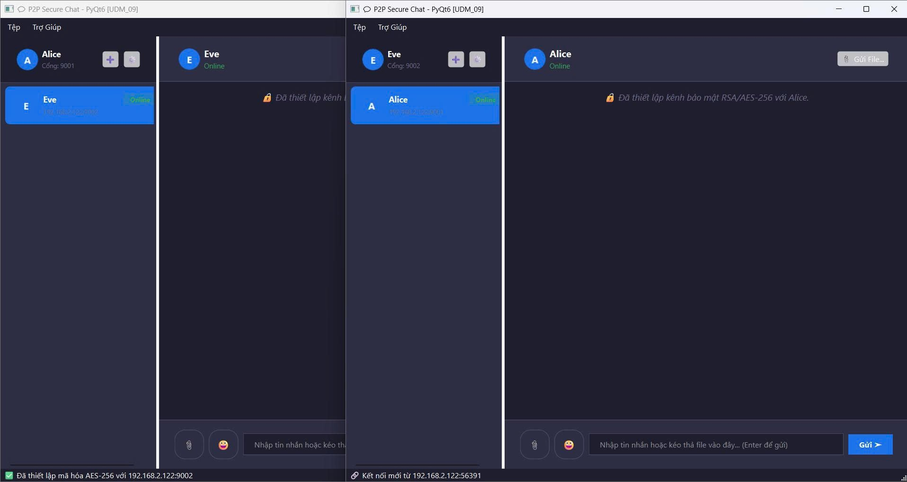

### 4.3.3. Giao diện chính của ứng dụng
Sau khi khởi chạy, ứng dụng hiển thị cửa sổ chính được xây dựng bằng PyQt6.

Giao diện được tổ chức thành các khu vực phục vụ việc quản lý Peer, trao đổi tin nhắn và thực hiện tác vụ truyền tệp.

Các thành phần chính bao gồm danh sách Peer, khu vực trò chuyện, ô nhập tin nhắn, các nút chức năng và khu vực hiển thị trạng thái truyền tệp.

Danh sách Peer hỗ trợ hiển thị các thiết bị đã được phát hiện hoặc được bổ sung thông qua thông tin kết nối phù hợp.

Khi người dùng lựa chọn một Peer, giao diện chuyển sang nội dung cuộc trò chuyện tương ứng.

**Hình 4.2.  Ảnh toàn bộ giao diện chính**

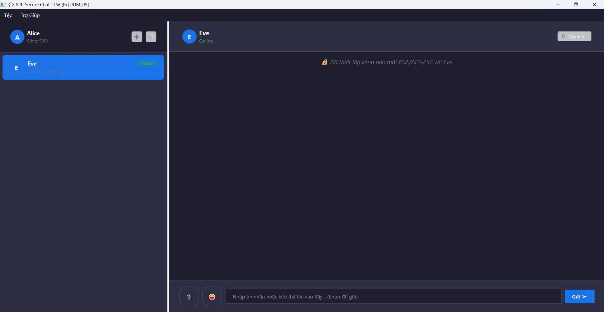

### 4.3.4. Thao tác gửi và nhận tin nhắn

Người dùng lựa chọn Peer đích từ danh sách, nhập nội dung vào ô soạn thảo và thực hiện thao tác gửi.

Ứng dụng hỗ trợ văn bản Unicode, bao gồm tiếng Việt và biểu tượng cảm xúc.

Tin nhắn gửi và nhận được hiển thị trong khu vực trò chuyện tương ứng với từng Peer.

Ngoài thao tác gửi nội dung thông thường, người dùng có thể lựa chọn tin nhắn đã có để thực hiện Reply hoặc Forward.

Đối với Reply, giao diện hiển thị khung tham chiếu đến tin nhắn được trả lời.

Đối với Forward, người dùng lựa chọn một hoặc nhiều Peer đích để chuyển tiếp nội dung.

**Hình 4.3.Hai Peer trao đổi tin nhắn tiếng Việt và Emoji.**

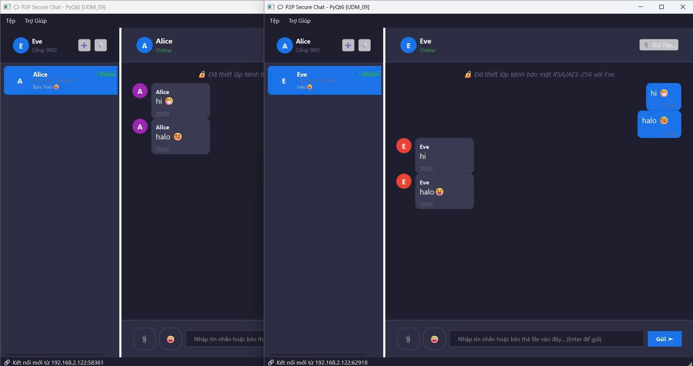

**Hình 4.4.Chức năng Reply và Forward**

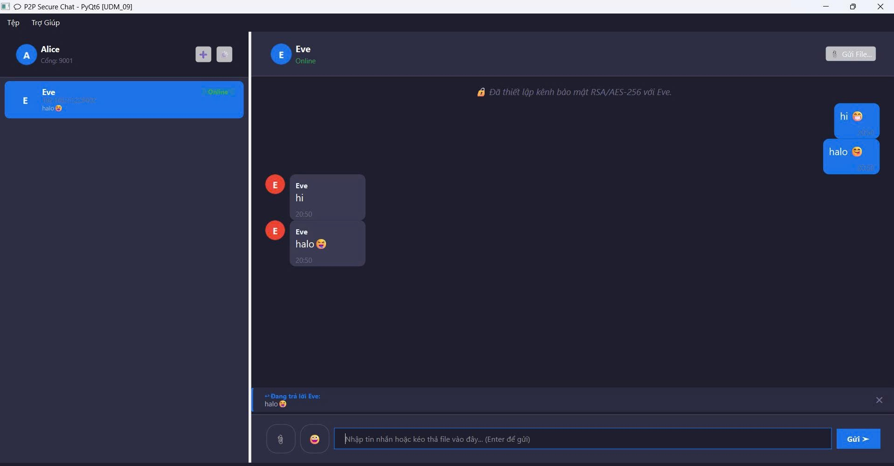

### 4.3.5. Thao tác truyền và nhận tệp
Ứng dụng hỗ trợ lựa chọn tập tin thông qua giao diện hoặc thực hiện kéo thả tệp vào vùng được hỗ trợ.

Sau khi người dùng lựa chọn Peer và tập tin, hệ thống tạo tác vụ truyền tương ứng.

Trong quá trình truyền, giao diện sử dụng các thành phần quản lý tác vụ để hiển thị thông tin như tên tệp, tiến độ, tốc độ và trạng thái xử lý.

Tại phía nhận, dữ liệu được xử lý theo từng chunk và lưu vào tệp tạm trước khi hoàn tất lưu trữ theo điều kiện kiểm tra tương ứng.

Ứng dụng cũng cung cấp chức năng hủy tác vụ truyền tệp.

**Hình 4.5.Quá trình truyền file đang diễn ra**

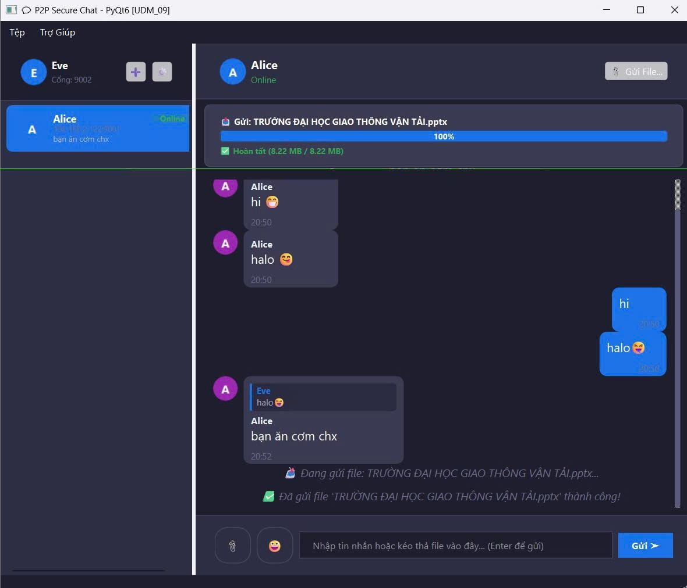

**Hình 4.6. File đã nhận được trong thư mục lưu trữ và kết quả đối chiếu SHA-256**

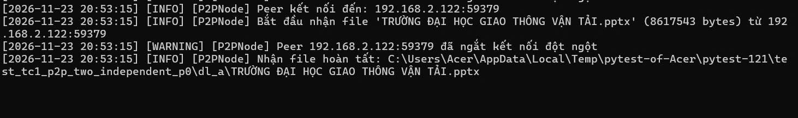

**Hình 4.7.Thao tác hủy truyền file hoặc trạng thái thông báo hủy**

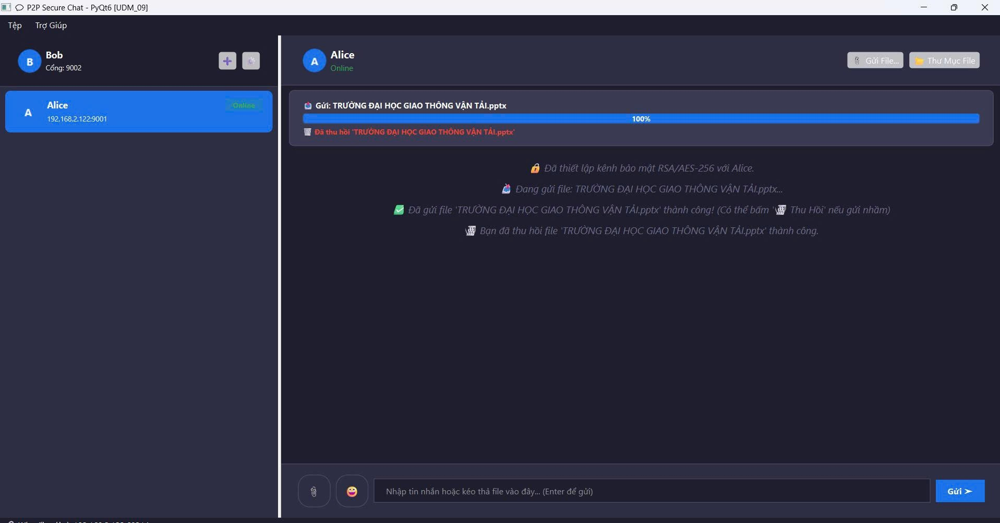
---

## 4.4. Kiểm thử chức năng hệ thống

### 4.4.1. Mục tiêu kiểm thử

Các mục tiêu kiểm thử bao gồm:

- Xác nhận ứng dụng có thể khởi chạy và thiết lập kết nối giữa các Peer.
- Kiểm tra khả năng gửi và nhận tin nhắn.
- Kiểm tra việc xử lý Emoji, Reply và Forward.
- Xác minh khả năng truyền và nhận tập tin.
- Kiểm tra tính toàn vẹn của dữ liệu sau khi truyền.
- Kiểm tra khả năng xử lý lỗi và trạng thái mất kết nối.
- Đánh giá khả năng phản hồi của giao diện trong những tình huống sử dụng thông thường.

Quá trình kiểm thử được chia thành kiểm thử tự động và kiểm thử tích hợp trực tiếp trên giao diện ứng dụng.

### 4.4.2. Phương pháp kiểm thử

**a. Kiểm thử tự động**

Dự án sử dụng pytest để triển khai các bài kiểm thử tự động.

Các chương trình kiểm thử được tổ chức trong thư mục `tests`, bao gồm những nhóm kiểm thử liên quan đến giao thức, bảo mật, giao diện, kết nối và truyền dữ liệu.

Một số tệp kiểm thử tiêu biểu:

| Tệp kiểm thử | Nội dung |
|---|---|
| `test_tv4_protocol.py` | Kiểm tra cấu trúc và xử lý thông điệp |
| `test_gui_tv2.py` | Kiểm thử các widget và logic GUI |
| `test_tc1_p2p_connect.py` | Kiểm thử kết nối giữa hai tiến trình Peer |
| `test_functional_e2e.py` | Kiểm thử chức năng qua môi trường kiểm thử được thiết lập riêng |
| `test_handshake.py` | Kiểm thử quá trình trao đổi khóa |
| `test_chunk_crypto.py` | Kiểm thử mã hóa dữ liệu chunk |
| `test_resilience.py` | Kiểm tra hành vi khi kết nối hoặc dữ liệu không bình thường |

**b. Kiểm thử tích hợp trên giao diện**

Bên cạnh kiểm thử tự động, nhóm cần thực hiện kiểm thử trực tiếp trên ứng dụng GUI để xác minh khả năng phối hợp giữa các module.

Việc kiểm thử có thể tiến hành với hai hoặc nhiều Peer chạy trên cùng máy tính hoặc trên những thiết bị khác nhau trong mạng LAN.

Các kịch bản bao gồm kết nối Peer, gửi và nhận tin nhắn, Reply, Forward, truyền file và xử lý mất kết nối.

Kết quả được ghi nhận thông qua ảnh giao diện, trạng thái chương trình và log liên quan.

### 4.4.3. Danh sách kịch bản kiểm thử chức năng

Bảng dưới đây xác định những kịch bản cần được thực hiện để đánh giá hệ thống.

**Bảng 4.1. Danh sách 13 test case ứng dụng**

| Mã | Kịch bản | Kết quả mong đợi |
|---|---|---|
| TC-01 | Khởi chạy hai Peer | Hai ứng dụng mở thành công |
| TC-02 | Phát hiện Peer trong LAN | Peer được hiển thị trong danh sách |
| TC-03 | Thiết lập kết nối TCP | Hai Peer có thể thiết lập phiên giao tiếp |
| TC-04 | Gửi tin nhắn tiếng Việt | Nội dung nhận đúng Unicode |
| TC-05 | Gửi Emoji | Emoji hiển thị đúng |
| TC-06 | Reply một tin nhắn | Tin nhắn phản hồi hiển thị thông tin tham chiếu |
| TC-07 | Forward đến Peer khác | Peer đích nhận được nội dung chuyển tiếp |
| TC-08 | Truyền file | Tệp được nhận và lưu thành công |
| TC-09 | Đối chiếu SHA-256 | Mã băm file gửi và nhận trùng nhau |
| TC-10 | Hủy truyền file | Tác vụ được hủy và cập nhật trạng thái phù hợp |
| TC-11 | Peer đích Offline | Ứng dụng xử lý lỗi mà không bị treo |
| TC-12 | Mất kết nối khi truyền file | Tác vụ được xử lý theo cơ chế lỗi |
| TC-13 | Gửi file khi đang nhắn tin | Giao diện vẫn phản hồi và các tác vụ được xử lý |

**Hình 4.8.Kết quả kiểm thử**


### 4.4.4. Kiểm thử giao diện người dùng

Bộ kiểm thử GUI của dự án kiểm tra những thành phần như AvatarWidget, ReplyPreview, EmojiPicker, MessageListModel, MessageDelegate và PeerListWidget.

Ngoài ra, các kịch bản liên quan đến MainWindow kiểm tra hành vi giao diện khi Peer mất kết nối và những tình huống dữ liệu không hợp lệ.

Các bài kiểm thử này giúp kiểm tra hành vi riêng của các thành phần giao diện. Tuy nhiên, kết quả unit test không thay thế hoàn toàn kiểm thử sử dụng ứng dụng giữa những Peer độc lập.

**Hình 4.9.Kết quả chạy pytest cho nhóm kiểm thử GUI**

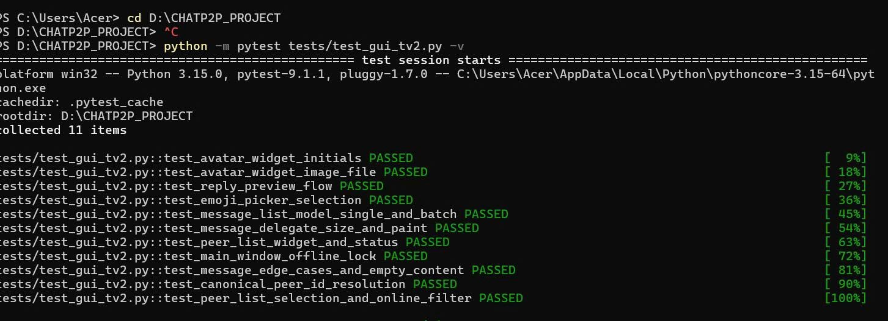


### 4.4.5. Kiểm thử truyền file và kiểm tra tính toàn vẹn

Đối với chức năng truyền file, kiểm thử cần xác nhận cả dữ liệu nhận được và quá trình quản lý tác vụ.

Các trường hợp kiểm tra bao gồm:

1. Truyền file có kích thước nhỏ.
2. Truyền file có kích thước lớn.
3. Kiểm tra mã băm SHA-256 của file gửi và nhận.
4. Kiểm tra trạng thái tiến độ.
5. Hủy tác vụ trong quá trình truyền.
6. Ngắt kết nối khi tác vụ chưa hoàn tất.

Kết quả kiểm thử cần ghi rõ kích thước tệp, môi trường mạng, thời gian truyền, trạng thái hoàn tất và kết quả đối chiếu SHA-256.

**Hình 4.10.Log đối chiếu SHA-256 của cùng một file tại Peer gửi và Peer nhận.**

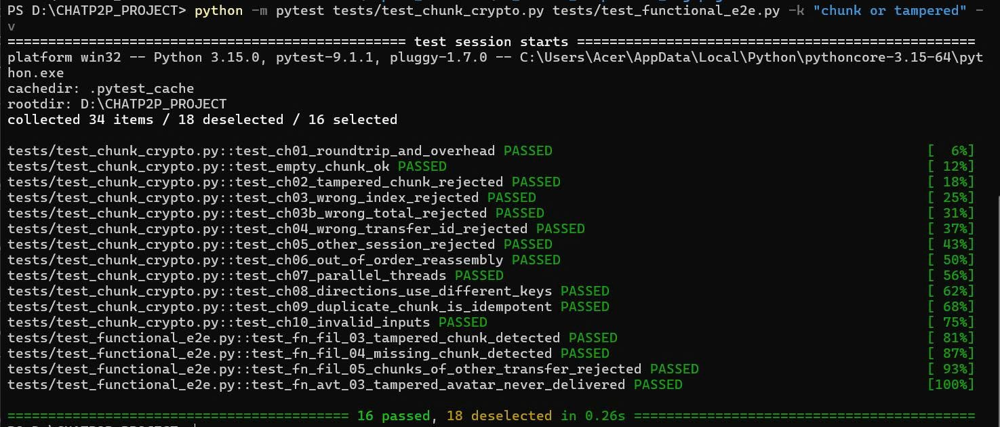

### 4.4.6. Tổng hợp kết quả kiểm thử chức năng

Kết quả của các kịch bản kiểm thử được tổng hợp theo từng nhóm chức năng.

Bảng tổng hợp chính thức cần ghi rõ số lượng test case đạt, không đạt và chưa thực hiện.

Không đánh dấu PASS cho những kịch bản chỉ mới có mã nguồn hoặc file kiểm thử nhưng chưa được thực thi.

**Bảng 4.2. Tổng hợp kết quả kiểm thử tự động**

| Nhóm kiểm thử | Tệp kiểm thử | Số test | PASS | FAIL |
|---|---|---:|---:|---:|
| Khả năng chịu lỗi và phục hồi (Resilience) | `test_resilience.py` | 5 | 5 | 0 |
| Bảo mật và xử lý xung đột (Security Conflicts) | `test_security_conflicts_tv2.py` | 10 | 10 | 0 |
| Kiểm tra đặc tả giao thức (QA Specification) | `test_qa_spec.py` | 11 | 11 | 0 |
| **Tổng cộng** | **3 tệp** | **26** | **26** | **0** |

**Kết quả:** Tất cả 26 bài kiểm thử trong phạm vi ba tệp được thực thi đều đạt yêu cầu, với tỷ lệ thành công 100%.

### Chi tiết các trường hợp kiểm thử

**Bảng 4.3. Chi tiết năm test Resilience được ghi nhận PASS**

| STT | Tên bài kiểm thử | Kết quả |
|---|---|---|
| 1 | `test_socket_abrupt_disconnect_cleanup` | PASS |
| 2 | `test_tampered_packet_rejection_no_crash` | PASS |
| 3 | `test_file_transfer_abort_cleans_temp_file` | PASS |
| 4 | `test_peer_session_key_renegotiation` | PASS |
| 5 | `test_malformed_protocol_isolation` | PASS |

**Bảng 4.4. Chi tiết mười test Security Conflicts được ghi nhận PASS**

| STT | Tên bài kiểm thử | Kết quả |
|---|---|---|
| 1 | `test_path_traversal_and_reserved_names_blocked` | PASS |
| 2 | `test_avatar_executable_svg_and_oversized_blocked` | PASS |
| 3 | `test_cross_ip_username_spoofing_blocked` | PASS |
| 4 | `test_validator_rejects_bool_ports_type_confusion_and_oversize` | PASS |
| 5 | `test_gui_dos_long_text_invalid_types_and_model_cap` | PASS |
| 6 | `test_anti_downgrade_drops_unencrypted_when_session_active` | PASS |
| 7 | `test_forward_encrypts_message_and_strips_original_content` | PASS |
| 8 | `test_ephemeral_disconnect_no_zombie_model_and_peerlist_userrole` | PASS |
| 9 | `test_listener_concurrent_malformed_and_flood_resilience` | PASS |
| 10 | `test_real_loopback_handshake_key_exchange_and_encrypted_chat` | PASS |

**Bảng 4.5. Chi tiết mười một test QA Specification được ghi nhận PASS**

| STT | Tên bài kiểm thử | Kết quả |
|---|---|---|
| 1 | `test_valid_messages_pass` | PASS |
| 2 | `test_structure_errors` | PASS |
| 3 | `test_header_rules` | PASS |
| 4 | `test_reply_rules` | PASS |
| 5 | `test_forward_rules` | PASS |
| 6 | `test_file_offer_rules` | PASS |
| 7 | `test_key_exchange_rules` | PASS |
| 8 | `test_secret_fields_rejected_anywhere[private_key]` | PASS |
| 9 | `test_secret_fields_rejected_anywhere[password]` | PASS |
| 10 | `test_secret_fields_rejected_anywhere[session_key]` | PASS |
| 11 | `test_secret_fields_rejected_anywhere[aes_key]` | PASS |

**HÌNH 4.11: Kết quả chạy bài kiểm thử tự động bằng pytest**

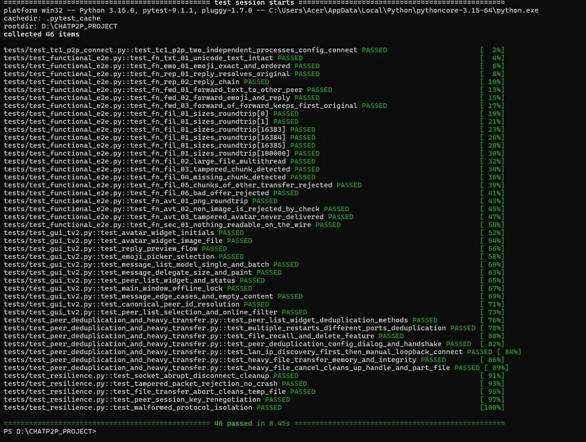


### Nhận xét kết quả kiểm thử

Kết quả cho thấy toàn bộ 26 bài kiểm thử thuộc ba nhóm Resilience, Security Conflicts và QA Specification đều hoàn thành thành công, không ghi nhận trường hợp thất bại trong lần chạy được cung cấp.

Các bài kiểm thử tập trung vào việc xử lý kết nối bất thường, kiểm tra tính hợp lệ của thông điệp, bảo vệ dữ liệu, quản lý khóa và xử lý một số tình huống lỗi liên quan đến truyền tệp và giao diện.

Kết quả này cung cấp minh chứng về hoạt động của các chức năng trong phạm vi kịch bản đã kiểm thử. Tuy nhiên, tỷ lệ PASS 100% không đồng nghĩa toàn bộ hệ thống đã được kiểm thử đầy đủ trong mọi điều kiện thực tế.

Các chức năng như Peer Discovery trên nhiều thiết bị LAN, trao đổi tin nhắn trực tiếp và truyền file trong điều kiện mạng thực tế vẫn cần được đối chiếu với kết quả kiểm thử tích hợp của nhóm.

---

## 4.5. Kiểm thử bảo mật và hiệu năng

### 4.5.1. Mục tiêu và phạm vi kiểm thử

Quá trình kiểm thử bảo mật và hiệu năng được thực hiện nhằm đánh giá hoạt động của các cơ chế mật mã, khả năng xử lý dữ liệu và mức độ ổn định của các thành phần truyền thông trong ứng dụng P2P Chat & File Transfer Application.

Các nội dung kiểm thử bao gồm:

- Kiểm tra khả năng trao đổi khóa RSA-2048 và thiết lập phiên bảo mật.
- Kiểm tra cơ chế mã hóa và giải mã AES-256-GCM.
- Đánh giá khả năng xử lý thông điệp khi có nhiều Peer hoạt động.
- Đo độ trễ khứ hồi và tốc độ truyền dữ liệu.
- Kiểm tra tính toàn vẹn của tập tin bằng SHA-256.
- Đánh giá khả năng xử lý kết nối bất thường và dữ liệu không hợp lệ.

Nhóm xây dựng chương trình benchmark trong `tests/benchmark_stress.py` để đánh giá hiệu năng tại hai mức tải.

Cần phân biệt kết quả kiểm thử các thành phần bằng chương trình benchmark với kết quả kiểm thử tích hợp trực tiếp trên ứng dụng GUI.

### 4.5.2. Môi trường kiểm thử hiệu năng

Theo báo cáo `EXTRA/benchmark_ketqua.md`, phiên kiểm thử hiệu năng được ghi nhận ngày 22/11/2026 với cấu hình sau:

**Bảng 4.6. Môi trường kiểm thử hiệu năng**

| Thành phần | Cấu hình |
|---|---|
| Hệ điều hành | Windows 11 |
| Python | 3.12.10 |
| CPU | 12 nhân logic |
| RAM | 7,8 GiB |
| Thư viện `cryptography` | 50.0.2 |
| Môi trường mạng | Loopback trên cùng máy tính |
| Công cụ kiểm thử | `tests/benchmark_stress.py` |

Chương trình benchmark sử dụng một tiến trình máy chủ thử nghiệm, nhiều tiến trình Peer và một kết nối riêng để truyền tập tin.

Máy chủ thử nghiệm sử dụng cơ chế tiếp nhận và phản hồi dữ liệu nhằm hỗ trợ đo độ trễ khứ hồi. Các Peer thực hiện trao đổi thông điệp đã mã hóa và gửi dữ liệu với tốc độ được cấu hình.

Trong quá trình kiểm thử, chương trình ghi nhận thông tin về số lượng thông điệp, độ trễ, tốc độ truyền tệp và tài nguyên hệ thống.

Kết quả này phản ánh hiệu năng của môi trường benchmark, không phải phép đo trực tiếp toàn bộ ứng dụng GUI trên nhiều thiết bị LAN.

### 4.5.3. Kịch bản kiểm thử hiệu năng

Chương trình benchmark được tổ chức thành hai mức tải nhằm đánh giá khả năng xử lý dữ liệu trong những điều kiện khác nhau.

**Bảng 4.7. Cấu hình hai mức kiểm thử hiệu năng**

| Thông số | Mức 1 | Mức 2 |
|---|---|---|
| Số Peer | 5 | 15 |
| Tốc độ gửi mục tiêu | 50 tin nhắn/giây | 200 tin nhắn/giây |
| Kích thước tập tin | 10 MB | 100 MB |
| Kết nối truyền file | Kết nối riêng | Kết nối riêng |
| Cơ chế bảo mật | RSA, AES-256-GCM | RSA, AES-256-GCM |
| Kiểm tra tính toàn vẹn | SHA-256 | SHA-256 |

Các chỉ số được sử dụng để đánh giá bao gồm:

1. Số lượng tin nhắn gửi, nhận và bị mất.
2. Tốc độ gửi thông điệp thực tế.
3. Độ trễ khứ hồi tại các mức p50, p95 và p99.
4. Tốc độ truyền tập tin.
5. Thời gian thực hiện Handshake.
6. Tốc độ mã hóa và giải mã dữ liệu.
7. Mức sử dụng CPU và RAM.
8. Kết quả kiểm tra SHA-256 của dữ liệu truyền.

Các tiêu chí đánh giá được xác định trong chương trình benchmark và có thể được điều chỉnh theo tham số thực thi.

### 4.5.4. Kết quả kiểm thử hiệu năng

Theo báo cáo kết quả được lưu tại `EXTRA/benchmark_ketqua.md`, cả hai mức tải đều được chương trình benchmark ghi nhận đạt yêu cầu.

**Bảng 4.8. Kết quả kiểm thử hiệu năng tại hai mức tải**

| Chỉ số | Mức 1 | Mức 2 |
|---|---|---|
| Số Peer | 5 | 15 |
| Tin nhắn gửi | 750 | 2.999 |
| Tin nhắn nhận | 750 | 2.999 |
| Tin nhắn mất | 0 | 0 |
| Tỷ lệ mất tin nhắn | 0% | 0% |
| Tốc độ gửi thực tế | 50 tin/giây | 200 tin/giây |
| Độ trễ khứ hồi p50 | 0,6 ms | 0,7 ms |
| Độ trễ khứ hồi p95 | 0,7 ms | 1,0 ms |
| Độ trễ khứ hồi p99 | 0,9 ms | 1,1 ms |
| Tốc độ truyền file trung bình | 198,8 MiB/s | 194,8 MiB/s |
| Kiểm tra SHA-256 | Đạt | Đạt |
| Kết quả benchmark | PASS | PASS |

Ở mức tải thứ nhất, hệ thống thử nghiệm thực hiện gửi và nhận 750 thông điệp với tốc độ 50 tin nhắn/giây, không ghi nhận thông điệp bị mất. Độ trễ khứ hồi p95 được ghi nhận là 0,7 ms.

Ở mức tải thứ hai, chương trình ghi nhận 2.999 thông điệp được gửi và nhận với tốc độ 200 tin nhắn/giây, không ghi nhận mất thông điệp. Độ trễ khứ hồi p95 đạt 1,0 ms.

Đối với quá trình truyền file, chương trình ghi nhận tốc độ trung bình khoảng 198,8 MiB/s ở mức 1 và 194,8 MiB/s ở mức 2. Các lần truyền được báo cáo đạt yêu cầu kiểm tra SHA-256.

Những kết quả trên cho thấy chương trình benchmark đáp ứng các tiêu chí kiểm thử trong môi trường loopback đã thiết lập.

Tuy nhiên, kết quả không thể được sử dụng để khẳng định toàn bộ ứng dụng GUI đạt tốc độ hoặc độ trễ tương tự trong điều kiện truyền thông LAN thực tế.

**Hình 4.11. Kết quả kiểm thử hiệu năng bằng chương trình benchmark**

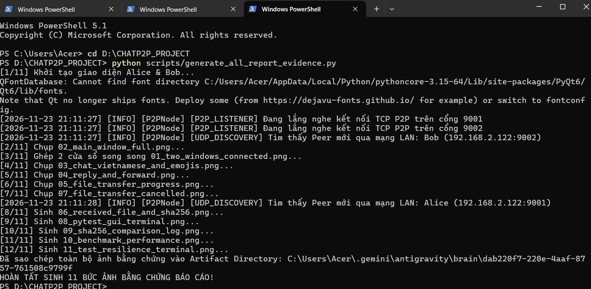

### 4.5.5. Kết quả kiểm thử mật mã

Bên cạnh kiểm thử tải, nhóm thực hiện đo tốc độ xử lý của các thành phần mật mã được xây dựng trong dự án.

Các thành phần được đánh giá bao gồm `SessionCrypto`, `ChunkCrypto` và quy trình trao đổi khóa RSA.

**Bảng 4.9. Kết quả kiểm thử hiệu năng mật mã**

| Thành phần | Kích thước dữ liệu | Mã hóa | Giải mã |
|---|---|---|---|
| SessionCrypto | 1 KiB | 351 MiB/s | 477 MiB/s |
| SessionCrypto | 64 KiB | 1.558 MiB/s | 1.885 MiB/s |
| ChunkCrypto | 64 KiB | 1.563 MiB/s | 2.788 MiB/s |

Ngoài tốc độ mã hóa và giải mã, chương trình còn ghi nhận:

- Thời gian sinh cặp khóa RSA-2048 trung vị: 36 ms.
- Thời gian Handshake trung vị trong phép đo mật mã: 1,9 ms.

Các kết quả cho thấy khả năng xử lý của những thành phần mật mã trong điều kiện thử nghiệm cụ thể.

Cần lưu ý rằng tốc độ mã hóa và giải mã là thông lượng xử lý dữ liệu của thuật toán, không đồng nghĩa với tốc độ truyền dữ liệu thực tế qua mạng.

Hiệu năng mật mã có thể thay đổi tùy theo cấu hình CPU, phiên bản Python, thư viện `cryptography` và khả năng tăng tốc phần cứng của thiết bị.

### 4.5.6. Kiểm thử khả năng chịu lỗi và bảo mật

Ngoài chương trình benchmark, nhóm thực hiện kiểm thử tự động đối với những tình huống liên quan đến khả năng chịu lỗi, bảo mật và kiểm tra giao thức.

Trong phiên kiểm thử được ghi nhận bằng pytest, nhóm đã thực thi ba tệp:

- `tests/test_resilience.py`
- `tests/test_security_conflicts_tv2.py`
- `tests/test_qa_spec.py`

Kết quả của phiên chạy này được tổng hợp tại mục 4.4.6 với tổng cộng 26 bài kiểm thử PASS, không có bài kiểm thử FAIL.

Riêng nhóm Resilience gồm năm bài kiểm thử, tập trung vào các tình huống:

1. Ngắt kết nối socket đột ngột và giải phóng tài nguyên.
2. Phát hiện dữ liệu bị thay đổi và từ chối gói tin không hợp lệ.
3. Hủy truyền tập tin và dọn dẹp dữ liệu tạm.
4. Thương lượng lại khóa phiên giữa các Peer.
5. Cô lập lỗi khi tiếp nhận thông điệp sai định dạng.

Nhóm Security Conflicts gồm mười bài kiểm thử về các trường hợp như Path Traversal, dữ liệu Avatar không hợp lệ, giả mạo thông tin Peer, giới hạn đầu vào, cơ chế Anti-Downgrade, bảo vệ nội dung Forward và xử lý nhiều kết nối bất thường.

Nhóm QA Specification gồm mười một bài kiểm thử nhằm xác minh các quy tắc cấu trúc thông điệp, Header, Reply, Forward, File Offer, Key Exchange và việc từ chối những trường dữ liệu nhạy cảm không được phép xuất hiện.

Toàn bộ 26 bài kiểm thử đã hoàn thành thành công trong 5,05 giây theo kết quả terminal được nhóm cung cấp.

Kết quả phản ánh phạm vi của ba tệp kiểm thử trong phiên chạy tương ứng, không đại diện cho toàn bộ test suite hoặc mọi tình huống sử dụng thực tế của ứng dụng.

**Hình 4.12. Kết quả kiểm thử khả năng chịu lỗi, bảo mật và đặc tả giao thức bằng pytest**


### 4.5.7. Giới hạn của kết quả kiểm thử

Mặc dù các kết quả kiểm thử đã cung cấp những minh chứng về hoạt động của các thành phần truyền thông và bảo mật, vẫn tồn tại một số giới hạn cần được xem xét.

Thứ nhất, chương trình benchmark được thực hiện trên cùng một máy tính thông qua kết nối loopback. Điều kiện này không phản ánh đầy đủ ảnh hưởng của môi trường LAN thực tế, bao gồm độ trễ mạng, băng thông và sự khác biệt giữa các thiết bị.

Thứ hai, chương trình benchmark sử dụng máy chủ thử nghiệm và các tiến trình Peer riêng. Vì vậy, kết quả đo hiệu năng không phản ánh trực tiếp thông lượng của giao diện GUI và các luồng truyền file được tích hợp trong ứng dụng.

Thứ ba, những kết quả kiểm thử tự động chỉ đánh giá các tình huống đã được xây dựng thành test case. Việc tất cả bài kiểm thử đạt yêu cầu không có nghĩa hệ thống không còn lỗi.

Thứ tư, kết quả kiểm thử cần được gắn với phiên bản mã nguồn cụ thể. Khi ứng dụng có thay đổi về giao thức, bảo mật hoặc truyền dữ liệu, các bài kiểm thử liên quan cần được thực thi lại để xác nhận tính tương thích.

Do đó, việc đánh giá toàn diện ứng dụng cần kết hợp kết quả kiểm thử thành phần, kết quả chạy ứng dụng thực tế và các minh chứng tích hợp trên nhiều Peer trong mạng LAN.

## 4.6. Đánh giá kết quả triển khai và kiểm thử

### 4.6.1. Các kết quả đã có minh chứng

Những kết quả này xác nhận mức độ triển khai và các phạm vi được kiểm thử, không tương đương chứng nhận hệ thống ứng dụng hoạt động ổn định trong mọi cấu hình mạng.

### 4.6.2. Hạn chế và nội dung cần hoàn thiện

Các hạn chế quan trọng gồm: hai nhóm API framing vẫn cùng tồn tại; phạm vi mã hóa và bảo vệ metadata của GUI chưa thống nhất hoàn toàn; chưa có xác nhận hoàn tất file tại phía nhận cho mọi luồng truyền; benchmark không phải đo trên mạng LAN thực tế; kết quả 13 test case giao diện chưa có bảng PASS/FAIL đủ căn cứ. Đây là hạn chế kiểm chứng và thiết kế được nhận diện, không có nghĩa mọi chức năng liên quan đều gặp lỗi.