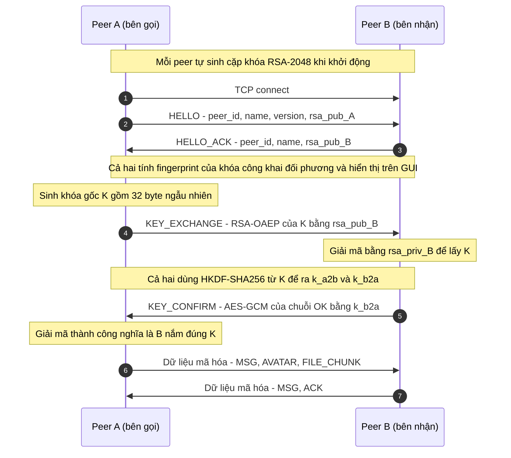
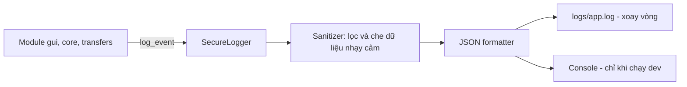

# Thiết kế Bảo mật và Ghi Log an toàn (Chặng 1)

Người phụ trách: TV1 | Dự án: UDM_09 – Chat P2P | Thư viện: `cryptography`

## 1. Mục tiêu bảo mật

| Mục tiêu | Cách đạt được |
|---|---|
| Bí mật (confidentiality) | Mọi tin nhắn, avatar, file đều mã hóa AES-256-GCM |
| Toàn vẹn (integrity) | GCM sinh thẻ xác thực (tag), sửa 1 bit là giải mã thất bại |
| Chống phát lại (replay) | Số thứ tự (seq) tăng dần, đưa vào AAD của GCM |
| Nhận diện peer | Dấu vân tay (fingerprint) khóa công khai hiển thị trên GUI để người dùng đối chiếu |
| Không lộ dữ liệu qua log | Bộ ghi log lọc và che dữ liệu nhạy cảm (mục 5) |

Ngoài phạm vi: chống tấn công từ chối dịch vụ (DoS), PKI/chứng chỉ, bảo mật trên Internet.

## 2. Lựa chọn thuật toán

| Mục đích | Thuật toán | Ghi chú |
|---|---|---|
| Trao đổi khóa | RSA-2048, đệm OAEP (SHA-256) | Mã hóa khóa phiên bằng khóa công khai của bên nhận |
| Mã hóa dữ liệu | AES-256-GCM | Khóa 32 byte, nonce 12 byte, tag 16 byte |
| Sinh khóa theo chiều | HKDF-SHA256 | Tách 2 khóa riêng cho 2 chiều A→B và B→A |
| Dấu vân tay | SHA-256 của khóa công khai (DER) | Hiển thị dạng hex, nhóm 4 ký tự |

Dùng GCM thay vì CBC vì GCM vừa mã hóa vừa xác thực, không cần tự ghép HMAC.

## 3. Sơ đồ bắt tay và trao đổi khóa



Quy tắc:
- `K` chỉ tồn tại trong RAM, hủy khi đóng kết nối. Mỗi kết nối một `K` mới.
- Nếu `KEY_CONFIRM` sai hoặc quá thời gian (đề xuất 5 giây) thì đóng kết nối và ghi log `HANDSHAKE_FAIL`.
- `HKDF`: salt = SHA-256(rsa_pub_A || rsa_pub_B), info = `"a2b"` hoặc `"b2a"`.

## 4. Định dạng gói tin sau khi bắt tay

Mỗi gói gửi qua TCP có dạng:

```
| 4 byte: độ dài | 8 byte: seq | 12 byte: nonce | ciphertext | 16 byte: tag |
```

- Độ dài tính từ `seq` đến hết `tag`, dùng big-endian (giúp TV4 tách gói, tránh dính gói trên TCP).
- AAD của GCM = `seq` (8 byte). Bên nhận kiểm tra `seq` phải lớn hơn seq trước đó, nếu không thì loại gói và ghi `REPLAY_DETECTED`.
- Plaintext là JSON UTF-8, ví dụ `{"type":"msg","id":"abc123","text":"Hello","reply_to":null}`.
- File lớn: mỗi chunk mã hóa riêng, dùng chung bộ đếm seq của kết nối (TV5 chỉ gọi `encrypt`, không tự quản nonce).

## 5. Bộ ghi Log an toàn



**Định dạng một dòng log (JSON Lines):**

```json
{"ts":"2026-11-03T10:15:30.123Z","level":"INFO","event":"HANDSHAKE_OK","session":"a1b2c3","peer":"ab12cd34","msg":"Bắt tay thành công"}
```

| Trường | Ý nghĩa |
|---|---|
| `ts` | Thời gian UTC, chuẩn ISO 8601 |
| `level` | DEBUG, INFO, WARNING, ERROR |
| `event` | Mã sự kiện cố định (bảng dưới) |
| `session` | Mã phiên ngẫu nhiên, 6 ký tự |
| `peer` | 8 ký tự đầu của fingerprint, không ghi IP đầy đủ nếu không cần |
| `msg` | Mô tả ngắn, không chứa dữ liệu nhạy cảm |

**Danh sách sự kiện bảo mật:** `KEYPAIR_GENERATED`, `HANDSHAKE_START`, `HANDSHAKE_OK`, `HANDSHAKE_FAIL`, `DECRYPT_FAIL`, `REPLAY_DETECTED`, `PEER_CONNECTED`, `PEER_DISCONNECTED`.

**Tuyệt đối KHÔNG ghi log:**
- Khóa riêng RSA, khóa phiên `K`, `k_a2b`, `k_b2a`.
- Nội dung tin nhắn gốc, nội dung file, dữ liệu avatar.
- Ciphertext đầy đủ (nếu cần debug, chỉ ghi độ dài).

**Cơ chế bảo vệ:**
- `Sanitizer` là một `logging.Filter`: thay chuỗi dạng PEM (`-----BEGIN`), chuỗi hex hoặc base64 dài trên 32 ký tự bằng `[REDACTED]`.
- Ghi file bằng `RotatingFileHandler` (ví dụ 1 MB x 5 file) để log không phình vô hạn.
- Thư mục `logs/` nằm trong `.gitignore`, không commit lên GitHub.

## 6. Quản lý khóa

- Khóa RSA **sinh động** (ephemeral) mỗi lần mở ứng dụng, chỉ nằm trong RAM, không lưu ra đĩa. Nhược điểm: fingerprint đổi mỗi lần chạy. Nếu nhóm muốn cố định danh tính, có thể mở rộng lưu khóa vào `keys/` (đã bị `.gitignore`) và đặt mật khẩu bảo vệ.
- Fingerprint hiển thị trên GUI ở hộp thoại "Kết nối mới" để hai người đối chiếu qua kênh khác (nói miệng, tin nhắn).

## 7. Giao diện lập trình (API) cho các module khác

Đặt tại `CODE/core/security/` (đề xuất):

```python
class KeyPair:
    @staticmethod
    def generate() -> "KeyPair": ...
    def public_pem(self) -> bytes: ...
    def fingerprint(self) -> str: ...

class SessionCrypto:
    def encrypt(self, plaintext: bytes) -> bytes: ...   # trả về seq|nonce|ct|tag
    def decrypt(self, blob: bytes) -> bytes: ...        # ném DecryptError nếu sai

def handshake_initiator(sock, keypair, name) -> tuple[SessionCrypto, str]: ...
def handshake_responder(sock, keypair, name) -> tuple[SessionCrypto, str]: ...
```

Log: `CODE/core/logging/secure_logger.py` cung cấp `get_logger(name)` và `log_event(event, level, **fields)`.

| Ai dùng | Gọi gì |
|---|---|
| TV phụ trách socket (TV4) | `handshake_*`, rồi `encrypt` trước khi `sendall`, `decrypt` sau khi nhận |
| TV truyền file | `encrypt` từng chunk |
| TV giao diện | `fingerprint()` để hiển thị |
| Mọi module | `log_event(...)` thay cho `print` |

## 8. Mối đe dọa và biện pháp

| Mối đe dọa | Biện pháp | Mức |
|---|---|---|
| Nghe lén trên LAN | AES-256-GCM | Xử lý |
| Sửa gói tin | Tag GCM | Xử lý |
| Phát lại gói cũ | seq trong AAD | Xử lý |
| Kẻ đứng giữa (MITM) khi bắt tay | Hiển thị fingerprint để đối chiếu | Giảm thiểu |
| Lộ khóa qua file log | Sanitizer, không ghi khóa và nội dung | Xử lý |
| DoS, quét cổng | Ngoài phạm vi | Bỏ qua |

## 9. Kế hoạch kiểm thử bảo mật (QA)

| Mã | Kiểm thử | Kỳ vọng |
|---|---|---|
| SEC-01 | Mã hóa rồi giải mã | Ra đúng plaintext |
| SEC-02 | Sửa 1 byte ciphertext | `DecryptError` |
| SEC-03 | Giải mã bằng khóa sai | `DecryptError` |
| SEC-04 | Gửi lại gói cũ | Bị loại, log `REPLAY_DETECTED` |
| SEC-05 | Bắt tay hai tiến trình trên 1 máy | Hai bên có cùng khóa phiên |
| SEC-06 | Chạy toàn bộ luồng rồi tìm trong `logs/` chuỗi `BEGIN`, khóa, nội dung tin | Không tìm thấy |
| SEC-07 | Bên nhận không gửi `KEY_CONFIRM` | Hết hạn, đóng kết nối, log `HANDSHAKE_FAIL` |

## 10. Checklist Chặng 1 (01/11 – 03/11/2026)

- [x] Thiết lập môi trường ảo Python (venv)
- [x] Tạo `requirements.txt` (PyQt6, cryptography, psutil, pytest)
- [x] Thiết kế sơ đồ trao đổi khóa RSA + AES-256 (mục 3, 4)
- [x] Thiết kế cấu trúc bộ ghi Log an toàn (mục 5)
- [ ] Nhóm xác nhận các lựa chọn (GCM, khóa sinh động, định dạng gói)
