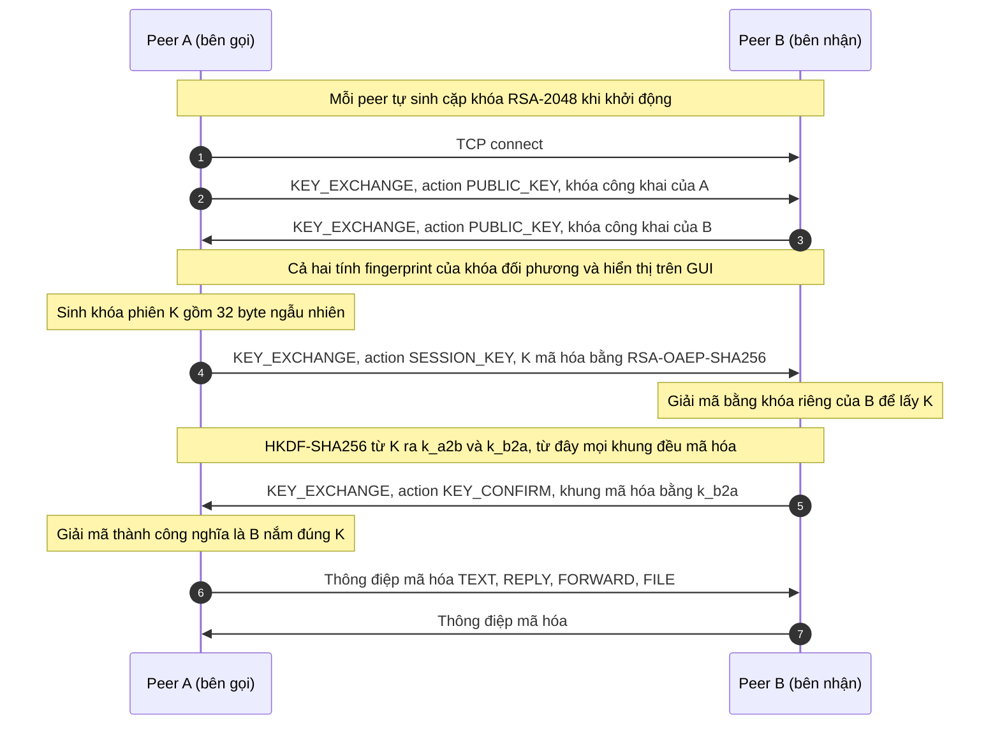
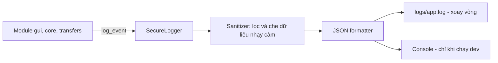

# Thiết kế Bảo mật và Ghi Log an toàn (Chặng 1)

Người phụ trách: TV1 | Dự án: UDM_09 – Chat P2P | Thư viện: `cryptography`

## 1. Mục tiêu bảo mật

| Mục tiêu | Cách đạt được |
|---|---|
| Bí mật (confidentiality) | Mọi tin nhắn, avatar, file đều mã hóa AES-256-GCM |
| Toàn vẹn (integrity) | GCM sinh thẻ xác thực (tag), sửa 1 bit là giải mã thất bại |
| Chống phát lại (replay) | Số thứ tự (seq) tăng dần, đưa vào AAD của GCM |
| Nhận diện peer | Dấu vân tay (fingerprint) khóa công khai hiển thị trên GUI để người dùng đối chiếu |
| Không lộ dữ liệu qua log | Bộ ghi log lọc và che dữ liệu nhạy cảm (mục 5) |

Ngoài phạm vi: chống tấn công từ chối dịch vụ (DoS), PKI/chứng chỉ, bảo mật trên Internet.

## 2. Lựa chọn thuật toán

| Mục đích | Thuật toán | Ghi chú |
|---|---|---|
| Trao đổi khóa | RSA-2048, đệm OAEP (SHA-256) | Mã hóa khóa phiên bằng khóa công khai của bên nhận |
| Mã hóa dữ liệu | AES-256-GCM | Khóa 32 byte, nonce 12 byte, tag 16 byte |
| Sinh khóa theo chiều | HKDF-SHA256 | Tách 2 khóa riêng cho 2 chiều A→B và B→A |
| Dấu vân tay | SHA-256 của khóa công khai (DER) | Hiển thị dạng hex, nhóm 4 ký tự |

Dùng GCM thay vì CBC vì GCM vừa mã hóa vừa xác thực, không cần tự ghép HMAC.

## 3. Sơ đồ bắt tay và trao đổi khóa

Bắt tay dùng đúng loại thông điệp `KEY_EXCHANGE` trong giao thức chung của nhóm (`message_protocol.md`, mục 3.6). Mỗi thông điệp có `header` và `payload` như mọi tin khác, `sender_id` và `receiver_id` là ID của peer.



**Ánh xạ vào payload của giao thức nhóm:**

| Bước | `action` | `algorithm` | Trường chính |
|---|---|---|---|
| 2, 3 | `PUBLIC_KEY` | `RSA-2048` | `key_id` = `key-` + 8 ký tự đầu fingerprint, `public_key` = chuỗi PEM |
| 6 | `SESSION_KEY` | `RSA-OAEP-SHA256` | `key_id` của khóa đã dùng, `encrypted_session_key` = base64 |
| 9 | `KEY_CONFIRM` | `AES-256-GCM` | Không cần trường khóa. Khung này đã được mã hóa |

Quy tắc:
- `K` chỉ tồn tại trong RAM, hủy khi đóng kết nối. Mỗi kết nối một `K` mới.
- Nếu `KEY_CONFIRM` sai hoặc quá thời gian (đề xuất 5 giây) thì đóng kết nối và ghi log `HANDSHAKE_FAIL`.
- HKDF: salt = SHA-256 của (khóa công khai bên gọi nối khóa công khai bên nhận), info = `p2p-chat a2b` hoặc `p2p-chat b2a`. Hàm `handshake_salt` trong code làm việc này.
- Khi nhận `PUBLIC_KEY`, GUI hiện fingerprint để người dùng đối chiếu, đúng quy tắc "xác thực khóa công khai" trong giao thức nhóm.

## 4. Khung dữ liệu (framing)

Giữ nguyên quy tắc framing của nhóm (`message_protocol.md`, mục 5): **4 byte độ dài (số nguyên không dấu, big-endian) rồi đến dữ liệu**. Phần tách gói của TV Socket không phải đổi. Chỉ phần dữ liệu thay đổi theo trạng thái kết nối:

| Giai đoạn | Dữ liệu sau 4 byte độ dài |
|---|---|
| Trước `SESSION_KEY` (bắt tay) | JSON UTF-8 thuần, đúng như giao thức nhóm |
| Sau `SESSION_KEY` | Khối mã hóa: `seq (8)` + `nonce (12)` + `ciphertext` + `tag (16)` |

- Plaintext của khối mã hóa chính là JSON UTF-8 của thông điệp (cả `header` và `payload`), nên `message_type`, `message_id`... không đổi.
- Độ dài trong 4 byte đầu tính cả phần thêm vào (36 byte). Hằng `OVERHEAD = 36` có trong code.
- AAD của GCM là `seq`. Bên nhận loại gói có `seq` không lớn hơn `seq` trước đó và ghi `REPLAY_DETECTED`.
- Đề xuất giới hạn khung 1 MiB (`MAX_FRAME_SIZE`) để tránh cấp phát bộ nhớ quá lớn, đúng yêu cầu mục 5 của giao thức nhóm.
- Mỗi chunk file là một khối mã hóa riêng. TV truyền file chỉ gọi `encrypt`, không tự quản lý nonce.

## 5. Bộ ghi Log an toàn



**Định dạng một dòng log (JSON Lines):**

```json
{"ts":"2026-11-03T10:15:30.123Z","level":"INFO","event":"HANDSHAKE_OK","session":"a1b2c3","peer":"ab12cd34","msg":"Bắt tay thành công"}
```

| Trường | Ý nghĩa |
|---|---|
| `ts` | Thời gian UTC, chuẩn ISO 8601 |
| `level` | DEBUG, INFO, WARNING, ERROR |
| `event` | Mã sự kiện cố định (bảng dưới) |
| `session` | Mã phiên ngẫu nhiên, 6 ký tự |
| `peer` | 8 ký tự đầu của fingerprint, không ghi IP đầy đủ nếu không cần |
| `msg` | Mô tả ngắn, không chứa dữ liệu nhạy cảm |

**Danh sách sự kiện bảo mật:** `KEYPAIR_GENERATED`, `HANDSHAKE_START`, `HANDSHAKE_OK`, `HANDSHAKE_FAIL`, `DECRYPT_FAIL`, `REPLAY_DETECTED`, `PEER_CONNECTED`, `PEER_DISCONNECTED`.

**Tuyệt đối KHÔNG ghi log:**
- Khóa riêng RSA, khóa phiên `K`, `k_a2b`, `k_b2a`.
- Nội dung tin nhắn gốc, nội dung file, dữ liệu avatar.
- Ciphertext đầy đủ (nếu cần debug, chỉ ghi độ dài).

**Cơ chế bảo vệ:**
- `Sanitizer` là một `logging.Filter`: thay chuỗi dạng PEM (`-----BEGIN`), chuỗi hex hoặc base64 dài trên 32 ký tự bằng `[REDACTED]`.
- Ghi file bằng `RotatingFileHandler` (ví dụ 1 MB x 5 file) để log không phình vô hạn.
- Thư mục `logs/` nằm trong `.gitignore`, không commit lên GitHub.

## 6. Quản lý khóa

- Khóa RSA **sinh động** (ephemeral) mỗi lần mở ứng dụng, chỉ nằm trong RAM, không lưu ra đĩa. Nhược điểm: fingerprint đổi mỗi lần chạy. Nếu nhóm muốn cố định danh tính, có thể mở rộng lưu khóa vào `keys/` (đã bị `.gitignore`) và đặt mật khẩu bảo vệ.
- Fingerprint hiển thị trên GUI ở hộp thoại "Kết nối mới" để hai người đối chiếu qua kênh khác (nói miệng, tin nhắn).

## 7. Giao diện lập trình (API) cho các module khác

Mã nguồn: `CODE/security/crypto.py` (import: `from security.crypto import ...`).

```python
# Bắt tay
kp = KeyPair.generate()              # RSA-2048 sinh động, khóa riêng chỉ ở RAM
kp.public_pem()                      # str, đặt vào payload.public_key
kp.fingerprint()                     # "AB12 CD34 ..." hiển thị trên GUI
kp.short_id()                        # 8 ký tự, dùng cho key_id và log
fingerprint_of_pem(pem)              # fingerprint của khóa nhận được

k = new_session_key()                # bên gọi: 32 byte ngẫu nhiên
enc = encrypt_session_key(peer_pem, k)       # str base64, đặt vào payload.encrypted_session_key
k = kp.decrypt_session_key(enc)              # bên nhận: lấy lại K
salt = handshake_salt(pem_bên_gọi, pem_bên_nhận)

# Sau bắt tay
sc = SessionCrypto(k, is_initiator=True, salt=salt)   # bên nhận dùng is_initiator=False
blob = sc.encrypt(json_bytes)        # gửi: 4 byte độ dài + blob
data = sc.decrypt(blob)              # nhận: sai khóa, bị sửa -> DecryptError, gói cũ -> ReplayError
```

Lỗi: `CryptoError` (gốc), `DecryptError`, `ReplayError`. Khi bắt được lỗi thì bỏ gói, ghi log sự kiện, không để chương trình thoát.

| Ai dùng | Gọi gì |
|---|---|
| TV Socket | `KeyPair`, 3 bước bắt tay, rồi `encrypt` trước `sendall` và `decrypt` sau khi nhận đủ khung |
| TV truyền file | `encrypt` từng chunk |
| TV giao diện | `fingerprint()` để hiển thị |
| Mọi module | `log_event(...)` thay cho `print` (làm ở chặng sau) |

Lưu ý khi nhiều luồng cùng gửi: đặt `encrypt` và `sendall` trong **cùng một lock**, nếu không các gói có thể đến sai thứ tự và bị coi là phát lại.

## 8. Mối đe dọa và biện pháp

| Mối đe dọa | Biện pháp | Mức |
|---|---|---|
| Nghe lén trên LAN | AES-256-GCM | Xử lý |
| Sửa gói tin | Tag GCM | Xử lý |
| Phát lại gói cũ | seq trong AAD | Xử lý |
| Kẻ đứng giữa (MITM) khi bắt tay | Hiển thị fingerprint để đối chiếu | Giảm thiểu |
| Lộ khóa qua file log | Sanitizer, không ghi khóa và nội dung | Xử lý |
| DoS, quét cổng | Ngoài phạm vi | Bỏ qua |

## 9. Kế hoạch kiểm thử bảo mật (QA)

| Mã | Kiểm thử | Kỳ vọng |
|---|---|---|
| SEC-01 | Mã hóa rồi giải mã | Ra đúng plaintext |
| SEC-02 | Sửa 1 byte ciphertext | `DecryptError` |
| SEC-03 | Giải mã bằng khóa sai | `DecryptError` |
| SEC-04 | Gửi lại gói cũ | Bị loại, log `REPLAY_DETECTED` |
| SEC-05 | Bắt tay hai tiến trình trên 1 máy | Hai bên có cùng khóa phiên |
| SEC-06 | Chạy toàn bộ luồng rồi tìm trong `logs/` chuỗi `BEGIN`, khóa, nội dung tin | Không tìm thấy |
| SEC-07 | Bên nhận không gửi `KEY_CONFIRM` | Hết hạn, đóng kết nối, log `HANDSHAKE_FAIL` |

## 10. Checklist Chặng 1 (01/11 – 03/11/2026)

- [x] Thiết lập môi trường ảo Python (venv)
- [x] Tạo `requirements.txt` (PyQt6, cryptography, psutil, pytest)
- [x] Thiết kế sơ đồ trao đổi khóa RSA + AES-256 (mục 3, 4)
- [x] Thiết kế cấu trúc bộ ghi Log an toàn (mục 5)
- [x] Đối chiếu với `message_protocol.md` (framing, KEY_EXCHANGE)
- [ ] Nhóm xác nhận các lựa chọn (GCM, khóa sinh động, thêm action KEY_CONFIRM)
